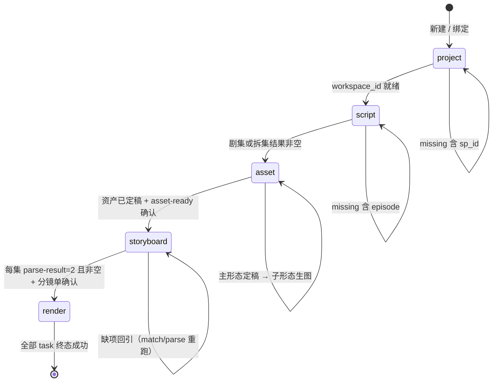

# D4 · 剧集流水线域（制片工坊：建项 → 剧本 → 资产 → 分镜 → 出片）

> 竞品：万兴剧厂 ReelMate（www.reelmate.cn）。本文只做竞品侧抽取，不含 OneFrame 规划。
> 证据口径：`SKILL.md`、`manual/workflow/*`、`commands/*.md` 均指 `rea-reelmate\cli-skill\reelmate-cli-skill\` 下同名文件，行号即该文件行号；`报告 §N` 指 `rea-reelmate\REELMATE-逆向分析报告.md` 的章节。**标「推断」的条目为工程判断，非文档直述。**

---

## 1. 域定位

制片工坊（`--scope studio`）是 ReelMate 两条创作主路径之一，承担「已有剧本 → 成片」的**确定性四环节量产流水线**；另一条是无限画布（`--scope canvas`，一次一句话即兴生成），两者共用同一项目/剧集容器但阶段机互不承认（`_stage-machine.md:26`、`:32`）。

一句话：**把「剧本」这种非结构化输入，压缩成「可批量下单的付费任务清单」的工业管道**——它的真正产出不是视频，而是被拆到「每集 × 每镜」粒度、每一条都带齐模型/模板/参考图/时长参数的生成请求（`gui-script-video-storyboard.md:154-166`、`storyboard.md:415-425`）。

产品边界：四环节止于「视频任务终态成功」，合并导出是阶段机外的可选追加步骤，不属本域（`_stage-machine.md:42`、`:87`）。

---

## 2. 功能清单表

| # | 功能 | 用户可见入口 | 输入 | 输出/产物 | 关键约束 | 证据 |
|---|---|---|---|---|---|---|
| 1 | 建项/绑定项目 | 制片工坊「新建项目」/ 项目列表 | 创作模式、剧目类型、画面比例 | `workspace_id`（= `SP_ID`） | 三步枚举必须是网页展示名并列全；`sp_type` 建成后不可改；新建前须过 `project.create` 权限预检 | `gui-script-video-project.md:13-21`、`_bootstrap.md:47` |
| 2 | 剧本上传 | 环节 2「上传剧本」 | `.txt` / `.docx` 本地文件 | `file_id` | 上传后过内容审核，未通过不返回可用成功态；单文件单次 | `upload.md:3`、`:43` |
| 3 | 剧本拆集 | 环节 2「解析剧本」 | `file_id` 或已定稿小说 `nt_id` | 拆集结果 + `task_id` | **不消耗积分**；不查积分预估、不展现报价；`task_id` 不计入完成总结的生成任务数 | `gui-script-video-script.md:15`、`_hard-gate.md:92` |
| 4 | 批量建正式剧集 | 环节 4 步 1 | `episodes.json`（`sort`/`name`/`s_script_id`） | 全部 `EP_ID` | 必须一次落全部集，禁止只处理第一集；`unconfirmed[]` 非空不算失败但须 `episode list` 复核 | `gui-script-video-storyboard.md:23-32`、`episode.md:152` |
| 5 | 资产清单提取 | 环节 3 步 1「AI 智能提取资产」 | `SP_ID` + `task_type=1` + `generate_mode`(1 专业/2 快速) | `et_id` + 三类草稿 | 状态 `1`进行中/`2`成功/`3`失败/`4`失效；只提 `task_type=1` 时顶层 status 会卡在 1 直到超时，须看子任务 | `resource.md:552-556`、`gui-script-video-asset.md:24-30`、`:47` |
| 6 | 三类资产提示词生成 | 环节 3 步 2（清单确认后自动） | `task_type=5` + `need_voice` | 角色/场景/道具提示词 | 默认同步生成角色音色描述；该动作 Web 已隐藏旧价格，账单为 `source=unavailable` 仍须展示原因 | `gui-script-video-asset.md:65-79` |
| 7 | 主形态批量生图 | 环节 3 步 3 | `eed_ids[]` + 图片参数包 | 图片（`preview_status=4/5`） | 三类各一次批量接口，同类禁止逐个下单；`style_uk_id`/`theme_uk_id` 必须带引号传 JSON 字符串 | `gui-script-video-asset.md:99-110`、`resource.md:739` |
| 8 | 定稿 / 存 Seedance 主体 | 环节 3 步 3/4 确认弹窗 | `resource_ids[]`、用户选中的 `generate_id` | `status=2` 正式资产、`subject_id` | 角色批次带 `business_list=[3]`，场景/道具不传；主形态定稿必须早于子形态生图 | `gui-script-video-asset.md:120-131`、`:142-157` |
| 9 | 子形态图生图 | 环节 3 步 4 | 子形态 `eed_id` + 父形态 `MAIN_FILE_ID` | 子形态图片 | `images` 对整批 `eed_ids` 生效，必须按「类型 + 父 `MAIN_FILE_ID`」分组提交 | `gui-script-video-asset.md:142-153` |
| 10 | 资产提示词表回填 | 资产页空态「生成角色/场景/道具」 | 官方 5 列 `.xlsx`（或 4 列方言） | `data.batches[]` → `resource_id` | 10 步流程；`resource add` 只建未定稿，必须 `confirm`/`confirm-record` | `gui-backfill-asset-prompt.md:13-24`、`_backfill-contract.md:26-36` |
| 11 | 已有图片包回填 | 资产页「上传图片」 | 本地图片（文件夹分类或映射表） | 已定稿 `resource_id` | `file-import` 成功即已定稿；同次调用只允许一种 `type`；多图用逗号分隔单字符串 | `gui-backfill-asset-image.md:55-64`、`resource.md:489` |
| 12 | 资产匹配 + 自动拆分镜 | 环节 4 步 2「下一步，匹配本集资产」 | `ep_ids[]` + `refer2video_model` + `prompt_use_type/prompt_type/prompt_ukid` | `match-result.status=2` + `parse-result` 草稿 | **组合任务**：服务端匹配完成后自动拆分镜，Web 无资产匹配确认环节；提交即同时授权两笔费用（拆分镜费率约为资产匹配 16 倍） | `episode.md:265`、`gui-script-video-storyboard.md:82-84` |
| 13 | 分镜 Excel 回填 | 分镜表「导入 Excel」 | 官方 3 列 `.xlsx`/`.xlsm` | 分镜草稿 `esd_id` + `images` | 只认三列；转写禁令严格（不编集号/镜号、不按相似合并）；同一集不要重复 `draft-import` | `gui-backfill-shot-video.md:65-91`、`_backfill-contract.md:99-106` |
| 14 | 批量出片 | 分镜表「立即批量生成」 | `nums[]` + 视频模型/画幅/分辨率 | 正式分镜 + 视频 `task_id` | `is_store_draft=true` 在同一次付费操作里物化正式分镜并提交视频；空 `nums` 会生成全部，CLI 主动阻止 | `gui-script-video-storyboard.md:152-166`、`storyboard.md:415` |
| 15 | 缺失资产智能补充 | 拆分镜后提示（可选） | 缺失项清单（`status=3` 且 prompt 空） | 补全提示词 → 生图 → 回写匹配 | **不是拆分镜前置门**；一次确认同时授权提示词补全与生图，成功后不再问「是否生图」 | `_storyboard-asset-match.md:3`、`:15` |
| 16 | 原创/改编剧本生产链 | 剧本库「新建剧本」入口组 | 灵感文本 / 小说文件 / 已有剧本 | `NT_ID` + 创意方案/角色/素材/总纲/章纲/集纲/分集剧本/定稿 | 四个上传型入口（`analyze` 分析开始改编 / `direct` 直接改编 / `derive` 创意裂变 / `overseas` 转海外）+ 纯原创 `create`；每个中间产物一个独立触发命令，成功只代表「服务端已接受」，非生成完成 | `novel.md:38-57`、`:376-390` |
| 17 | 分镜素材挂载 | 分镜卡片「素材」抽屉 | `file_id` + `category`(1图/2视/3音) | `storyboard_info`（`info_id`） | 与项目资产、资产库是三层不同实体，不可互替 | `material.md:5-10`、`:191-196` |
| 18 | 跨项目资产库 | 「我的资产库」 | 目录/标签/关键词 | `uk_id` | 与项目资产双向 `resource import`（`asset-to-resource` / `resource-to-asset`）；**不能**拿 `uk_id` 当 `resource_id` | `asset-lib.md:3`、`resource.md:453-458` |

---

## 3. 核心对象模型

### 3.1 实体与关键字段

| 实体 | 主键 | 关键字段 | 说明 / 证据 |
|---|---|---|---|
| 项目（工作区） | `workspace_id` = `SP_ID` | `creation_mode`(1 工坊/2 画布)、`sp_type`(1 动漫/2 国内仿真人/3 海外仿真人)、`ratio` | `sp_type` 决定模型目录与模板 ID 空间，建成不可改（`_bootstrap.md:47`） |
| 剧集 | `EP_ID` | `sort`、`name`、`creation_mode`、`canvas_id`、`ep_content`、`is_any_parse`、`split_task_id`、`operate` | `canvas_id` 空或 `"0"` 才属工坊侧（`_stage-machine.md:32`、`episode.md:69`） |
| 拆集结果 | `s_script_id`（split id） | `split_fail_type`、`split_message` | 建正式剧集的输入；`fail_type=10/11` 允许继续（`novel.md:380`） |
| 正式分镜 | `sd_id`（`storyboard_id`） | `num`、`name`、`desc`、`status` | `list`/`get` **只回骨架字段**，`desc`/`storyboard_description` 恒空（`storyboard.md:65`） |
| 分镜草稿 | `esd_id` | `video_prompt`、`video_gen_prompt`、`image_gen_prompt`、`images[]`、`duration`、`metadata`(首帧 `file_id`) | 真实内容只能从 `storyboard link-draft` 读（`storyboard.md:190`） |
| 项目资产 | `resource_id` | `resource_type`(1/2/3)、`name`、`status`(2=已定稿)、`prompt`、`desc`、`parent_file_id` | 未定稿 ↔ 定稿状态机（`resource.md:15`、`:207`） |
| 资产草稿（提取态） | `eed_id` | `group_id`、`state_id`、`parent_state_id`、`main_eed_id`、`resource_generate_preview.preview_status` | `batch-draft-generate` **只认 `eed_id`**，不接受 `resource_id`（`resource.md:712`、`:862`） |
| 生成记录 | `generate_id` / `file_id` | `task_status`（3=成功）、定稿状态 | 一个 `resource_id` 可含多条生成记录，定稿须精确绑 `generate_id`（`resource.md:379`） |
| 主体 | `subject_id` | `subject_type`(角色=1)、`support_business`、审核三态 | 跨镜角色一致性载体，见 §7（`subject.md:3`、`:206-216`） |
| 剧本项目 | `NT_ID` | 创作/改编参数、`status`(16=已定稿) | 与画布、剧集、项目是不同实体（`novel.md:736`） |
| 资产库资产 | `uk_id` | 目录、标签、`prompt_template` | 跨项目层（`resource.md:7-13`） |
| 分镜素材 | `info_id` | `category`(1/2/3)、`file_id` | 分镜级层，非项目资产（`material.md:191-196`） |

### 3.2 关系

```mermaid
graph TD
  SP[项目 SP_ID<br/>creation_mode / sp_type / ratio] -->|1:N| EP[剧集 EP_ID]
  SP -->|1:N| RS[项目资产 resource_id<br/>character / scene / prop]
  SP -->|1:N| NT[剧本项目 NT_ID]
  NT -->|finalize 后可作 split 源| SPLIT[拆集结果 s_script_id]
  SPLIT -->|episode batch-create| EP
  RS -->|主形态 MAIN_FILE_ID| RS2[子形态 resource_id]
  RS -->|save-from-resource| SUBJ[主体 subject_id]
  EP -->|资产匹配后拆解| SD[正式分镜 sd_id]
  SD -->|1:1 关联| ESD[分镜草稿 esd_id]
  ESD -->|images 引用| RS
  SD -->|material add| INFO[分镜素材 info_id]
  RS -->|resource import| UK[资产库 uk_id]
  RS -.->|prompt 中的 [[@imgN]] 位序| ESD
  SUBJ -.->|生成模型按 subject_id 保一致| SD
```

要点：**资产侧与分镜侧是双向指针，但只有分镜侧存引用**——`esd_id`/`sd_id` 的 `images[]` 指向 `resource_id + file_id`；资产侧正式结果**不记录父子关系**，也不记录被哪些分镜引用（`gui-script-video-asset.md:157`、`resource.md:727`）。这意味着「删/改资产 → 已生成分镜是否失效」在数据层没有级联依据（推断）。

---

## 4. 阶段机 / 状态机

### 4.1 阶段定义与完成条件

阶段顺序固定 `project → script → asset → storyboard → render`，`stage` 返回**第一个未完成阶段**（`_stage-machine.md:30`）。stage 机以 `workflow detect` 的返回当「当前包」，不凭对话记忆推断（`_stage-machine.md:15-24`）。

| 阶段 | 前置条件 | done_when（studio） | 产物 | 可续跑 |
|---|---|---|---|---|
| `project` | 已登录、已定空间 | `workspace show` 有 `workspace_id`，且重探测后 `stage ≠ project` | `SP_ID` | `--from project` |
| `script` | 有 `SP_ID` | 工坊剧集（`creation_mode=1`）或 `episode split-list` 非空；本次拆集任务终态成功 | `EP_ID` 集候选 + `s_script_id` | `--from script` |
| `asset` | 剧本已解析 | 已有**已定稿**资产（`resource status=2`） | `resource_id` 集 | `--from asset` |
| `storyboard` | 资产已 ready（`hitl.asset-ready`） | 批量拆分镜组合任务成功，且**每个正式剧集**的 `parse-result` 均 `status=2` 且列表非空 | `sd_id` + `esd_id` | `--from storyboard` |
| `render` | 分镜单已确认 | 所有 `task wait` 返回终态成功（由调用方判定） | 视频文件 | `--from render` |

来源：`_stage-machine.md:34-42`、`gui-script-video.md:22-29`、`gui-script-video-asset.md:7-12`、`gui-script-video-storyboard.md:7-11`。

### 4.2 阶段流转



缺项回引表（`data.missing[].goto_stage` 决定回哪一环节，回引后必须重新探测）：`_stage-machine.md:58-68`。

### 4.3 可续跑性（本域最强的工程属性）

- `workflow resume --scope studio --from STAGE` **只记录用户意图，不证明前置条件成立**；实时探测发现缺项必须回引（`_stage-machine.md:97`）。
- 只加载当前阶段**一个**阶段文件，不预读其它环节（`gui-script-video.md:20`）。
- 重跑前再次探测；远端已前进时**不得拉回旧阶段**（`_stage-machine.md:105`、`_hard-gate.md:35`）。
- 异步任务超时先 `task get` 原 ID，不重新提交；部分失败只重跑 `failed[]`（`_hard-gate.md:34-35`）。
- 同一项目可同时承载工坊剧集与画布剧集，studio 阶段只认工坊侧（`_stage-machine.md:32`）。

进度口径：**分母来自场景文档写死的步骤表**（项目 1、剧本 1、资产 4、分镜 3），对用户报 `进度 n/m：动作`，禁止写成「环节 n/4」（`_hard-gate.md:9`、`gui-script-video.md:29`）。

---

## 5. 人机协作点（HITL）与硬门

### 5.1 命名 HITL 节点（7 个）

| id | 触发时机 | 问什么 | 证据 |
|---|---|---|---|
| `hitl.project-create` | 新建项目前（须先过 `project.create` 预检） | 创作模式、剧目类型、画面比例，全部按网页展示名列全 | `_stage-machine.md:76` |
| `hitl.paid-image-params` | 付费生图前 | 工坊：风格/题材/构图/图片模型 → 再列画幅与分辨率；画布：只问模型/画幅/分辨率 | `_stage-machine.md:77` |
| `hitl.paid-video-params` | 付费生视频前 | 先视频模型，再（拆分镜场景）三类完整模板目录合并 + 画幅/分辨率 | `_stage-machine.md:78` |
| `hitl.asset-list-confirm` | 资产提取成功后 | 角色/场景/道具清单是否确认；交付物 = `deeplink asset-confirm` 的 `href` | `_stage-machine.md:79`、`gui-script-video-asset.md:59` |
| `hitl.asset-result-confirm` | 主/子资产生图成功后 | 是否定稿、哪些角色存 Seedance 主体；**同一条消息必须先给 `deeplink project` 的 `href`，没有链接不得提问** | `_stage-machine.md:80`、`gui-script-video-asset.md:120` |
| `hitl.asset-ready` | 进拆分镜/分镜回填前 | 本次引用的资产图是否已备好（列表非空 ≠ 用户确认可用） | `_stage-machine.md:81`、`gui-backfill-shot-video.md:29` |
| `hitl.shot-result-confirm` | 分镜拆解成功后 | 分镜单是否确认；**未确认不得生视频**；须带项目页 + 首集两条 `href` | `_stage-machine.md:82`、`gui-script-video-storyboard.md:150` |

补充：`hitl.cli-needs-input` —— CLI 返回 `needs_input` 时只按 `missing[]` 补字段（`_stage-machine.md:83`）。

### 5.2 HARD-GATE 规则族

| 规则 | 内容 | 证据 |
|---|---|---|
| 单场景单选 | 路由表自上而下只匹配一行；未选定场景前不跑写命令 | `SKILL.md:12`、`_hard-gate.md:7` |
| 进度分母固定 | 分母来自场景文档步骤表，不临场发明步数 | `_hard-gate.md:9` |
| 写入三段式 | 批量/付费写先 `--dry-run --json`，确认后用**本次唯一** `--idempotency-key` 提交 | `_hard-gate.md:31` |
| 幂等重放 | 回包 `idempotent_replay=true` 说明 key 已打到服务端，用回包 `task_id` 去 `task wait`，**禁止换新 key 重发** | `_hard-gate.md:32` |
| 权限拒绝 | `error.kind=permission` 时把 `error.message` **原样**写入可见回复后停止，禁止重试/改走相近命令/建议换号 | `_hard-gate.md:39` |
| 付费前权限预检 | 资产提示词回填 `resource.edit`；拆分镜 `episode.edit` + `storyboard.edit`；Excel 分镜回填只 `storyboard.edit`；画布 `project.edit` | `_hard-gate.md:45-48` |
| 禁止能力绕过 | `--help` 未列出的子命令即能力缺口，停止上报，不改走语义相近命令 | `_hard-gate.md:33` |
| 完成判定 | 场景 `done_when` 全满足才报完成；缺必填行先补查 | `_hard-gate.md:54` |
| 固定完成总结 | 七项固定结构（结果/项目链接/参数/产物/积分消耗/积分明细/未做），不可删行改名；仅「积分消耗」可按条件整行省略；本轮必须现跑命令取数，禁止用记忆或时间段估算 | `_hard-gate.md:56-67` |
| 积分只报实扣 | 仅当 M=T 且 T≥1 才输出「积分消耗」；否则整行省略，禁止用预估替代 | `_hard-gate.md:69`、`:94` |
| 预估文案分级 | `point_calculate`/`web_formula` 写「预计消耗」；`provisional` 必须写「暂估消耗」+ reason；`unavailable` 必须写「当前 Web 无可验证积分预估：REASON」，不得填 0 | `_hard-gate.md:85-90` |
| 余额不足话术 | 只给原因（预估 N / 余额 B）+ `deeplink pricing` + 进度链接 + 固定收尾「充值完成后回复我，我会从当前步骤继续执行」；**禁止**贴 shell / 内部 ID | `_hard-gate.md:96-113` |
| 选项必须列全 | 有限选项不得收成「是否使用推荐配置」；推荐项仅加 `（推荐）`；上游决定下游时分步问 | `_hard-gate.md:125-127` |
| 交付物同位 | 选择器不能代替深链交付物；深链与确认问句必须在同一条用户可见消息里 | `_hitl-present.md:17` |
| 本地文件沙箱 | Agent 中间产物一律写当前工作目录 `outputs/`，禁止带日期/拼音/随机后缀的新目录 | `_hard-gate.md:27`、`SKILL.md:16` |

### 5.3 必须人工确认的「不可跳过」清单

阶段探测、`hitl.asset-list-confirm`、`hitl.asset-result-confirm`、`hitl.shot-result-confirm` **不能因「沿用历史参数」跳过**（`gui-script-video.md:33`、`_stage-machine.md:72`）。反之，用户明确给了参数或要求沿用历史值时，可跳过**对应参数包**的澄清，但须先复述实际值（`_stage-machine.md:72`）。

---

## 6. 批量与回填机制

### 6.1 资产提示词表（官方 5 列）

| 模板列 | 必填规则 | 转换规则 | 缺时问 |
|---|---|---|---|
| `资产类型（必填）` | 每行必填 | `角色`→`character`、`场景`→`scene`、`道具`→`prop` | 这是角色、场景还是道具？ |
| `资产名称（必填）` | 每行必填 | 写 GUI 图片名称 `name` | 这张图片叫什么名字？ |
| `形态（必填）` | 每行必填 | `主形态/主` 的 `parent_state_id` 为空；`子形态/子` 指向所属主形态 | 主形态还是子形态？ |
| `所属主形态名称（子形态必填）` | 子形态必填 | 同类内精确匹配唯一主形态；4 列方言缺此列时按子名去尾括号前缀唯一匹配，0 或 ≥2 条追问 | 这个子形态属于哪个主形态？ |
| `提示词（必填）` | 每行必填 | 原样写入 `prompt` | 这张图片的提示词是什么？ |

证据：`_backfill-contract.md:26-32`。四条附加约束：

1. 工作簿至少两个 Sheet：「资产提示词清单」（含下拉）+「填写示例」（只参考、不作为数据）；未指定 `--set sheet` 时按序汇总全部业务 Sheet，跳过示例与空 Sheet（`_backfill-contract.md:34`）。
2. 同类型内主形态名称**全工作簿唯一**；子形态可跨 Sheet 引用，但必须按「类型 + 主形态名称」精确命中唯一一条（`_backfill-contract.md:36`）。
3. 4 列方言可直接读：`资产类型`/`资产名称`/`主子资产属性`（或`形态`）/`生图提示词`（或`提示词`）（`_backfill-contract.md:18`）。
4. CLI 为每组生成 `group_id`、每行 `state_id`——技术字段，不改业务术语「主形态/子形态」（`_backfill-contract.md:36`）。

### 6.2 分镜提示词表（官方 3 列 + 可选第 4 列时长）

| 规范列 | 模板表头 | 必填 | 缺时问 |
|---|---|---|---|
| `episode_no` | `剧集号` | 每行必填，接受 `第1集`/`第一集`/`1` | 这一镜属于第几集？ |
| `shot_no` | `分镜号` | 每行必填，接受 `1`/`01`/`1-01` | 这一镜的镜号是多少？ |
| `prompt` | `视频提示词` | 每行必填 | 这一镜的视频提示词是什么？ |
| `duration` | `时长`（用户表可选列，非官方表头） | 可选，`8`/`8秒` 等 | 这一镜时长多少秒？ |

证据：`_backfill-contract.md:99-106`。约束：同一集内 `shot_no` 唯一，`1` 与 `01` 视为同镜号，`1-01` 前半段须与 `剧集号` 一致（`:106`）；只接受 `.xlsx`/`.xlsm`，`.csv`/`.tsv` 不兼容，十列「表格样式分镜单」走转写（`:95`）。

### 6.3 提示词内嵌字段解析（无需独立列）

| 规范列 | 提示词写法 | 提取优先级 |
|---|---|---|
| `duration` | `【时长】N秒` → `时长N秒`/`时长：N秒`/`视频时长N秒` → 首个 `N秒` | 传 `ai_model_mark` 时按 Web 模型规则调到最近合法档位（同距取低档）并保留 `original_duration`；未传模型仍按通用 4–15 秒 |
| `asset_names` | `【参考资产】名称`、`参考资产：名称`，逗号/顿号/分号/换行分隔 | 显式名单须能唯一定位 `resource_id` + `file_id`；无名单时从整段提示词匹配项目内已定稿资产名 |

证据：`_backfill-contract.md:110-115`。

### 6.4 回填边界（八条命令不可互替）

| 命令 | 语义 | 产出 ID | 禁止用法 |
|---|---|---|---|
| `resource extract` | 服务端 AI 提取任务 | `et_id` + 草稿 | 不接受用户已备好的清单 |
| `resource draft-import` | 写**提取草稿**（含主子关系） | `eed_id` | 不得用 `add` 的 `resource_id` 冒充 |
| `resource add` | 建**未定稿**正式资产 | `resource_id` | 不得传 `file_id` 冒充挂图或定稿 |
| `resource file-import` | 用 `file_id` 建**已定稿**资产 | `resource_id`（已定稿） | 同批只能一种 `type` |
| `resource import` | 资产库 ↔ 项目双向导入 | `uk_id` / `resource_id` | 不能用于本地图片导入 |
| `storyboard batch-add` | 只建**空白正式分镜** | `sd_id` | 只接受 `num`/`name`/`desc`；带 `prompt`/`refs`/`duration`/`images` 直接拒绝 |
| `storyboard draft-import` | 写**分镜草稿**（含 `images`） | `esd_id` | 同一集不要重复执行 |
| `storyboard match-assets` | 按 GUI 顺序 AI 打标补 `images` | 无 | 不替代 `draft-import` 的本地匹配 |

证据：`resource.md:19-21`、`:628-632`、`storyboard.md:240-250`、`storyboard.md:371-373`。

### 6.5 其他回填不变量

- 转写只搬用户表里已有的字：不编名称/提示词/集号/镜号，不默认第一行是主形态，不默认整表属第 1 集，不按相似合并行（`_backfill-contract.md:22`、`:87`、`gui-backfill-shot-video.md:88-91`）。
- 形态列/集号列整表缺失时**问一次**（二选一），不默填（`_backfill-contract.md:22`、`:87`）。
- 提示词正文不作格式要求；多描述列默认按列序**直接拼接原文**，不插列名/分隔符（`_backfill-contract.md:91`）。
- `draft-import` 会把资产按表内顺序转成 `images`，并把提示词中的资产名替换成 `[[@imgN]]` 标记（`_backfill-contract.md:123`）。
- 新建分集后服务端会异步补一条空白正式分镜，实测滞后 **35–45 秒**；先等它出现再 `batch-add`，否则会多出一镜（`gui-backfill-shot-video.md:102`）。

---

## 7. 一致性机制（角色/场景/道具如何绑到分镜）

### 7.1 三道一致性闸门

```
① 资产层定稿闸门：resource status=2（已定稿）+ file_id 存在
        ↓ 未定稿/无图 → 不可作为参考图被引用
② 匹配闸门：episode match-result.characters/scenes/props[].status
        status=1 未定稿 / status=2 已匹配 / status=3 缺失
        ↓ 组合任务在匹配完成后自动启动拆分镜
③ 生成闸门：分镜草稿 images[] → 提交 batch-generate 时作为参考图
```

- 闸门 ①：`resource list` 的 `status=2` 是唯一正式态；`draft-import` / `match-assets` 都只认「已定稿且有 `file_id`」的资产（`resource.md:208`、`storyboard.md:308-310`）。
- 闸门 ②：`episode match-result` 按角色/场景/道具三数组返回 `status`，`2` 计已匹配、`1` 计未定稿、`3` 计缺失；统计口径与证据见 `_storyboard-asset-match.md:5`。
- 闸门 ③：`batch-generate` 只按 `nums` 下单选中的分镜，未选中记录 `task_id=""`（不扣费）；参考图是否生效只看 `link-draft` 的 `images` 是否非空（`gui-script-video-storyboard.md:166`、`:172`）。

### 7.2 asset-match 的两条路径

| 路径 | 触发 | 匹配方式 | 写回 | 证据 |
|---|---|---|---|---|
| 服务端算法匹配（主路径） | 环节 4 步 2 `episode match-resources --set ep_ids=[...]` | 服务端读剧集 `ep_content` 跑匹配，完成后自动拆解分镜 | 无需手写；结果由 `match-result` 读取 | `episode.md:265`、`:331` |
| 确定性快照写回（补充路径） | 缺失资产补充成功后 | 不走算法，直接把当前资产清单写成完整三数组快照 | `episode save-resource-matches`，必须保留全部非目标项 | `episode.md:372-378` |

关键约束：
- `save-resource-matches` 按**完整快照**保存，空类别也要显式传 `[]`；不得只提交新增资产的局部数组；不得把提示词任务中的占位 `resource_id=-1` 当已匹配资产写回（`episode.md:376`、`_storyboard-asset-match.md:39`）。
- 匹配的模型、模板必须与项目 `sp_type` 同属一个 ID 空间，否则**两种静默失败**：模板取自别的 `sp_type` → `parse-result` 恒 `status=3`、无 task、不扣费；模型 `need_vip=true` 而账号无权益 → `parse` 直接 400 `740019`。两种都要新建剧集才能重试（`episode.md:289-294`）。

### 7.3 缺失资产的智能补充判定

可智能补充项必须**同时**满足：类型是角色/场景/道具、有 `resource_id`、`status=3`、`name` 非空、`prompt` 为空、`prompt_generating` 不为真、`prompt_blocked` 不为真（`_storyboard-asset-match.md:9`）。

三选项（用户不选默认第三项）：①智能补充缺失资产 ②重新匹配（`resource match-reset`，破坏性、一次选择只重跑一次）③保持现状进分镜确认（`_storyboard-asset-match.md:12-17`）。

执行顺序（严格）：`prompt-complete` → 轮询 `prompt-complete-result`（仅 `item_status=2|3` 且有非空 `candidates[0].visual_prompt` 才继续）→ `resource list` 分页复核查重 → 无复用则 `add`/`generate`/`task wait`/`generate-list`/`confirm-record` → `save-resource-matches` 快照 → 重查 `match-result` 仅当目标项 `status=2` 才宣称完成（`_storyboard-asset-match.md:34-40`）。

### 7.4 角色跨镜一致性的真正载体：`subject_id`

> 主体库是**角色跨镜一致性**的载体：生成模型按 `subject_id` 保持同一角色在不同分镜里长得一样。—— `subject.md:3`

- 写入路径：资产定稿后 `subject save-from-resource`，必填 `name`/`generate_id`/`subject_type`(角色=1)/`files[]`/`business_list=[3]`(Seedance)（`subject.md:89-98`）。
- 与 `subject from-resource`、`subject create` 的边界：只有 `from-resource` 会新建资产；`save-from-resource` 通过 `sp_res_id` 绑原资产不重复建（`subject.md:79-85`）。
- 审核异步且有三态：`reviewing`/`approved`/`rejected`；**驳回 `kind=moderation`、`retryable=false`，禁止自动重试**，否则触发风控（`subject.md:206-216`、`:279`）。

---

## 8. 未知项 / 证据缺口

| # | 未知项 | 类型 | 已知边界 |
|---|---|---|---|
| 1 | 资产提取 `task_type=2/3/4`（单类提示词）的产物结构与 `task_type=5` 的差异只知语义，无字段级文档 | 文档缺口 | `resource.md:554` 仅给枚举释义 |
| 2 | 子形态正式资产**不保留父子关系**，`child eed_id → main_eed_id → child resource_id` 映射只能由 Agent 自行保存 | 产品缺陷 | `gui-script-video-asset.md:157`、`resource.md:727` |
| 3 | 「拆分镜费率约为资产匹配的 16 倍」只见命令页注释，未见定价表或实测账单 | 单一来源 | `episode.md:265`；未在 `credits` 相关页复核 |
| 4 | `parse-result=status=2` 但 `list` 为空 = 静默失败；根因只能反推为「模型+模板后端不兼容」，接口与前端均不提前校验 | 黑盒行为 | `episode.md:399`、`gui-script-video-storyboard.md:132` |
| 5 | 批量 `match-resources` 返回的 `task_id` **不能**由通用 `task get/wait` 查询（实测 `740015`/`unknown 0%`），只能逐集轮询 | 已知限制 | `episode.md:271` |
| 6 | 主体审核时长、驳回原因字段未文档化 | 文档缺口 | `subject.md:214` 明示「拿不到时不要编造」 |
| 7 | 画布侧 `script asset-extract` 产出的画布资产与工坊 `resource` 是否互通**未确认** | 未验证 | `script.md:146` 明示不得声称可互转 |
| 8 | 「分镜 Excel 批量生视频」在无限画布无对应场景（`node table import` 待实测） | 能力缺口 | `SKILL.md:31` |
| 9 | 资产提示词生成当前返回 `source=unavailable`——Web 已隐藏旧价格，实际计费规则不可见 | 计费缺口 | `gui-script-video-asset.md:67`、`_hard-gate.md:92` |
| 10 | `duration` 不属于 `batch-generate` 入参，只能靠 `draft-import`/`draft-batch-update` 写入；首帧清单式 `batch-generate-video` 走另一路径 | 双路径并存 | `storyboard.md:419`、`:389-397` |
| 11 | 影视版任务表格的字段类型系统、ReelFlow `timeline` 完整 schema 仍未知 | 报告遗留 | `报告 §10` |
| 12 | 资产删除/改名对已生成分镜的失效联动：数据层无级联依据，产品行为未验证（推断：不会自动重建分镜参考图） | 推断 | 见 §3.2 |
| 13 | 新建项目 `sp_type` 与既有项目 `ratio` 对模型枚举的**联合**约束（如项目 `9:16` 但模型 `ratios` 不含时）在四环节与回填两场景的处置不一致 | 规则碎片 | `gui-backfill-shot-video.md:43` 要求停下改画幅；`gui-script-video-asset.md:93` 要求照列全 |
| 14 | `novel` 剧本链（创意方案→角色→素材→总纲→章纲→集纲→分集剧本→定稿，每个中间产物一条触发命令）与四环节 `script` 阶段之间的**衔接契约**无专门文档：只能由 `episode split --set nt_id=` 推断「已定稿剧本可作拆集源」 | 推断 | `episode.md:168`、`novel.md:667` |

---

### 附：本域高频 ID 混淆清单（抽取时最易错处）

`SP_ID`（项目）≠ `EP_ID`（剧集）≠ `sd_id`/`storyboard_id`（正式分镜）≠ `esd_id`（分镜草稿）≠ `resource_id`（项目资产）≠ `eed_id`（提取草稿）≠ `generate_id`（生成记录）≠ `subject_id`（主体）≠ `uk_id`（资产库）≠ `info_id`（分镜素材）≠ `NT_ID`（剧本项目）。

三条最容易踩的错位：`batch-draft-generate` 只认 `eed_id`；`resource match-reset` 位置参数是 `EP_ID` 不是 `SP_ID`；`storyboard total-list` 位置参数是 `EP_ID`。证据：`resource.md:862`、`resource.md:798`、`storyboard.md:228`。
