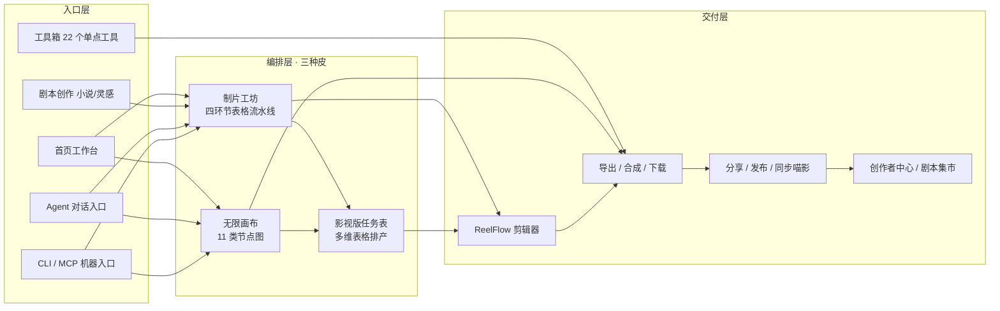
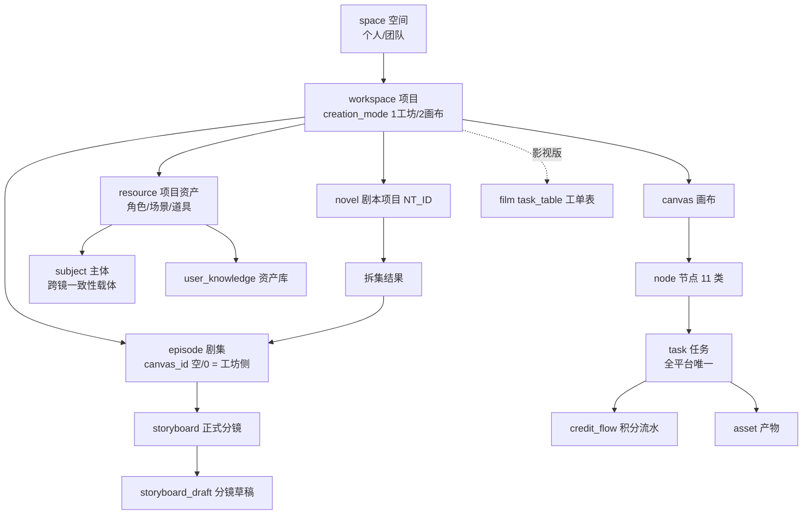

# 竞品产品功能地图 · 万兴剧厂 ReelMate

> 对象：万兴剧厂 ReelMate（`www.reelmate.cn`，万兴科技旗下 AI 漫剧/短剧一站式生产 SaaS）；关联品牌 `tomoviee.cn`、海外 API `app.reelmate.ai`
> 版本：v1.0 · 2026-10-27 · 类型：**功能地图 + 产品逻辑设计图解**（竞品侧，不含 OneFrame 规划）
> 证据基座：`rea-reelmate/`（逆向分析报告、官方 CLI Skill 包 38 命令组、928 行路由清单、46 模型结构化目录、473 个画布前端源文件、抓包与截图）
> 分域深挖附录：`docs/01-product/_parts/`（D4 流水线 / D6 模型任务 / D7 画布 Agent / D5 商业化 / D8 影视版）
>
> **证据口径约定**
> - `报告 §N` = `rea-reelmate/REELMATE-逆向分析报告.md` 章节
> - `rt:N` = `rea-reelmate/routes.txt` 第 N 行
> - `cmd/x.md`、`wf/_x.md` = `rea-reelmate/cli-skill/reelmate-cli-skill/` 下命令/手册文档
> - **标「推断」者为工程判断，非文档或源码直述**
> - 价格/积分/档位数字**实测于 2026-10-24，可能已变**

---

## 0. 一句话结论

**ReelMate 不是"又一个文生视频站"，而是一套把"不可控的外部模型"包装成"可控的内部产能"的生产系统。**

它的产品逻辑可以压成一句话：

> **用「一份模型目录 + 一套任务协议 + 一套积分账本」作底座，在上面套三种编排皮（制片工坊的表格、无限画布的节点图、影视版的多维表格），把 AI 生成这种概率性动作，产品化成「可下单、可续跑、可审核、可对账」的工单。**

真正的护城河不在模型（46 个模型里 33 个是外采聚合，13 个是自营贴牌线，分布在 TG Chat 文本 / TGI·TNB 图像 / 天幕·ToMoviee 视频 / TS·TV 视频 四条自营产品线），而在三处：

1. **目录协议**——46 个模型 / 11 种模式 / 却只落 8 个生成端点，差异全部用参数表达（`报告 §12.9`）；
2. **任务协议**——所有生成走同一条 `提交 → task_id → 轮询 → 终态 → 产物` 流水线，状态机 / 退出码 / 业务错误码三层映射；
3. **可交付性机制**——阶段机（在哪一步）+ 硬门（什么算做完）+ 幂等账本（这次写到底生效没有），把生成包成工单。

---

## 1. 产品全景图（一张图看完）

### 1.1 用户视角：五个入口 → 三条生产路径 → 一处交付



### 1.2 系统视角：六层能力栈

```
┌──────────────────────────────────────────────────────────────┐
│ L1 入口层   工作台 / 工具箱22 / 剧本创作 / Agent / CLI·MCP    │
├──────────────────────────────────────────────────────────────┤
│ L2 编排层   制片工坊(表格) · 无限画布(节点图) · 影视版(多维表) │  ← 三种皮，同一个引擎
├──────────────────────────────────────────────────────────────┤
│ L3 领域层   剧本工厂(df 466) · 资产/主体 · 分镜 · 剪辑(wf 23)  │
├──────────────────────────────────────────────────────────────┤
│ L4 协议层   目录协议 · 任务协议 · 计费协议 · 幂等/锁/版本      │  ← 真正的自研资产
├──────────────────────────────────────────────────────────────┤
│ L5 能力层   AI 网关 63 端点 → 46 模型 / 11 供应商 / 8 生成端点 │
├──────────────────────────────────────────────────────────────┤
│ L6 商业层   积分 · 订阅 · 团队池 · 创作者经济 · 运营增长       │
└──────────────────────────────────────────────────────────────┘
             横向：账号/SSO · 空间隔离 · 合规审核 · 多区域数据面 · 埋点
```

### 1.3 数据视角：核心实体链



**要点：**`task` 是全系统唯一的"钱与活"的交叉点——任何界面（表格/画布/对话框/CLI）上的任何生成，最终都落成一条 `task` + 一条 `credit_flow`。这是"一个引擎三种皮"的数据基础。

---

## 2. 全站功能分区（7 个域 · 可复现数字）

页面路由 102 条、API 路径常量 821 条（801 个 `/web/v1/*` + 20 个直连 `/v1/*`），共 927 条非空（`rt` 全文；口径校验见附录 A）。

| # | 功能域 | 页面入口 | 后端端点前缀 | 端点数 | 成熟度 | 详图 |
|---:|---|---|---|---:|---|---|
| 1 | **工作台与入口** | `/` `/home` `/tools` `/task` `/pricing` | `/task*` (16) + `/config` `/user-info` `/msg` `/op/abtest` `/env` | 16+5 | 完整 | §3.1 |
| 2 | **制片工坊（主路径 A）** | `/episode-list` `/series-manage/*` | `/df/episode/*` (57) `/df/storyboard/*` (12) `/df/extraction/*` (26) | 95+ | **最完整** | §3.2 |
| 3 | **无限画布（主路径 B）** | `/canvas` `/workflow-canvas` | `/df/canvas/*` (78) `/df/canvas-tpls` (2) `/df/anu/canvas/*` (4) | **85** | 完整 | §3.3 |
| 4 | **剧本工厂（主路径 C）** | `/novel-to-script/*` `/script-manage` `/ad-drama/*` `/video-redraw/*` | `/df/novel/*` (86) `/df/script_project/*` (41) `/df/creation-projects/*` (23) | 150 | 完整 | §3.4 |
| 5 | **单点工具箱** | `/tools` + 17 条 `/create/*` | `/ai/*` (63) | 63 | 完整 | §3.5 |
| 6 | **团队与规模化** | `/team/*` `/film/*` `/project-members` `/series-manage/asset-*` | `/cam/*` (39) `/film/*` (37) `/kds/da/*` (13) `/df/user_knowledge/*` (29) | 118 | 完整（影视版商务开通制） | §3.6 |
| 7 | **交付与变现** | `/reelflow/*` `/creator-center/*` `/novel-market/*` `/pricing` `/activities` | `/wf/*` (23) `/crc/*` (30) `/df/novel_market/*` (29) `/buy/*` (4) `/op/*` (31) `/campaign/*` (6) | **123** | 完整 | §3.7 |
| — | **平台能力（横向）** | — | `/ai` 网关 `/task` `/asset`(24) `/subject`(8) `/kds` | — | — | §4 |

`df` 域 466 条端点占全部 `/web/v1` 的 **58%**——这是"这是一个生产工具，不是生成工具"最直接的量化证据。

> 口径：上表"端点数"按各域引用的端点前缀求和，**域间存在复用**（`/ai`、`/task`、`/asset`、`/subject`、`/kds` 被多个域共用），故各域相加不等于 821 总数，仅供比较相对体量。全局分布以附录 A.2 为准。

---

## 3. 功能地图分域展开

### 3.1 工作台与入口

| 功能 | 说明 | 证据 |
|---|---|---|
| 首页工作台 | 短剧工作流 / 无限画布 / 工具矩阵三大区块；配置驱动（`GET /config?key=&module_name=<20438 或 sys 或 web>&lang=`） | `报告 §1`、`rt:274` |
| 未读消息长轮询 | `msg/exist-unread`，超时返回 `741001`（长轮询保持连接） | `报告 §12.3`、`rt:828` |
| AB 实验位 | `op/abtest/hit` 返回新人权益 5 个开关：`BENEFIT_CREATE_EPISODE` / `EXTRACT_ASSET_LIST` / `GEN_ASSET_PROMPT` / `MATCH_SUBJECT` / `SPLIT_SHOT` | `报告 §12.8`、`rt:829` |
| 多语言 | zh（默认，无前缀）/ en / ja / br / es；请求头 `X-Lang` 而非路径前缀 | `报告 §1`、`rt:50,52,60` |
| 工具箱索引 | `/tools` 聚合 AI视频 / AI图片 / AI音频 三类单点工具 | `报告 §1`、`rt:93` |
| 任务中心 | `/task` 全平台任务列表（`request_type=task_list`） | `rt:89` |

**设计意图**：首页不是 dashboard，是**路由分发器**——把"我要干什么"分流到三条生产路径 + 工具区；配置中心而不是硬编码，让运营能改首屏而不发版。

---

### 3.2 主路径 A：制片工坊（四环节表格流水线）

> 定位：**已有剧本 → 成片**的确定性量产管道。它的产出不是视频，是"拆到每集×每镜、参数齐全的付费任务清单"。

#### 3.2.1 四环节功能表

| 环节 | 功能 | 用户动作 | 产物 | 关键约束 |
|---|---|---|---|---|
| ① 建项 | 新建项目 | 选创作模式 / 剧目类型 / 画面比例 | `workspace_id`（=`SP_ID`） | `sp_type` 建成不可改，它决定模型目录分区 |
| ② 剧本 | 上传剧本 → 拆集 | 传 `.txt`/`.docx`，点解析 | 拆集结果 + 剧集 | **拆集不消耗积分** |
| ③ 资产 | 提取 → 提示词 → 生图 → 定稿 | 4 步：AI 提取清单 → 确认清单 → 生成提示词 → 批量生图 → 定稿/存主体 | `resource_id`（`status=2` 已定稿） | 未定稿资产不得被分镜引用 |
| ④ 分镜 | 匹配资产 → 拆分镜 → 批量出片 | 提交资产匹配（自动续拆分镜）→ 确认分镜单 → 批量生成视频 | 正式分镜 + 视频任务 | 未确认分镜单不得生视频 |

**四环节细分动作（可追溯）**：`wf/gui-script-video-project.md:13-21`、`wf/gui-script-video-script.md:15`、`wf/gui-script-video-asset.md:7-157`、`wf/gui-script-video-storyboard.md:7-179`。

#### 3.2.2 批量回填（容易被忽略的第二主线）

除了"AI 自动提取"，工坊还支持**反方向**：把用户**已有**的生产素材灌进系统。这是面向"已经在用 Excel 干活的工作室"的关键兼容口。

| 回填通道 | 表列契约 | 走哪条命令 | 产物 |
|---|---|---|---|
| 资产提示词表 | 5 列：资产类型 / 资产名称 / 形态（主/子）/ 所属主形态名称 / 提示词 | `resource prompt-sheet-read` → `draft-import` → 批量生图 → `confirm` | `resource_id` |
| 已有资产图片包 | 文件夹分类 或 映射表 | `resource file-import` | **直接已定稿** `resource_id` |
| 分镜提示词表 | 3 列：剧集号 / 分镜号 / 视频提示词（可选第 4 列时长） | `storyboard sheet-read` → `draft-import` → `batch-generate` | `esd_id` → 视频任务 |

证据：`wf/_backfill-contract.md:26-115`、`wf/gui-backfill-asset-prompt.md:13-24`、`wf/gui-backfill-shot-video.md:65-91`。

**设计意图（重要）**：回填不是"导入功能"，而是**降低迁移摩擦的获客设计**——竞品允许用户带着自己的 Excel 进来，而不是强迫从零开始对话生成。这也解释了为什么它的表格列契约写得如此死板（"只认三列""不编集号镜号"）：**能自动化的一定自动化，不能自动化的绝不猜**。

#### 3.2.3 阶段机与可续跑

```
workflow detect → { stage, completed, pending, missing, next_command }
stage = 第一个未完成阶段：project → script → asset → storyboard → render
```

| 阶段 | done_when（工坊侧） | 步骤分母 |
|---|---|---|
| `project` | `workspace show` 有 `workspace_id` | 1 |
| `script` | 有正式剧集 或 拆集结果非空 | 1 |
| `asset` | 已有**已定稿**资产（`status=2`） | 4 |
| `storyboard` | **每个**正式剧集 `parse-result` 均 `status=2` 且列表非空 | 3 |
| `render` | 全部 `task wait` 终态成功 | — |

关键产品决策（`wf/_stage-machine.md:30-105`）：

- **探测驱动，不是编排驱动**：`detect` 返回什么就执行什么；`resume --from` **只记录意图，不证明前置成立**，必须重新探测并按 `missing[].goto_stage` 回引。
- **进度分母写死**：`进度 n/m：动作`，禁止临场发明步数，禁止写成"环节 n/4"。
- **只加载当前阶段一个文档**：避免 LLM 长上下文下"自行排期"。

---

### 3.3 主路径 B：无限画布（节点即任务）

> 定位：**灵感创作**。一句话 → 剧本节点 → 图片/视频节点 → 成片。与工坊共用项目/剧集容器但阶段机互不承认。

#### 3.3.1 画布能力（20 项，节选核心）

| 能力 | 说明 | 关键参数 |
|---|---|---|
| 节点 CRUD + 批量创建 | 每批 ≤100，自动网格排布；未给坐标则放到已有内容右侧（间距 180px） | 11 种 `NODE_TYPE` |
| 自动排布 / 连线 | 三种边语义 `pipeline` / `reference` / `sequence`（默认 pipeline） | `--left/--right`、`--left-add` |
| 提交生成 | 「节点是画布中的可执行单元」；`node generate` 独立于 `node create`，是扣费下单动作 | image/video/audio/text |
| 生成预演 | 先 `--dry-run` 出"报价单"再提交 | 核对模型/分辨率/画幅/qty |
| 组执行 | 按**依赖拓扑分层**下单，`concurrency` 控同层并发，环检测 `max_cycle_layers` | 整组执行是"最贵的写操作" |
| 固定组（pin-group） | 每画布**预置 7 色**，只做颜色标记/收藏 | 禁止交给 `group execute` |
| 模板 | 整画布模板（`canvas-tpls`）/ 组模板 / 个人模板 / 团队同步 | 三者互不通用 |
| 表格节点 | Excel 两步导入：`import` → 看 Sheet 列表 → `confirm-sheet` 显式指定 | 不自动选第一个 Sheet |
| 评论节点 | 节点级评论线程 + resolve | 画布内评审 |
| 协同 | 心跳 5s 取 `editable`；节点级 lock/unlock/renew；版本冲突 exit 9 / 锁竞争 exit 10 | 悲观锁 |

证据：`cmd/node.md`、`cmd/group.md`、`cmd/pin-group.md`、`cmd/canvas.md`、`报告 §12.5`。

#### 3.3.2 节点类型矩阵（11 类）

| 节点 | mode 维度 | 数量 | 说明 |
|---|---|---:|---|
| `text` | — | 0 | 剧本/文本；默认模型 TG Chat 5.5 |
| `image` | `mode` | **16** | 3 个生成模式 + **13 个无模型编辑算子**（超清/裁剪/扩图/重绘/擦除/全景/多角度/打光/九宫格/剧情推演 4·9·25 格） |
| `video` | `mode` | **13** | 8 个生成模式 + 5 个编辑算子（切片/超清/去字幕×2/截帧） |
| `audio` | `audioKind` | 4 | 旁白 / 音乐 / 音效 / 环境音；时长规则随 kind 变 |
| `table` | `source.type` | 3 | 手工 / Excel 导入 / 项目剧集导入 |
| `script` | `runPhase` | 2 | `storyboard`（拆分镜）/ `asset_match`（资产匹配） |
| `asset` | `activeTab` | 3 | 角色 / 场景 / 道具 |
| `clip` | — | — | `shotOrder` + `timeline` + `exportSettings`，成片承接点 |
| `director` | — | — | 3D 导演台入口（状态存 3d-director 子系统） |
| `threeDWorld` | 复用 image | — | 额外 `worldInputIsPano` |
| `group` | — | — | 不出现于"加节点"菜单，由框选建组产生 |

证据：`cmd/node.md:76-88`（CLI 契约）、`报告 §12.5`、画布前端 `CpJ9`/`B7V` 源文件。

**设计意图（重点）**：`image` 的 16 个 mode 里只有 3 个是"模型生成"，其余 13 个是**无模型的图像后处理算子**。也就是说——**同一个节点壳同时承接"模型能力"与"滤镜/编辑"，用户不需要区分**。这是把"AI 能力"降维成"常规编辑工具"的产品手法：降低学习成本，同时把后处理（零边际成本）留在自有体系内。

---

### 3.4 主路径 C：剧本工厂（内容供给端）

> 定位：**从零产出剧本**。这是 `df` 域占 58% 的主要原因——小说改编是数量最大的入口。

| 子功能 | 入口 | 关键链路 |
|---|---|---|
| 小说改编（analyze） | `/novel-to-script/:id` | 上传小说 → 内容分析 → 世界观 → 章节大纲 → 分集大纲 → 核心角色 → 剧本生成 → **剧本编辑 Agent**（会话式 diff，`apply`/`reject`/`apply_all`/`reject_all`，版本 `finalize`/`restore`） |
| 小说直改（direct） | 同上 | 跳过内容分析，直接按改编设定开工 |
| 原创剧本（create） | `/novel-to-script-agent/create` | 创意方案 → 核心角色 → 素材 → 总纲 → 分章纲 → 集纲 → 分集剧本 → 定稿 |
| 创意裂变（derive） | 同上 | 从已有剧本裂变新本（`fission_script/*`） |
| 海外改编（overseas） | 同上 | 转海外剧本（`ai_noval_overseas_adaptation`） |
| 剧本管理 / 预览 | `/script-manage` `/script-view/:id` | 列表、版本、导出 |
| 广告剧 | `/ad-drama/*` | 商品图 + 卖点 → brief → 剧本 → 分镜（`drama_ad` 子域的 `brief` / `selling-point` / `script` / `storyboard` / `asset` 五段） |
| 视频转绘 | `/video-redraw/*` | 已有视频 → 重新绘制成动漫 |
| 剧本集市 | `/novel-market/:id` | 见 §3.7 |

证据：`rt:515-712`（novel 86 条）、`rt:674-714`（script_project 41 条）、`rt:408-430`（creation-projects 23 条）、`cmd/novel.md:38-57`。

**设计意图**：**内容供给是入口不是终点**。剧本工厂产出的 `NT_ID` 可以 `finalize` 后作为工坊的拆集源——即"AI 写本 → 自己拍"，把用户锁在自家内容生产链上，同时用剧本集市把外部创作者的内容也接进来（§3.7）。

---

### 3.5 单点工具箱（17 条独立工具 + 5 个报告点名）

| 类别 | 工具 |
|---|---|
| AI 视频（9） | 文生视频、图生视频、视频对口型、参考生视频、视频参考、视频超清、视频续写、视频编辑、视频特效 |
| AI 图片（4） | 文生图、图生图、涂抹重绘、文字重绘 |
| AI 音频（4） | 文生语音、文生音乐、文生音效、自动配乐 |
| 报告点名无独立路由（5） | 灵感成片（Agent）、视频翻译、视频拉片、音色修改、错字重读 |
| 另有独立模块 | 视频转绘（`/video-redraw/*`，已并入 §3.4） |

证据：`rt:25-41`（17 条 `/create/*`）、`报告 §1`。

后端支撑：`/web/v1/ai/*` 63 条端点，覆盖生成（8 个）+ 编辑/后处理（约 40 个）+ 识别/分析（约 10 个）+ LLM/会话（约 5 个）。

**设计意图**：单点工具是**获客漏斗**而非主战场。它们对标的是模型厂商官方前端（即梦/可灵有免费额度），竞品的正面对抗能力不在价格而在"生成的成果能直接进项目当分镜素材"——完成"工具 → 项目"的转化。

---

### 3.6 团队与规模化（把工具升级成生产系统）

#### 3.6.1 影视版（film）——管理壳包产能

| 能力 | 内容 |
|---|---|
| 任务表格 | 仿多维表格：`project → task_table → field → task(行) → cell`；字段类型客户端实证 9 种 |
| 字段类型 | 文本/日期/人员/单选/多选/数字/链接/`canvas_ref`（内容制作）/`asset_ref`/`review_ref`/`points_ro`（只读积分） |
| 派工 | `user` 字段 + `notify-assignees`（催办） |
| 审核流 | **版本链**：每次提交产生不可变 `version_no`（V01/V02…），评论挂版本、已读回执按版本记 |
| 画布绑定 | `canvas-bindings`：一行 → 一块画布（"这活在哪儿干"）；画布侧 `submit-result` 回填成审核版本并推 `pending_review` |
| 准入 | **商务开通制**，不是自助订阅：`func-whitelist?scene=ai_film` 校验 |
| 端点 | 37 路径 / 48 操作（多方法复用同一路径） |

证据：`rt:775-811`、附录 D8 §2。

**设计意图（全产品最巧的一处）**：影视版**没有新增任何生成能力**——字段类型里 `asset_ref`/`canvas_ref`/`review_ref` 全是指向既有资产的引用。它新增的只有：派工（user）、排期（date）、验收（review 版本链）、结算（points_ro 只读聚合）。**用管理壳包住既有产能**，这是它能快速上线、且不拖累主引擎的原因。而"画布提交即进审核"（`submit-result` 一次调用做三件事）是唯一把"创作"和"管理"缝死的接缝——没有它，影视版只是一张外挂 Excel。

#### 3.6.2 团队域（cam 39 条）

| 能力 | 关键端点 |
|---|---|
| 团队/分组/成员 | `team/:id/info`、`edit`、`group`、`groups`、`member/*`、`members`、`member/batch` |
| 角色权限 | `role/list`、`permission/user`（58 个点号权限码 + 11 个分组） |
| 团队积分池 | `points-allocation`（分配）、`points-recovery`（回收）、`batch-points-allocation`、`points-flow/list`、`points-flow/export`、`account-points-ranking` |
| 项目级成员 | `project/:project_id/members`（含 `bind`/`delete`） |
| 团队模型开关矩阵 | `team/temp-info`：`seedance_is_support` / `sd_480p` / `tsd` 等布尔位 |
| 第三方 Key | `user/third/key/*`（BYOK 雏形） |

证据：`rt:228-266`、`报告 §12.8`。

#### 3.6.3 团队知识库 + 数据看板

- 知识库 `df/user_knowledge/*`（29 条）：目录 / 标签 / 资产三层，团队级素材沉淀；
- 看板 `kds/da/*`（13 条）：团队积分消耗排名、成员参与明细、项目数据导出、画布总消耗。

---

### 3.7 交付与变现

| 子域 | 能力 | 端点数 |
|---|---|---:|
| **ReelFlow 剪辑（wf）** | 项目 → 视频 → 切片 → 片段对象（uuid）→ 资产绑定 → 发布 | 23 路径 / 26 操作 |
| **导出** | 剧集合成（`export merge`，只合并已定稿视频）、逐镜下载、批量 zip、分享页下载 | — |
| **分享** | `task/:id/share` 公开只读、`share/{id}/info`、`share/{id}/batch-download`、Agent 会话分享 SSE | 4 |
| **创作者中心（crc）** | 投稿、审核、资产、点赞、关注/粉丝、激励、活动、banner/pop_up | 30 |
| **剧本集市** | C 端：上架/预售/协议/收益/提现/作品解析；Admin 侧 12 条审核流 | 29 + 12 |
| **激励活动（campaign）** | 报名/提名/入围/获奖 | 6 |
| **商业化（buy）** | 积分充值 / VIP / DF-VIP / 动态价格 | 4 |
| **运营增长（op）** | 邀请码、分销、兑换码、每日奖励、问卷、AB 实验、定向发分 | 31 |

证据：`rt:901-923`（wf）、`rt:275-304`（crc）、`rt:601-629`（novel_market）、`rt:223-226`（buy）、`rt:435-502+`（op）。

**ReelFlow 的设计要点**：左栏「剧集资产」只列**已定稿**的分镜素材，点选加入时间线；「更新分镜」是**显式同步**（不自动同步）。即剪辑器与流水线是**松耦合**——流水线负责"做出可用的料"，剪辑器负责"把料编成片"，中间靠"定稿"这个状态位衔接。

---

## 4. 平台能力（横向支撑）

### 4.1 模型聚合层（真正的自研资产之一）

| 维度 | 实测读数（口径：`cli-out/model-all.json` `data` 数组） |
|---|---|
| 模型总数 | **46**（video 30 / image 13 / file 3） |
| 供应商 | **11 家**：tomoviee 13（自营）、jimeng 8、kling 7、hailuo 5、wan 3、happy-horse 3、vidu 3、deepseek/google/openai/midjourney 各 1 |
| 需 VIP | 20 / 46（43%）；自营 3/13，聚合 17/33 |
| 模式并集 | **11 种**（text2video / image2video / first_frame / first_last_frame / universal_reference / multi_reference / text2image / image2image / video_edit / video_extend / studio_asset_image） |
| 生成端点 | **8 个**（text-to-image / text-to-video / image-to-video / refer-image-to-image / refer-image-to-video / refer-media-to-video / video-to-video / refer-video-to-video） |
| 分辨率展示档 | 10 档：`720P` `768P` `1080P` `1080P全高清版` `1080P优惠版` `1K` `2K` `2K超清版` `3K` `4K` |
| 画幅 | 13 档：`1:1` `1:2` `2:1` `2:3` `3:2` `3:4` `4:3` `4:5` `5:4` `9:16` `16:9` `9:21` `21:9` |

**核心设计：一份目录，五种切片（场景键）。**

| 场景键 | 服务的产品场景 | 成员数 | 成员构成 |
|---|---|---:|---|
| `params.generation.<mode>` + `supported_modes` | 画布生图/生视频 | 9（生图） | TGI 2 / 悠船 / 即梦系 / TNB 2 系 |
| `params.generation.studio_asset_image` | **资产生图**（工坊环节 ③） | **4** | TGI 2.5 Flare / TGI 2.5 Sunburst / 天幕写实版 / TNB —— **全自营** |
| `params.script_to_scene_refer` | **剧本拆分镜**（工坊环节 ④） | **4** | Seedance 2.5 / 2.0 VIP / 2.0 mini / Wan 3.0 —— **全聚合** |
| `params.storyboard_reference_video` | 分镜规划 / Excel 回填生视频 | **10** | Seedance 系 + Wan 3.0 + Hailuo 系 + Happy Horse 系 + 可灵 O3 + Vidu Q2 |
| `types` 含 `file` | 画布生剧本 | 3 | TG Chat 5.5（默认）/ DeepSeek V4 Pro / Gemini 3.1 Pro |

**两个反直觉的实测结论：**

1. **资产生图 4 条 ∩ 画布生图 9 条 = ∅**。两套候选池物理隔离、零重叠。→ **推断**：刻意做"场景专用模型池"——资产生图是流水线必经环节（量大），只放自营可控模型控成本；画布生图是创意探索，放效果最好的聚合模型。
2. **推荐一律是 `Seedance 2.0 VIP` 而非排第一的 `Seedance 2.5`**。2.5 支持 30s（VIP 15s）但更贵更慢；分镜是"几十镜 × 多集"量级，用 2.5 会失控。→ **推断**：**推荐规则是成本护栏，不是质量上限**。同理分辨率推"1080P优惠版"（实为 720p 码率）。

**双层可见性陷阱（工程上最易踩）**：`supported_modes` 混了"模型天生支持"与"该账号开白"两层语义（未开白时服务端会摘掉），而场景键只表达前者。所以文档反复禁止"用 `supported_modes` 筛分镜场景"（`wf/_models.md:25-28`）。**能力是商品的属性，可用性是订单的属性**——必须分离。

### 4.2 统一任务系统（真正的自研资产之二）

| 层 | 内容 |
|---|---|
| 创建 | 每能力一个端点（63 个 `/ai/*`） |
| 生命周期 | **全平台一套**（16 条 `/task*`）：查询单/批、列表、取消、重试、重生、下载、反馈、分享 |
| 状态机 | `1 WAITING / 2 RUNNING / 3 DONE / 4 FAILED / 5 CLOSED / 6 TIMEOUT / 20 NOSPACE / 96 TALKING_SHORT / 10001 PROJECT_NULL` |
| 轮询 | 前端 `useTaskPolling` **5000ms**，按 `task_type` 分组成 `{task_type, pid, task_ids[]}` 一次批量 POST，不限次数；完成后 `debounce` 刷新积分 |
| 多区域数据面 | `domainMap = { sz, eus, eop, sgp }`，按 `user-info.data_center` 路由，取不到**报错不兜底** |
| 幂等 | 写操作统一 `--idempotency-key`；回包 `idempotent_replay=true` 表示已打到服务端，**禁止换新 key 重发** |

**审核态是散落的，没进主状态机**（推断：历史叠加）：提交侧腾讯验证码 → 文本侧 `text-sensidetect` → 任务侧 `seedance-review-status` → 上传侧独立失败枚举 → CLI 退出码 8。→ **"统一任务系统"在合规这条轴上并未真正收敛**，这是竞品的一处结构性欠账。

### 4.3 计费协议（真正的自研资产之三）

| 机制 | 说明 |
|---|---|
| 计价编码 | `points_code` 把价格编成规则名（如 `tm_text2video_5s_720p`），改价=改配置表 |
| 三价分离 | `credit_original`（原价）/ `credit_discount`（折扣）/ `strike_*`（划线价） |
| 先估后付 | `POST /ai/point-calculate {alg_code, params}` → `{cost, credit_original, credit_discount}`；文生视频 5s/720p = **8 积分** |
| 节点级报价 | `asset/workflows/node-point-calc`（画布节点） |
| 批量报价 | 工坊出片前按分镜分组出 `credits_estimate.requests[]` |
| 团队计价 | `credits estimate --set scenario=<asset_match 或 script_split>`（Web 公式口径） |
| 余额不足 | `745701 Insufficient Balance` → 跳定价页 |
| 先出片后挂账 | `credits-dashboard/debt-list`（`debt_amount` + `待充值补扣`/`已充值补扣`）+ `volc-query`（火山后结算查询窗口） |

### 4.4 账号与空间

- **万兴统一 SSO**：`accounts.wondershare.cn/v3/user/oauth-client/authorize` → 回调 `/web/v1/callback/login`；登录方式：微信扫码 / 手机验证码（默认）/ 密码 / QQ / Apple / 抖音，可选邀请码，勾选协议后才能登录，未注册手机号自动建号（`报告 §6`、`§12.1`）
- **双 token**：`access_token`（≈33min，`expires_in≈1985s`）+ `master_access_token`（团队主控），前端定时静默 `renew`
- **三层作用域**：`space_id`（空间/团队）→ `workspace_id`（项目）→ 资源 ID
- **请求头携带身份**：`Authorization`（裸 token，无 Bearer）+ `X-Prod-Id` `X-Lang` `X-Space-Id` `X-User-Id` `X-Prod-Ver` `X-Model-Ver` `X-Op-User-Id` `X-Module-Action` `X-Client-Sn`

### 4.5 商业化结构（见 §5.8 的逻辑解读）

| 层 | 结构 |
|---|---|
| 积分 | 10 积分 = 1 元；充值 4 档 ¥50/100/300/600 → 500/1000/3000/6000 分，**单价恒 0.10 无阶梯** |
| 订阅 | 13 档（个人 basic/std/pro/ultra × 月/年 + 团队 premium 5 档年付） |
| 团队 | 席位 × 并发 × **19 项功能权限**（`func_*` 7 项 + `ex_*` 12 项） |
| 创作者经济 | 剧本集市（预售/协议/收益/提现）+ 创作者中心（投稿/审核/激励）+ campaign |
| 增长 | 邀请码 / 分销 / 兑换码 / 每日奖励 / 问卷 / AB 新人权益 5 项 |

---

## 5. 产品逻辑提炼（这张地图真正的价值）

### 5.1 设计公理一：一个引擎，三种皮

| 皮 | 界面形态 | 服务的人 | 表达什么 |
|---|---|---|---|
| 制片工坊 | 表格 / 向导 / 步骤条 | 有剧本、要批量出片 | **确定性**（我知道下一步是什么） |
| 无限画布 | 节点图 / 连线 | 有灵感、要探索 | **自由度**（我想怎么连就怎么连） |
| 影视版任务表 | 多维表格 / 工单 | 团队 / 剧组 | **可管理性**（谁做、何时交、谁审） |

三者共用：同一 `task` 体系、同一模型目录、同一积分账本、同一空间隔离。→ **新形态的边际成本极低，这是它能同时铺三条线的根本原因。**

### 5.2 设计公理二：三种"皮"背后是三份协议

| 协议 | 回答的问题 | 载体 |
|---|---|---|
| **目录协议** | 能不能用？怎么参数化？ | `models` 记录 + `supported_modes` + `mode_order` + 场景键 |
| **任务协议** | 扣不扣钱？什么时候算完？ | `task` + `TASK_STATUS` + 退出码 + `TMV_ERROR_CODE` |
| **计费协议** | 多少钱？谁付？ | `point-calculate` / `points_code` / `credit_flow` / `debt-list` |

**推断**：这三份协议才是竞品的真资产。它自研的不是模型，而是"**把 N 个不可控的外部模型，伪装成 1 个可控的内部能力**"的协议层。换供应商只改目录记录，不动端点、不动前端、不动工作流。

### 5.3 设计公理三：阶段机 + 硬门 + 幂等账本 = 把生成产品化成工单

| 组件 | 回答 | 关键规则 |
|---|---|---|
| **阶段机** | 现在在哪？下一步？分母几？ | `detect` 只读、探不到也退 0；`resume` 只记意图；缺项走 `missing[].goto_stage` |
| **硬门** | 什么算做完？什么绝不能做？ | 进度分母不许发明；ID 只取上一跳 `--json`；付费写必须 `--dry-run` + 唯一幂等键；积分只报实扣（M=T 且 T≥1） |
| **幂等账本** | 这次写到底生效没有？ | 三态 `pending`(exit 9) / `in_doubt`(exit 11) / `applied`(短路重放) |

**这是"AI 生成"能卖给企业的关键**：企业买的不是"能生成"，是"**能对账、能交接、能审计**"。所以竞品把"完成总结"做成固定七行（结果/项目链接/参数/产物/积分消耗/积分明细/未做），且**积分明细链接始终保留、积分消耗只在流水全匹配时才允许写**——这是把"不许编数字"写进产品契约。

### 5.4 设计公理四：一致性靠三道闸门 + 一个主体

```
① 资产层定稿闸门   resource.status=2 且 file_id 存在
        ↓ 未定稿 / 无图 → 不可被分镜引用
② 匹配闸门         match-result.status：1 未定稿 / 2 已匹配 / 3 缺失
        ↓ 组合任务：匹配完成后自动启动拆分镜（一次提交授权两笔费用）
③ 生成闸门         分镜草稿 images[] → batch-generate 时作为参考图
```

- **角色跨镜一致性的真正载体是 `subject_id`**（主体库，Seedance `business_list=[3]`），不是 `resource_id`；
- **结构性缺陷**：正式资产结果**不保留父子关系**（`main_eed_id`），也**不记录被哪些分镜引用**。→ 推断：删改资产不会级联重建分镜参考图，映射得调用方自己兜。

### 5.5 设计公理五：场景专用模型池（隔离优于可用性）

资产生图只放 4 个自营模型、拆分镜只放 4 个聚合模型、两者零重叠；某场景 0 条时**停止并说明原因，禁止降级改走别的清单**。

**推断**：这是"错误模型的返工成本 > 没得选"的判断。对 Agent 侧转化为 **fail-closed** 硬约束——宁可空列表，也不让 LLM 幻觉式换模型。

### 5.6 设计公理六：推荐即成本护栏

三个视频场景全推 `Seedance 2.0 VIP`（而非更强的 2.5），分辨率推"1080P优惠版"（实为 720p 码率），资产生图推自营 `TGI 2`。

**推断**：推荐位不是"最佳效果"，是"**让用户在不知不觉中走便宜档**"。这是毛利率管理，不是产品体验设计。

### 5.7 设计公理七：节点即任务，时间线是节点图的投影

- 一个节点 = `params`（参数快照）+ `task_info`（任务句柄）+ `result.items[]`（产物）+ `node_mode`（七态展示派生）；
- 一次"编辑"在数据上不是原地修改，而是 `node_fanout` **新建派生节点并保留下游血缘** → 画布天然是版本树；
- `clip` 节点对"上游新增一条视频边"**自动追加片段** → 用户连线即入轨，时间线不是独立编辑器。

### 5.8 设计公理八：商业化的四个反直觉设计

| # | 现象 | 逻辑 |
|---|---|---|
| 1 | 充值包 4 档单价**完全相同**（0.10 元/分） | 折扣全部挪进订阅 → 漏斗被刻意设计成「免费跑通一集 → 发现积分不够 → **订阅**（而非充值）」 |
| 2 | 团队前三档 **10 人/10 并发完全相同，价格差 25 倍** | 团队客户为「**能不能用**」付钱（19 项功能权限），不为「用多少」付钱 |
| 3 | 允许余额耗尽后**继续出片再挂账**（`debt-list` + `volc-query`） | 保护"一集 100+ 镜"的长任务不被余额中断 → **批量生产场景下是刚需，不是风控漏洞** |
| 4 | 5 个 `BENEFIT_*` 新人权益**贯穿整条流水线**（建集/资产提取/资产提示词/主体匹配/拆分镜） | 让新用户**零成本跑通完整一集** → 把付费漏斗前移到"体验完整度" |

**综合起来就是一条完整的变现路径**：

```
零成本跑通一集（BENEFIT_* 覆盖每个付费节点）
   → 感受到"流水线真的能出片"
   → 集数/镜数一多，积分告罄（充值无折扣，订阅有）
   → 订阅（买的是折扣率与去水印/VIP 模型资格）
   → 团队人一多，需要派工/审核/并发（买席位与功能权限）
   → 内容做多了，把剧本上架集市变现（平台抽成 + 生态锁定）
```

### 5.9 设计公理九：CLI / MCP 是产品外延，不是调试工具

- 分发形态是 **Agent Skill 包**（`SKILL.md` 路由协议 + 38 命令组），不是普通 SDK；
- **退出码即任务语义**：`3` 鉴权 / `4` 任务失败 / `5` 取消 / `6` 超时 / `7` 积分不足 / `8` 审核未过 / `9` 画布版本冲突 / `10` 节点锁 / `11` 幂等 in_doubt；
- **一次只选一个场景**（路由表自上而下只匹配一行）；"一句话生成剧本"默认走无限画布且**不问**——把最高频的冷启动路径做成零决策；
- **HITL 呈现协议宿主无关**：有限选项必须列全、推荐只加`（推荐）`、上游定下游时分步、提交标识不给用户看。

**推断**：把任务终态映射成进程退出码，本质是**为 Agent 时代做的接口设计**——让 LLM 无需解析 JSON 即可分支。这比 MCP/JSON-RPC 更早解决了"机器可消费的异步任务"。

### 5.10 竞品的结构性欠账（可攻击面）

| # | 欠账 | 影响 |
|---|---|---|
| 1 | **展示口径与技术口径分离**：`720p_sale`→"1080P优惠版"、`720p_hd`→"2K超清版"，同一 label 在不同模型下指向不同真实分辨率 | 用户无法从 label 反推规格；文档被迫写"不要按码口算中文"这类防御性说明 |
| 2 | **审核态没收敛**（4 处散落 + `status=2` 双重语义） | 合规链路难统一治理 |
| 3 | **正式资产不记父子/被引用关系** | 资产变更无法级联，映射由调用方自兜 |
| 4 | **CLI 契约落后于 Web 发布态**（`clip` 导出枚举、`split16`、`multi_camera_grid_9` 三处不一致） | 机器入口与人类入口行为不一致 |
| 5 | **`parse-result status=2` 但列表为空 = 静默失败**（模型+模板不兼容），接口不提前校验 | 白跑一次费用，只能新建剧集重试 |
| 6 | **MCP Server 工具清单缺失**（产品页并列宣传"MCP & CLI"，证据基座只有 CLI Skill 包） | 对外承诺与可交付物之间的落差 |

---

## 6. 功能 × 成熟度矩阵

| 层级 | 功能 | 状态 | 备注 |
|---|---|---|---|
| **核心闭环（已验证可跑）** | 制片工坊四环节、无限画布节点生成、46 模型目录、任务系统、积分计费、剧本工厂 | ✅ 生产可用 | 有 CLI 一手实测与抓包 |
| **完整但未深测** | 影视版任务表格、ReelFlow 剪辑、创作者中心、剧本集市、团队看板 | 🟡 结构与端点齐全，请求体/响应体无样本 | 受限于"影视版内测权限账号" |
| **有入口无证据** | MCP Server、`/create/*` 17 条中未截图的 15 条实际界面、`/agent` 三页形态 | ⚪ 路由存在但零截图/零契约 | 见 §7 |
| **明确未知（竞品自己也留白）** | 生成成功响应体结构、SSE 完整事件表、ReelFlow timeline schema、影视版字段类型系统 | ❓ | `报告 §10` 已自认 |

---

## 7. 未知项汇总（取证缺口）

| # | 未知 | 阻塞原因 | 优先级 |
|---:|---|---|---|
| 1 | **生成成功响应体结构**（`task_id` 字段名、进度事件格式、结果 URI） | 探针账号 0 积分，创建请求在计费前被拦 | **高**（所有"计费成功后产物形态"结论都标了推断） |
| 2 | **MCP Server 的工具清单/传输/鉴权** | 证据基座只有 CLI Skill 包，全文无 MCP 字样 | **高** |
| 3 | **画布 Agent / 创作 Agent 的 SSE 完整事件表** | 只知端点与三类卡，帧格式未取证 | 高 |
| 4 | **影视版字段类型系统的服务端契约** | 需影视版内测账号 | 高 |
| 5 | **ReelFlow `timeline` 完整 schema** | 报告 §10 已列遗留 | 中 |
| 6 | **`film` 项目本体端点**（无 `POST/GET /film/projects`）与**审核决策端点**（无 approve/reject） | 路由表缺失 | 中 |
| 7 | `buy/vip` 与 `buy/df-vip` 的区别 / `sku-price` schema | `buy/vip` 从未在任何抓包中被调用 | 中 |
| 8 | VIP 各档 19 项功能权益的**具体文案** | chunk 只有 i18n key，语言包不在导出集内 | 中 |
| 9 | 画布资产与工坊 `resource` 是否互通 | 文档原话「不要声称可以互相转换」 | 中 |
| 10 | `node table import` / `confirm-sheet` / 整画布模板 4 子命令真实契约 | 文档标 **[YApi] 待实测** | 低 |

完整清单分散在五个分域附录，**原始登记合计 71 条**（D4 §8 = 14、D6 §10 = 10、D7 §12 = 15、D5 §9 = 12、D8 §7 = 20），上表是去重后按影响面挑出的 10 条。

---

## 8. 与 OneFrame 现状的对照（截至 2026-10-27 实测）

> 仅作坐标参照，不是本文结论。数字来自本机代码静态统计。

| 维度 | ReelMate | OneFrame 今日 | 覆盖率 |
|---|---:|---:|---:|
| 页面路由 | 102 | **29**（`app/apps/web/pages/**/*.vue`） | 28% |
| API 端点 | 821 路径常量 | **232**（25 个 controller 的 `@Get/@Post/...` 计数） | 28% |
| 后端域前缀 | **12 个服务前缀**（`报告 §3`：ai/df/film/wf/agent/cam/crc/kds/op + rmdfsrv/rmaisrv/rmadminsrv/skymedia；路由表 `/web/v1` 下可见 **35 个**顶层路径段） | **14** 个模块目录（`app/apps/api/src/modules/`：admin/agent/assets/auth/billing/canvas/credits/generations/models/moderation/reports/script/tasks/team） | — |
| 数据表 | 未知 | **49**（`app/packages/db/src/schema.ts` 的 `pgTable(` 声明） | — |
| 模型目录 | 46 条（8 生成端点） | **10** 条 seed（`app/apps/api/src/db/seed.ts`，占位价） | 22% |
| 单点工具 | 22 | **8** 条 `/create/*` 页面 | 36% |
| CLI/MCP | 38 命令组 | 0 | 0% |

**已跨过的关键门槛**：`canvases` / `canvas_nodes` / `canvas_edges` / `canvas_groups` / `canvas_snapshots` / `canvas_templates` / `canvas_group_templates` / `canvas_pin_groups` / `canvas_materials` / `canvas_comment_nodes` / `canvas_comments` / `canvas_download_lists` 共 **12 张画布表**已建；画布 API 已拆成 **8 个 controller / 86 个端点**（`canvas` 27 + `canvas-material` 15 + `canvas-node-tasks` 13 + `canvas-chat` 11 + `canvas-group` 8 + `canvas-template` 7 + `canvas-download` 3 + `canvas-table` 2）。**"一个引擎三种皮"里的第二种皮已有完整骨架**，这是最耗时的一块。

**最大缺口按投入产出排序**（推断）：
1. 影视版 `film`（37 端点 / 零实现）——但它是"商务开通制"，可后置；
2. 创作者经济（crc 30 + novel_market 29 + campaign 6 = 65 端点）——生态类，可后置；
3. CLI/MCP 外延（38 命令组）——**这一块竞品做得最像"产品"而非"功能"，建议提前规划**；
4. 模型目录从 10 条扩到 46 条结构——纯数据工作，成本低收益高。

---

## 附录 A · 证据索引与口径校验

### A.1 路由清单分类（`rea-reelmate/routes.txt`，928 行）

| 类别 | 条数 | 判定 |
|---|---:|---|
| `/web/v1/*` API 路径常量 | **801** | 前缀匹配 |
| `/v1/*` 直连后端 API（`rmdfsrv`/`rmaisrv`/`rmadminsrv`/`skymedia`） | **20** | 前缀匹配 |
| 页面路由 | **102** | `/` 开头且非 API |
| 裸 token（`assets`/`members`/`produce`/`tasks`） | 4 | 疑为子路由截断 |
| 空行 | 1 | — |
| **合计** | **928** | 801+20+102+4=927 非空，+1 空行 |

### A.2 `/web/v1` 按域分布（前 15）

| 域 | 条数 | 域 | 条数 |
|---|---:|---|---:|
| `df`（剧本/分镜/资产/画布/知识库） | **466** | `crc`（创作者中心） | 30 |
| `ai`（AI 能力网关） | 63 | `asset` | 24 |
| `cam`（团队/成员/积分池） | 39 | `wf`（ReelFlow） | 23 |
| `film`（影视版） | 37 | `task`（任务系统） | 16 |
| `op`（运营增长） | 31 | `kds`（数据看板） | 13 |
| | | `agent`（对话 Agent） | 12 |

### A.3 页面路由 102 条按首段分组

`/create/*` 17 · `/film/*` 5 · `/creator-center/*` 5 · `/series-manage/*` 5 · `/activity|/activities*` 7 · `/team/*` 3 · `/agent/*` 3 · `/novel-to-script*` 4 · `/channel/*` 3 · `/reelflow/*` 2 · `/director/*` 2 · `/video-redraw/*` 2 · `/ad-drama/*` 2 · 其余 30 个单例

### A.4 分域附录

| 文档 | 内容 | 行数 |
|---|---|---:|
| [D4 剧集流水线](_parts/d-pipeline.md) | 18 功能、12 实体、5 阶段机、7 HITL、15 硬门、回填契约、一致性三闸门 | 309 |
| [D6 模型聚合/任务](_parts/d-model-task.md) | 63 端点分组、11 mode、场景键切片、供应商全景、8 端点设计含义、计价耦合 | 600 |
| [D7 画布/Agent/CLI](_parts/d-canvas-agent.md) | 20 画布能力、11 节点矩阵、四道并发闸、节点四段状态、38 命令组、硬门 | 566 |
| [D5 商业化/账号](_parts/d-commerce-account.md) | 13 档 SKU、6 级 VIP、58 权限码、团队积分池、创作者经济、运营增长 | 549 |
| [D8 影视版/ReelFlow/Agent](_parts/d-film-reelflow-agent.md) | 37 端点工单表模型、9 字段类型、审核版本链、ReelFlow 闭环、SSE | 467 |

### A.5 原始证据位置

| 证据 | 路径 |
|---|---|
| 逆向分析报告（主） | `rea-reelmate/REELMATE-逆向分析报告.md` |
| 路由清单 928 条 | `rea-reelmate/routes.txt` |
| 46 模型结构化目录 | `rea-reelmate/cli-out/model-all.json`（76KB） |
| 官方 Agent Skill 包 | `rea-reelmate/cli-skill/reelmate-cli-skill/`（38 命令组 + 12 手册） |
| 画布前端源码 473 个 | `rea-reelmate/scripts-canvas/` |
| 首页 bundle 133 chunk | `rea-reelmate/scripts/` |
| 离线应用图（63MB） | `rea-reelmate/appgraph.json` |
| 关键页面截图 | `rea-reelmate/*.png`（首页/工具/定价/画布/登录弹窗） |
| 已脱敏抓包 | `rea-reelmate/api-log*.json`、`net*.json` |

---

## 附录 B · 一页速查（贴墙版）

```
【是什么】AI 漫剧/短剧一站式生产 SaaS（万兴科技）
【卖给谁】个人创作者 → 小工作室 → MCN/影视剧组（价格阶梯正好对应）
【核心命题】把不可控的外部模型，包成可控的内部产能

【三条生产路径】
  A 制片工坊：有剧本 → 建项→导入→资产→分镜→出片（表格驱动，确定性）
  B 无限画布：有灵感 → 节点即任务，连线即成片（图驱动，自由度）
  C 剧本工厂：没内容 → 小说/灵感/裂变/海外 → 剧本（供给驱动）

【三份协议（真资产）】
  目录协议：46 模型 / 11 模式 / 8 端点 / 5 场景键
  任务协议：一套 task + 9 状态码 + 12 退出码（0–11）
  计费协议：points_code + 三价分离 + 先估后付 + 先出片后挂账

【三个可交付性机制（卖给企业的关键）】
  阶段机（在哪）+ 硬门（什么算做完）+ 幂等账本（写到底生效没有）

【一致性】
  定稿闸门 → 匹配闸门 → 生成闸门；真正的载体是 subject_id

【变现路径】
  零成本跑通一集 → 订阅买折扣 → 团队买席位与权限 → 集市卖内容

【攻击面】
  label 与真实规格脱钩 / 审核态散落 / 资产无级联 / CLI 落后 Web / MCP 只有宣传
```

---

## 附录 C · 数字复现命令

本图所有计数均可复跑（只读，工作目录 `E:\wanxing`）：

```powershell
# ① 路由三分（801 / 20 / 102 / 4）
$l = Get-Content 'rea-reelmate\routes.txt' | ForEach-Object { $_.Trim() } | Where-Object { $_ -ne '' }
($l | Where-Object { $_ -like '/web/v1/*' }).Count          # 801
($l | Where-Object { $_ -like '/v1/*' -and $_ -notlike '/web/v1/*' }).Count   # 20
($l | Where-Object { $_ -like '/*' -and $_ -notlike '/v1/*' -and $_ -notlike '/web/v1/*' }).Count  # 102

# ② 域分布
$w = $l | Where-Object { $_ -like '/web/v1/*' } | ForEach-Object { $_ -replace '^/web/v1/','' }
$w | ForEach-Object { ($_ -split '/')[0] } | Group-Object | Sort-Object Count -Descending

# ③ 模型目录（46 / 11 供应商 / 20 need_vip / 8 生成端点）
$j = Get-Content 'rea-reelmate\cli-out\model-all.json' -Raw | ConvertFrom-Json
$j.data.Count
$j.data | Group-Object vendor | Sort-Object Count -Descending
($j.data | Where-Object { $_.need_vip }).Count
# 生成端点去重
$eps=@{}; foreach($m in $j.data){ if($m.params.generation){ foreach($p in $m.params.generation.PSObject.Properties){ $e=$p.Value.endpoint; if($e){$eps[$e]=1} } } }; $eps.Count

# ④ 场景键成员与零重叠
$vis = $j.data | Where-Object { $_.visible -ne $false }
$asset = $vis | Where-Object { $_.params.generation.studio_asset_image } | ForEach-Object display_name   # 4
$cimg  = $vis | Where-Object { $_.supported_modes -contains 'text2image' -and $_.params.generation.text2image } | ForEach-Object display_name  # 9
$asset | Where-Object { $cimg -contains $_ }     # 空 → 交集为 ∅
```

> 注：`model-catalog-summary.json` 与 `cli-out/*.json` **存在不一致**（`durations` 截断、`resolutions` 用 label、6 条模型 mode 集合不同）。本图一律以 **`cli-out/model-all.json` 为唯一权威源**，summary 仅用于交叉验证（详见 D6 §10.1）。
