# 数据库设计

> v1.2 · PostgreSQL 16 · 主键统一雪花 ID (bigint, 应用层生成)；均含 created_at/updated_at（下略）
> 命名：表/字段 snake_case 复数；枚举用 smallint+应用层常量（避免 PG enum 迁移痛）
> v1.1 · 2026-10-24 · 按启动前审查报告修订（P0-02/03/04/05/07/09、P1-11/22、P2-01/02/14/19）
> v1.2 · 2026-10-24 · 按《逆向一致性审查》修订：模型目录字段对齐 46 模型（mode_order/两 scene 键/价格三通道）、资产定稿状态、任务分享表、时长改为模型目录校验、credit_flows 去 expire、data_center 取值对齐 domainMap、补迁移执行顺序与外键 ALTER（RE-01~RE-20）
> v1.3 · 2026-10-24 · 与 P1.2 实现同步：models 补展示字段（description/logo/tags/promotions/audio_video_support）；P1 初始迁移覆盖 16 表（drizzle schema 为结构源）
> v1.4 · 2026-10-24 · P1' 流水线表落地（asset_folders/assets/script_projects/episodes/project_assets/storyboards/storyboard_assets，迁移 0001）；episodes 补 `synopsis`（大纲梗概，PRD F2②）
> v1.5 · 2026-10-24 · 导出表落地（exports，迁移 0002）：异步 zip 打包、file_uri/expires_at/error；分镜状态回写 4/5
> v1.6 · 2026-10-24 · 任务分享落地（task_shares，迁移 0003）：公开只读预览、token 过期/撤销；Web `/share/:token`
> v1.7 · 2026-10-24 · 举报表落地（content_reports，迁移 0004）+ 账号注销（users.deleted_at，迁移 0005）；当前实现共 26 表
> **v2.0 · 2026-10-26 · 四新域（F1 契约）**：新增 §12 `canvas`/`agent`/`cam`/`film` 四域表设计（21 张新表 + 3 张既有表 ALTER），
> 迁移规划 0013–0016；团队复用 `spaces(type=2)` 不另建表（ADR-010）、账本复用 `credit_flows` 不另起（ADR-011）、
> 任务一律复用 `tasks` 不另造（ADR-003）。逐字段证据见 `_acceptance/_gap/contract-draft-{canvas-agent,cam-film}.md`。
>
> **迁移执行顺序（本文件 DDL 按依赖而非章节顺序执行）**：§1 users/identities/spaces → §4 credit_accounts/credit_flows → §8 admin_users → §1.5 invite_* → §2 models/model_prices → §5 assets → §6 script_projects/episodes/storyboards/project_assets → §3 tasks/task_events/idempotency_records/exports/task_shares → §7 canvas_* → §8 configs → **§12 F1 四新域（canvas 0013 → agent 0014 → cam 0015 → film 0016）**。跨节前向外键（tasks.episode_id/shot_id、exports.episode_id、invite_redemptions.flow_id、invite_codes.created_by、canvases.episode_id）在目标表建好后用文件内标注的 `ALTER TABLE` 补加，禁止直接按本文件从上到下执行。

## ER 总览

```mermaid
erDiagram
    users ||--o{ identities : has
    users ||--o| spaces : owns
    spaces ||--o{ space_members : has
    spaces ||--|| credit_accounts : has
    credit_accounts ||--o{ credit_flows : logs
    spaces ||--o{ tasks : creates
    models ||--o{ tasks : used_by
    models ||--o{ model_prices : priced
    tasks ||--o{ task_events : audit
    tasks ||--o{ assets : produces
    tasks ||--o{ task_shares : shares
    spaces ||--o{ asset_folders : has
    asset_folders ||--o{ assets : contains
    spaces ||--o{ orders : buys
    skus ||--o{ orders : referenced
    spaces ||--o{ configs : ab
    script_projects ||--o{ episodes : has
    episodes ||--o{ storyboards : has
    script_projects ||--o{ project_assets : has
    storyboards ||--o{ storyboard_assets : references
    storyboards ||--o{ tasks : video_of
    spaces ||--o{ script_projects : creates
    spaces ||--o{ exports : exports
    episodes ||--o{ exports : exports
    invite_codes ||--o{ invite_redemptions : redeemed
    waitlist_entries

    %% ── F1 四新域（§12，2026-10-26）──
    spaces ||--o{ canvases : has
    canvases ||--o{ canvas_nodes : has
    canvases ||--o{ canvas_edges : has
    canvases ||--o{ canvas_snapshots : has
    canvases ||--o{ canvas_materials : has
    canvases ||--o{ canvas_pin_groups : has
    canvases ||--o{ canvas_comment_nodes : has
    canvas_comment_nodes ||--o{ canvas_comments : has
    canvas_nodes ||--o| tasks : generates
    spaces ||--o{ agent_sessions : has
    agent_sessions ||--o{ agent_messages : has
    agent_sessions ||--o{ agent_events : streams
    agent_messages ||--o{ agent_message_node_bindings : binds
    canvases ||--o{ agent_sessions : hosts
    spaces ||--o{ team_groups : has
    spaces ||--o{ team_roles : defines
    space_members }o--|| team_roles : holds
    team_groups ||--o{ space_members : groups
    spaces ||--o{ user_third_keys : owns
    spaces ||--o{ film_projects : has
    film_projects ||--o{ film_task_tables : has
    film_task_tables ||--o{ film_fields : has
    film_task_tables ||--o{ film_tasks : has
    film_tasks ||--o{ film_cells : has
    film_fields ||--o{ film_cells : typed_by
    film_tasks ||--o{ film_task_reviews : reviewed
    film_task_reviews ||--o{ film_review_comments : has
    film_tasks ||--o{ film_canvas_bindings : binds
    canvases ||--o{ film_canvas_bindings : bound_by
```



> **四新域 ER 已并入上图**（`%% F1 四新域` 以下）。关键约束复述：
> ① `canvas_nodes.task_id → tasks.id`（不另造任务表）；② `agent_sessions.canvas_id` 可空（scope=2 时必填）；
> ③ `space_members.role_id → team_roles.id`（`role` 列保留为空间归属）；④ `film_canvas_bindings` 是 film 与 canvas 的唯一连接点。

## 1. 账号与空间

```sql
CREATE TABLE users (
  id            BIGINT PRIMARY KEY,
  nickname      TEXT NOT NULL DEFAULT '',
  avatar_uri    TEXT,
  region        TEXT NOT NULL DEFAULT 'CN',
  data_center   TEXT NOT NULL DEFAULT 'sz',        -- 对齐竞品 domainMap 四区：sz|eus|eop|sgp；国内主区 sz
  status        SMALLINT NOT NULL DEFAULT 1,       -- 1正常 2封禁
  age_declared_at TIMESTAMPTZ,                     -- 注册协议勾选"已满18"留痕(合规C3, P0-07)
  last_login_at TIMESTAMPTZ
);
CREATE TABLE identities (
  id           BIGINT PRIMARY KEY,
  user_id      BIGINT NOT NULL REFERENCES users(id),
  provider     TEXT   NOT NULL,                    -- phone|wechat|apple
  phone_hash   TEXT,                               -- HMAC-SHA256(phone)，等值查询+唯一判定用(ADR-007)
  phone_cipher TEXT,                               -- AES-GCM(phone)，展示/发码解密用；provider=phone 时与 phone_hash 同时必填
  external_id  TEXT,                               -- 开放平台 unionid(wechat/apple)；provider=phone 时为 NULL
  UNIQUE (provider, phone_hash),
  UNIQUE (provider, external_id)
);
-- 手机号等值查询与唯一索引一律走 phone_hash；phone_cipher 仅在展示、重发短信等需要明文处解密。
CREATE INDEX idx_identities_user ON identities(user_id);
CREATE TABLE spaces (
  id            BIGINT PRIMARY KEY,
  owner_user_id BIGINT NOT NULL REFERENCES users(id),
  type          SMALLINT NOT NULL DEFAULT 1,       -- 1个人 2团队(Ph3)
  name          TEXT NOT NULL DEFAULT '我的空间'
);
CREATE TABLE space_members (                       -- Ph3 启用，MVP 仅 owner 一行
  space_id  BIGINT NOT NULL REFERENCES spaces(id),
  user_id   BIGINT NOT NULL REFERENCES users(id),
  role      SMALLINT NOT NULL DEFAULT 3,           -- 1owner 2admin 3member
  credits_quota INT NOT NULL DEFAULT 0,            -- 团队配额(Ph3)
  PRIMARY KEY (space_id, user_id)
);
```

### 1.5 邀请与等待名单（Alpha 准入，P0-05）

```sql
CREATE TABLE invite_codes (
  id         BIGINT PRIMARY KEY,
  code       TEXT NOT NULL UNIQUE,                 -- 发放给运营/种子用户的码
  credits    INT NOT NULL DEFAULT 0,               -- 核销时赠送积分(0=纯准入无额度)
  max_uses   INT NOT NULL DEFAULT 1,               -- 最大核销次数
  used_count INT NOT NULL DEFAULT 0,               -- 已核销次数(原子自增, ≤ max_uses)
  expires_at TIMESTAMPTZ,
  status     SMALLINT NOT NULL DEFAULT 1,          -- 1有效 2停用 3耗尽
  created_by BIGINT REFERENCES admin_users(id)
);
CREATE INDEX idx_invite_codes_status ON invite_codes(status, expires_at);
CREATE TABLE invite_redemptions (                  -- 一码多次核销留痕；(code_id, space_id) 唯一防同人重复用同码
  id BIGINT PRIMARY KEY,
  code_id BIGINT NOT NULL REFERENCES invite_codes(id),
  space_id BIGINT NOT NULL REFERENCES spaces(id),  -- 核销落账的空间(赠送积分进该空间 credit_flows kind=gift)
  flow_id  BIGINT REFERENCES credit_flows(id),     -- 赠分流水指针(credits>0 时必有)
  UNIQUE (code_id, space_id)
);
-- 前向外键（§4 credit_flows / §8 admin_users 建表后补加）
-- ALTER TABLE invite_codes ADD CONSTRAINT fk_invite_creator FOREIGN KEY (created_by) REFERENCES admin_users(id);
-- ALTER TABLE invite_redemptions ADD CONSTRAINT fk_invite_flow FOREIGN KEY (flow_id) REFERENCES credit_flows(id);
CREATE TABLE waitlist_entries (                    -- 未持码用户留资(J3a)；仅存哈希, 无需登录
  id BIGINT PRIMARY KEY,
  phone_hash TEXT NOT NULL UNIQUE,                 -- 同 identities.phone_hash 口径(HMAC-SHA256)
  source     TEXT NOT NULL DEFAULT 'landing',      -- 来源渠道标记(landing/share/...)
  invited_at TIMESTAMPTZ                           -- 后续发码时标记(运营用)
);
```

## 2. 模型注册表与计价

```sql
CREATE TABLE models (
  id           BIGINT PRIMARY KEY,
  vendor       TEXT NOT NULL,                      -- volcengine|aliyun|kling|vidu|minimax|deepseek|self
  name         TEXT NOT NULL UNIQUE,               -- 协议层标识 seedance-2.0-pro
  display_name TEXT NOT NULL,                      -- "Seedance 2.0 Pro"
  description  TEXT NOT NULL DEFAULT '',           -- 模型说明（RE description）
  logo         TEXT NOT NULL DEFAULT '',           -- 展示资源键（RE logo）
  capability   TEXT NOT NULL,                      -- video|image|text|speech|music(主能力)
  types        TEXT[] NOT NULL DEFAULT '{}',       -- 多能力标记(RE：type/types；如 video+audio)
  tags         JSONB NOT NULL DEFAULT '[]',        -- 展示标签(RE tags)
  promotions   JSONB NOT NULL DEFAULT '[]',        -- 运营标记(RE promotions)
  adapter_code TEXT NOT NULL,                      -- worker 路由 'volcengine:video-v3'
  visible      BOOLEAN NOT NULL DEFAULT TRUE,
  need_vip     BOOLEAN NOT NULL DEFAULT FALSE,
  audio_video_support BOOLEAN NOT NULL DEFAULT FALSE, -- 音画同出(RE audio_video_support)
  sort         INT NOT NULL DEFAULT 100,
  mode_order   JSONB NOT NULL DEFAULT '{}',        -- 同模式内排序 {"image2video":1,...}
  modes        JSONB NOT NULL DEFAULT '{}',        -- 见下 §modes 结构
  scene_modes  JSONB NOT NULL DEFAULT '{}'         -- 两 scene 键，见下（+studio_asset_image 为 mode）
);
-- modes 结构(以 image2video 为例；对齐 RE 46 模型目录 params.generation.<mode>)
-- {"image2video":{
--   "endpoint":"/web/v1/ai/image-to-video",        -- 供应商端点，adapter 内部路由
--   "ratios":["16:9","9:16"],
--   "durations":[4,5,6,8,10],                      -- 每模型不同，禁止全局固定
--   "default_duration":5,
--   "resolution_options":[{"value":"720p","label":"720P"},
--                         {"value":"1080p","label":"1080P"}],
--   "resolutions":["720p","1080p"],                -- 兼容/筛选用
--   "counts":[1,2,3,4],"default_count":1,
--   "media_limits":{"image":9,"video":3,"audio":3,"total":12},
--   "mouth_drive":"optional","off_peak":false
-- }}
-- scene_modes 两键（RE 实证）：
-- {"script_to_scene_refer":{"enabled":true},            -- 剧本拆分镜选模
--  "storyboard_reference_video":{durations[],ratios[],  -- 分镜视频投递参数(覆盖 mode)
--    resolution_options[],media_limits{},default_duration,mouth_drive,off_peak}}
-- 注：studio_asset_image 是 image 的一个 generation mode（见上 modes），不是 scene 键；
-- 资产生图用它选模，画幅/分辨率读该 mode 的 ratios/resolution_options。
CREATE TABLE model_prices (
  id            BIGINT PRIMARY KEY,
  model_id      BIGINT NOT NULL REFERENCES models(id),
  mode          TEXT NOT NULL,
  resolution    TEXT NOT NULL DEFAULT '',           -- ''=不限(如 text2image)
  duration_s    INT,                                -- NULL=按次, 非空=按秒档
  credits       INT NOT NULL,                       -- 实付积分(含毛利)；MVP 唯一生效价
  strike_credits INT,                               -- 划线原价(对齐 RE original_price)
  member_credits INT,                               -- 会员价(RE member_price)；Beta VIP 启用，MVP 留空
  time_limited_credits INT,                         -- 限时价(RE time_limited_price)；MVP 留空
  active        BOOLEAN NOT NULL DEFAULT TRUE,
  UNIQUE (model_id, mode, resolution, duration_s)
);
-- RE 定价三通道：member_price / time_limited_price / original_price（display 回退链
-- member → time_limited → original）；MVP 只启用 credits(=当期实付) 与 strike_credits(=划线)，
-- Beta 启用 member_credits/time_limited_credits，避免现在返回假 0 折扣。
```

> 竞品对照：结构**对齐**其 46 模型目录的 `display_name/need_vip/mode_order/params.generation.<mode>/两 scene 键/price_variants`（实测 30 video + 13 image + 3 file），按 MVP 裁剪，**不是逐字段复制**〔RM-证据：cli-out/model-all.json〕。初始数据：从该目录导入 8~10 行（Seedance 2.5/2.0 VIP、TGI 2/TGI 2.5、天幕 2.0、DeepSeek 等），导入时按上述结构映射并保留 `mode_order` 与 scene 键；`studio_asset_image` 记在 `modes` 而非 `scene_modes`。

## 3. 任务（脊柱）

```sql
CREATE TABLE tasks (
  id               BIGINT PRIMARY KEY,
  space_id         BIGINT NOT NULL REFERENCES spaces(id),
  user_id          BIGINT NOT NULL REFERENCES users(id),
  episode_id       BIGINT REFERENCES episodes(id), -- 任务归属(P0-03)：流水线任务必填, 工具箱任务 NULL
  shot_id          BIGINT REFERENCES storyboards(id), -- 镜级任务(分镜视频)必填, 其余 NULL
  attempt_no       INT NOT NULL DEFAULT 1,         -- 同镜重试次数(第1次=1)；重试任务+1
  origin_task_id   BIGINT REFERENCES tasks(id),    -- 重试链指针(首代任务=NULL)；历史经此+shot_id 反查
  capability       TEXT NOT NULL,
  mode             TEXT NOT NULL,
  scene            TEXT,                            -- script_to_scene_refer|storyboard_reference_video；
                                                   -- 资产生图用 mode=studio_asset_image，不填 scene
  model_id         BIGINT NOT NULL REFERENCES models(id),
  input            JSONB NOT NULL,                 -- {prompt, reference_uris[], first_frame_uri,...}
  options          JSONB NOT NULL,                 -- {ratio,resolution,duration,count,seed,...}
  status           SMALLINT NOT NULL DEFAULT 1,    -- 1PENDING 2RUNNING 3SUCCEEDED 4FAILED
                                                   -- 5CANCELED 6REVIEWING 7REVIEW_REJECTED
  progress         SMALLINT NOT NULL DEFAULT 0,
  error            JSONB,                          -- {kind,message,vendor_code}
  vendor_task_id   TEXT,
  results          JSONB,                          -- [{uri,preview_uri,duration_s,width,height,meta}]
  credits_frozen   INT NOT NULL DEFAULT 0,
  credits_settled  INT NOT NULL DEFAULT 0,
  idempotency_key  TEXT,                           -- 仅记录来源请求键(审计用)，幂等判定见 idempotency_records
  dedupe_key       TEXT,                           -- 任务级去重键(P0-04)：服务端按 f(request_key, shot_id) 派生；
                                                   -- 重试任务按 f(origin_task_id, attempt_no) 派生，前端不参与
  finished_at      TIMESTAMPTZ,
  expire_at        TIMESTAMPTZ                     -- 结果保留90天
);
CREATE UNIQUE INDEX uq_tasks_dedupe ON tasks(dedupe_key, space_id)
  WHERE dedupe_key IS NOT NULL;                    -- 任务级幂等兜底(防 Redis 失效双写)
CREATE INDEX idx_tasks_expire ON tasks(expire_at); -- §9/§10 清理扫描用(P2-19)
CREATE INDEX idx_tasks_shot ON tasks(shot_id, attempt_no DESC); -- 断点续跑/重试历史反查
CREATE INDEX idx_tasks_space_status ON tasks(space_id, status, created_at DESC);
CREATE INDEX idx_tasks_polling ON tasks(id, status) WHERE status IN (1,2,6);
-- 前向外键：episodes/storyboards 在 §6 创建，迁移中最后用 ALTER 补加（禁止按文件顺序直接建 tasks）
-- ALTER TABLE tasks ADD CONSTRAINT fk_tasks_episode FOREIGN KEY (episode_id) REFERENCES episodes(id);
-- ALTER TABLE tasks ADD CONSTRAINT fk_tasks_shot FOREIGN KEY (shot_id) REFERENCES storyboards(id);
-- ALTER TABLE exports ADD CONSTRAINT fk_exports_episode FOREIGN KEY (episode_id) REFERENCES episodes(id);
CREATE TABLE task_events (
  id BIGINT PRIMARY KEY, task_id BIGINT NOT NULL REFERENCES tasks(id),
  type TEXT NOT NULL, payload JSONB
);
CREATE TABLE idempotency_records (                 -- 请求级幂等(P0-04)：一键一请求, 批量接口重放返回原响应体
  id            BIGINT PRIMARY KEY,
  key           TEXT NOT NULL,
  space_id      BIGINT NOT NULL REFERENCES spaces(id),
  request_hash  TEXT NOT NULL,                     -- 请求体哈希(重放同键不同体 → 400101)
  response_body JSONB,                             -- 首次响应体(完成后写入, 并发中同键请求等待/返回冲突码)
  expire_at     TIMESTAMPTZ NOT NULL,              -- 创建后 5min 过期, 定时清理
  UNIQUE (key, space_id)
);
CREATE INDEX idx_idem_expire ON idempotency_records(expire_at);
CREATE TABLE exports (                             -- 导出异步化(P1-12)：全集打包 zip
  id BIGINT PRIMARY KEY, space_id BIGINT NOT NULL REFERENCES spaces(id),
  episode_id BIGINT NOT NULL REFERENCES episodes(id),
  status SMALLINT NOT NULL DEFAULT 1,              -- 1PENDING 2PACKAGING 3SUCCEEDED 4FAILED
  file_uri TEXT, expires_at TIMESTAMPTZ,           -- 成功后 7 天清理(§10)
  error JSONB
);
CREATE INDEX idx_exports_space ON exports(space_id, created_at DESC);
CREATE TABLE task_shares (                          -- 结果分享(PRD F3)：公开只读预览，默认 7 天
  id BIGINT PRIMARY KEY,
  task_id BIGINT NOT NULL REFERENCES tasks(id),
  space_id BIGINT NOT NULL REFERENCES spaces(id),
  token TEXT NOT NULL UNIQUE,                      -- 不可猜随机串(≥128bit)
  expires_at TIMESTAMPTZ NOT NULL,
  revoked_at TIMESTAMPTZ
);
CREATE INDEX idx_task_shares_expire ON task_shares(expires_at);

CREATE TABLE content_reports (                       -- 内容举报(compliance C2)：公开举报 + 运营处置
  id BIGINT PRIMARY KEY,
  space_id BIGINT NOT NULL REFERENCES spaces(id),
  task_id BIGINT NOT NULL REFERENCES tasks(id),
  share_id BIGINT REFERENCES task_shares(id),      -- 可空：非分享来源的举报
  reason TEXT NOT NULL,                            -- illegal|porn|violence|infringement|spam|other
  detail TEXT,
  contact TEXT,
  status SMALLINT NOT NULL DEFAULT 1,              -- 1待处理 2已下线 3已驳回
  handled_by BIGINT REFERENCES admin_users(id),
  handled_at TIMESTAMPTZ,
  resolution TEXT
);
CREATE INDEX idx_content_reports_status ON content_reports(status, created_at DESC);
```

**users 注销字段（PRD F1）**：`users.deleted_at TIMESTAMPTZ`；注销时置位并停用账号（status=2），
任务记录脱敏，30 天后由 worker 维护任务物理删除。

**状态枚举（流水线各表 status，smallint+应用层常量，集中此处定义）**：

| 表 | 字段 | 值 |
|---|---|---|
| script_projects.status | 项目状态 | 1草稿(已建未确认) 2确认(大纲已定) 3归档 |
| episodes.status | 剧集状态 | 1草稿(大纲生成即落库) 2确认(剧本定稿) |
| project_assets.status | 资产状态 | 1草稿(已抽取/待生图) 2已定稿(有 portrait_asset_id，可被分镜引用) |
| storyboards.status | 分镜状态 | 1草稿(LLM 生成待编辑) 2确认(可投递) 3已投递 4出图完成 5出片完成 |
| exports.status | 导出状态 | 1PENDING 2PACKAGING 3SUCCEEDED 4FAILED |

## 4. 积分与订单

```sql
CREATE TABLE credit_accounts (
  space_id BIGINT PRIMARY KEY REFERENCES spaces(id),
  balance  INT NOT NULL DEFAULT 0 CHECK (balance >= 0),
  frozen   INT NOT NULL DEFAULT 0 CHECK (frozen >= 0)
);
CREATE TABLE credit_flows (
  id            BIGINT PRIMARY KEY,
  space_id      BIGINT NOT NULL REFERENCES spaces(id),
  delta         INT NOT NULL,                      -- 可用余额变动(P0-09 口径, 见下)
  frozen_delta  INT NOT NULL DEFAULT 0,            -- 冻结额变动(见下)
  kind          TEXT NOT NULL,                     -- recharge|gift|freeze|settle|unfreeze|adjust|refund
                                                   -- 不写 expire：Alpha/Beta 积分不设有效期；
                                                   -- 若将来引入有效期，新增 kind 并同步 §4 对账不变式
  ref_task_id   BIGINT, ref_order_id BIGINT, ref_code_id BIGINT,  -- code_id=邀请码赠分
  balance_after INT NOT NULL,
  memo          TEXT
);
CREATE INDEX idx_flows_space ON credit_flows(space_id, created_at DESC);
```

**流水口径（唯一口径，消除二义，P0-09）**：`delta` 一律记 **可用余额变动**；`frozen_delta` 一律记 **冻结额变动**：

| kind | delta | frozen_delta |
|---|---|---|
| recharge / gift / expire / adjust | 充值/赠送记正、过期/调整按实 | 0 |
| refund（全额退款回冲） | -credits（仅当 `balance >= credits`，绝不产生负余额） | 0 |
| freeze（提交冻结） | -cost | +cost |
| settle（成功结算） | 0 | -cost |
| unfreeze（失败/取消/审核拒解冻） | +cost | -cost |

> refund 流水的幂等由业务保证：`orders.status=2 → 4` 只发生一次（事务 + 行锁），
> 且 `orders.refund_no = rf-{order_id}` 固定；`credit_flows.ref_order_id` 指回订单用于对账
> （不建唯一索引：同订单可能同时存在 recharge 与 refund 两条流水）。

**对账不变式（全库唯一表述，security §3 / testing §2-1 同文）**：`balance == Σ delta` 且 `frozen == Σ frozen_delta`。

freeze→成功/失败 三行示例流水（初始 balance=100, frozen=0, 任务 cost=8）：

| kind | delta | frozen_delta | balance_after | 说明 |
|---|---|---|---|---|
| freeze | -8 | +8 | 92 | 提交冻结：可用 92、冻结 8 |
| settle | 0 | -8 | 92 | 成功结算：冻结清零（可用不再变动） |
| unfreeze（替代行） | +8 | -8 | 100 | 若任务失败：解冻回可用 |

```sql
CREATE TABLE skus (
  id BIGINT PRIMARY KEY, kind TEXT NOT NULL,       -- credits|vip
  sku TEXT NOT NULL UNIQUE,                        -- SKU 编码(接口返回, 对齐 api-spec §10)
  label TEXT NOT NULL,                             -- 展示名("入门包"等)
  price_cents INT NOT NULL, credits INT NOT NULL,
  period TEXT, active BOOLEAN NOT NULL DEFAULT TRUE
);
CREATE TABLE orders (
  id BIGINT PRIMARY KEY, space_id BIGINT NOT NULL REFERENCES spaces(id),
  user_id BIGINT NOT NULL REFERENCES users(id),
  sku_id BIGINT NOT NULL REFERENCES skus(id),
  sku TEXT NOT NULL,                               -- SKU 编码快照（SKU 下架/改名不影响历史订单）
  amount_cents INT NOT NULL,                       -- 下单时价格快照
  credits INT NOT NULL,                            -- 下单时应到账积分快照
  channel TEXT NOT NULL,                           -- wechat|alipay|mock（api-spec §10）
  channel_order_id TEXT,                           -- 渠道侧订单号(回调对账)
  status SMALLINT NOT NULL DEFAULT 1,              -- 1待支付 2已支付 3已关闭 4已退款
  paid_at TIMESTAMPTZ, closed_at TIMESTAMPTZ,
  pay_token TEXT,                                  -- 前端轮询凭证
  pay_params JSONB,                                -- 渠道下单支付参数(二维码/跳转/预支付签名)，不含任何密钥
  -- 退款（api-spec §10.5；迁移 0009_funny_rage.sql）
  refund_no TEXT,                                  -- 我方幂等退款单号（rf-{order_id}）
  refund_status TEXT,                              -- processing|succeeded
  refund_amount_cents INT,                         -- 本期仅全额=amount_cents
  refunded_at TIMESTAMPTZ, refund_reason TEXT, refund_operator TEXT,
  created_at TIMESTAMPTZ NOT NULL DEFAULT now(),
  updated_at TIMESTAMPTZ NOT NULL DEFAULT now(),
  UNIQUE (channel, channel_order_id)               -- uq_orders_channel_order：重复回调不重复入账
);
CREATE INDEX idx_orders_space ON orders(space_id, created_at DESC);
CREATE INDEX idx_orders_status ON orders(status);
```

> `pay_params`（迁移 `0008_worried_lady_deathstrike.sql`）由渠道适配层写入：
> 微信 `{mode:"native",code_url}` / `{mode:"h5",h5_url}` / `{mode:"jsapi",prepay_id,pay_sign}`；
> 支付宝 `{mode:"page",pay_url}` / `{mode:"precreate",qr_code}`。
> 重复下单复用未支付订单时直接回放，避免重复打渠道。
>
> 退款字段（迁移 `0009_funny_rage.sql`）：全额退款成功后 `status=4` 并写 `refund_no/refund_status/refund_amount_cents/refunded_at/reason/operator`；
> 渠道退款失败事务回滚，字段保持为空、订单仍为已支付。

## 5. 资产

```sql
CREATE TABLE asset_folders (
  id BIGINT PRIMARY KEY, space_id BIGINT NOT NULL, parent_id BIGINT,
  name TEXT NOT NULL
);
CREATE TABLE assets (
  id BIGINT PRIMARY KEY, space_id BIGINT NOT NULL,
  kind TEXT NOT NULL,                              -- image|video|audio
  uri TEXT NOT NULL, preview_uri TEXT,
  source_task_id BIGINT REFERENCES tasks(id),
  folder_id BIGINT REFERENCES asset_folders(id),
  name TEXT NOT NULL DEFAULT '', tags TEXT[] NOT NULL DEFAULT '{}',
  meta JSONB NOT NULL DEFAULT '{}',
  deleted_at TIMESTAMPTZ                           -- 软删, 7天物理清
);
CREATE INDEX idx_assets_space ON assets(space_id, kind, created_at DESC);
CREATE INDEX idx_assets_tags ON assets USING GIN(tags);
```

## 6. 剧本流水线（MVP 启用 · 旗舰功能，PRD F2）

```sql
CREATE TABLE script_projects (
  id BIGINT PRIMARY KEY, space_id BIGINT NOT NULL,
  title TEXT NOT NULL, genre TEXT, drama_type SMALLINT DEFAULT 1, -- 1真人 2动漫
  ratio TEXT NOT NULL DEFAULT '9:16',
  source_type SMALLINT NOT NULL DEFAULT 1,         -- 1novel 2idea 3script(导入剧本拆集) 4fission(预留 Ph3)
  source_text TEXT, status SMALLINT NOT NULL DEFAULT 1  -- 状态枚举见 §3 状态枚举表
);
CREATE TABLE episodes (
  id BIGINT PRIMARY KEY, project_id BIGINT NOT NULL REFERENCES script_projects(id),
  ep_no INT NOT NULL, title TEXT, synopsis TEXT, script_text TEXT,
  status SMALLINT NOT NULL DEFAULT 1               -- 状态枚举见 §3 状态枚举表
);
CREATE TABLE project_assets (
  id BIGINT PRIMARY KEY, project_id BIGINT NOT NULL REFERENCES script_projects(id),
  kind TEXT NOT NULL,                              -- character|scene|prop
  name TEXT NOT NULL, description TEXT, prompt TEXT,
  ref_image_uri TEXT,
  source_task_id BIGINT REFERENCES tasks(id),      -- 资产生图任务(studio_asset_image)
  portrait_asset_id BIGINT REFERENCES assets(id),  -- 定妆图/定稿资产指针(P1-08 统一字段名)
  status SMALLINT NOT NULL DEFAULT 1,              -- 1草稿 2已定稿(可被分镜引用)；见 §3 状态枚举表
  finalized_at TIMESTAMPTZ
);
CREATE TABLE storyboards (
  id BIGINT PRIMARY KEY, episode_id BIGINT NOT NULL REFERENCES episodes(id),
  shot_no INT NOT NULL, shot_desc TEXT, video_prompt TEXT,
  duration_s INT,                                  -- 默认 5；投递时按所选模型 storyboard_reference_video.durations
                                                   -- 就近取低档并回写，不做全局固定档位(模型间枚举不同)
  ratio TEXT, resolution TEXT,                     -- 覆盖项目默认；必须在所选模型 scene 枚举内
  status SMALLINT NOT NULL DEFAULT 1,              -- 状态枚举见 §3 状态枚举表
  image_task_id BIGINT, video_task_id BIGINT,      -- 当前生效任务指针(P0-03)；重试历史经 tasks.shot_id+origin_task_id 反查
  first_frame_uri TEXT, last_frame_uri TEXT        -- P9：3D 导演台定格图(storage key，非签名 URL)；
                                                   -- first_frame/first_last_frame 生成时优先于绑定资产
);
CREATE TABLE storyboard_assets (
  storyboard_id BIGINT REFERENCES storyboards(id),
  project_asset_id BIGINT REFERENCES project_assets(id),
  PRIMARY KEY (storyboard_id, project_asset_id)
);
```

### 6.1 时间线与成片合成导出（P7）

> 迁移：`apps/api/drizzle/0011_common_stepford_cuckoos.sql`。时间线按**分集**持久化（替代前端 localStorage）；
> 合成导出与旧「整集 zip 导出」`exports` 表**分离**，保证旧语义零回归。

```sql
CREATE TABLE project_timelines (
  id BIGINT PRIMARY KEY,
  space_id BIGINT NOT NULL REFERENCES spaces(id),
  project_id BIGINT NOT NULL REFERENCES script_projects(id),
  episode_id BIGINT NOT NULL REFERENCES episodes(id),
  clips JSONB NOT NULL DEFAULT '[]',   -- 有序片段：[{clip_id, shot_id, task_id|null, name, duration}]，数组顺序=成片顺序
  created_at TIMESTAMPTZ NOT NULL DEFAULT now(),
  updated_at TIMESTAMPTZ NOT NULL DEFAULT now()
);
CREATE UNIQUE INDEX uq_project_timelines_episode ON project_timelines(episode_id);  -- 一个分集一条时间线(PUT 覆盖)
CREATE INDEX idx_project_timelines_project ON project_timelines(project_id, episode_id);

CREATE TABLE timeline_exports (
  id BIGINT PRIMARY KEY,
  space_id BIGINT NOT NULL REFERENCES spaces(id),
  project_id BIGINT NOT NULL REFERENCES script_projects(id),
  episode_id BIGINT NOT NULL REFERENCES episodes(id),
  status SMALLINT NOT NULL DEFAULT 1,   -- 1排队 2处理中 3完成 4失败（沿用 exports 状态语义）
  file_uri TEXT,                        -- 产物 storage key（API 读取时签 1h URL，不落会过期的签名 URL）
  clip_count INT NOT NULL DEFAULT 0,    -- 实际拼接进成片的片段数
  skipped INT NOT NULL DEFAULT 0,       -- 无源视频/不可解码且非 mock 时被跳过的片段数
  duration_s INT NOT NULL DEFAULT 0,    -- 成片时长（Σ clip.duration）
  watermarked BOOLEAN NOT NULL DEFAULT FALSE,  -- 是否已叠加「AI 生成」显式水印（合规留痕）
  error JSONB,                          -- {code,message}，失败时
  created_at TIMESTAMPTZ NOT NULL DEFAULT now(),
  updated_at TIMESTAMPTZ NOT NULL DEFAULT now()
);
CREATE INDEX idx_timeline_exports_space ON timeline_exports(space_id, created_at DESC);
CREATE INDEX idx_timeline_exports_episode ON timeline_exports(episode_id, created_at DESC);
```

设计取舍：新增 `timeline_exports` 而不给 `exports` 加 discriminator——旧 zip 导出逻辑（`apps/worker/src/export.ts`）
对 `exports` 的列/语义保持不变；时间线导出需要 `clip_count/skipped/duration_s/watermarked` 等合成专属字段，
单独建表避免旧表膨胀与语义耦合。

## 7. 画布（已被 §12.1 取代，本节仅留历史指针）

> ⚠️ **2026-10-26（F1）**：本节原为 Ph3 占位的 4 张表草案，**已由 §12.1 的正式定义取代**
> （补齐了 `space_id`/所有权/软删/`z_index`/生成态/固定组/唯一约束等）。
> **实现一律以 §12.1 为准**；本节保留仅为让历史 PR 与本文件的引用不悬空，**新代码不得按本节建表**。
>
> 保留的既有决策（未变）：`node_locks` 走 Redis（TTL 30s 心跳续期）**不落库**；`canvas_snapshots` 按版本存 JSONB 快照。

```sql
-- 【已废弃，勿照此建表】历史占位草案，见 §12.1
-- CREATE TABLE canvases ( id, space_id, title, version )
-- CREATE TABLE canvas_nodes ( id, canvas_id, node_type, name, x, y, width, height, params, task_id, version )
-- CREATE TABLE canvas_edges ( id, canvas_id, src_node_id, dst_node_id )
-- CREATE TABLE canvas_snapshots ( id, canvas_id, version, payload )
```

## 8. 运营

```sql
CREATE TABLE configs (                             -- key/module/lang 结构对齐竞品配置中心
  key TEXT NOT NULL, module TEXT NOT NULL DEFAULT 'web',
  lang TEXT NOT NULL DEFAULT 'zh-CN', value JSONB NOT NULL,
  PRIMARY KEY (key, module, lang)
);
CREATE TABLE admin_users (
  id BIGINT PRIMARY KEY, username TEXT NOT NULL UNIQUE,
  password_hash TEXT NOT NULL, role TEXT NOT NULL DEFAULT 'ops'
);
```

## 9. 索引与性能要点

1. 轮询热路径只碰 `idx_tasks_polling`（部分索引，行数=在途任务）；
2. `credit_flows` 只追加不更新；对账任务每日核对 `balance_after` 连续性；
3. tasks 按月分区：DAU>5k 后启用（MVP 单表 + expire_at 索引清理即可）；
4. JSONB 字段读取侧 `jsonb_path_query`，禁止在 WHERE 中对大 JSONB 做非索引过滤；
5. `task_shares.token` 唯一索引承担公开预览的主查询；过期清理走 `idx_task_shares_expire`，不在热路径扫全表。

## 10. 数据生命周期

| 数据 | 保留 | 依据 |
|---|---|---|
| 生成结果文件 | 90 天（到期 OSS 生命周期删除） | 成本；用户可下载转存 |
| 导出 zip（exports.file_uri） | 7 天后删除（exports-cleanup 定时任务，见 deployment §7） | 成本（P1-12） |
| 任务记录 | 永久（脱敏：到期清空 input.prompt/结果 uri） | 对账+纠纷 |
| credit_flows | 永久 | 财务 |
| 埋点原始日志 | 180 天 | 分析 |
| 回收站资产 | 7 天物理删 | 体验 |
| 分享 token | 7 天过期，撤销即时失效（定时清理过期行） | 安全/体验 |

## 11. 迁移规范

- 工具：`drizzle-orm` + `drizzle-kit`（TS 同构，SQL 可审）；迁移文件入 git，禁止手改生产；
- 破坏性变更走双写/灰度；每次迁移在 staging 演练并在 PR 附回滚 SQL。

---

## 12. 四新域表设计（F1 契约 · 2026-10-26）

> 背景：全站 1:1 复刻（决策 D-2026-10-26-01）引入四个全新后端域 `canvas` / `agent` / `cam` / `film`。
> 本节是**规范定义**；逐字段推导与证据见 `_acceptance/_gap/contract-draft-canvas-agent.md`（v1.6 草案）与 `contract-draft-cam-film.md`。
> 四条不可回退决策见 `adr.md` ADR-009~012；跨域裁决见 `_acceptance/_gap/f1-lead-decisions.md`。

### 12.0 总则（沿用既有约定，不另立）

| 项 | 约定 | 依据 |
|---|---|---|
| 主键 | `BIGINT` 雪花，应用层生成 | 本文件头 |
| 命名 | 表/字段 `snake_case` 复数 | 本文件头 |
| 枚举 | `smallint` + 应用层常量（避免 PG enum 迁移痛） | 本文件头 |
| 空间隔离 | **全部表含 `space_id`**，含子表冗余（避免 join 才能校验越权） | 本文件 §1 |
| 时间戳 | `created_at/updated_at NOT NULL DEFAULT now()` | 本文件头 |
| 软删 | `deleted_at TIMESTAMPTZ`（可恢复语义的域才加） | 本文件 §10 |
| 任务 | **一律复用 §3 `tasks`**，四域不得新建任务表 | ADR-003、§3 |
| 账本 | **一律复用 §4 `credit_accounts`/`credit_flows`**，四域不得新建账本 | ADR-011、§4 |

### 12.1 `canvas` 画布域（9 张；其中 4 张补齐 §7 占位）

#### 12.1.1 `canvases`（§7 占位补齐：+所有权/软删/剧集映射/钉住/时间戳）

```sql
CREATE TABLE canvases (
  id              BIGINT PRIMARY KEY,
  space_id        BIGINT NOT NULL REFERENCES spaces(id),
  title           TEXT NOT NULL DEFAULT '未命名画布',
  version         INT NOT NULL DEFAULT 1,            -- 乐观锁版本；冲突→746002
  creation_mode   SMALLINT NOT NULL DEFAULT 2,       -- 1制片工坊 2无限画布（CLI canvas.md:222）
  episode_id      BIGINT REFERENCES episodes(id),    -- 可空；前向外键，迁移末尾 ALTER 补
  owner_user_id   BIGINT NOT NULL REFERENCES users(id),
  pinned_node_id  BIGINT,                            -- 单选「钉住节点」（routes.txt:402 为单值语义）
  last_edited_at  TIMESTAMPTZ,
  deleted_at      TIMESTAMPTZ,                       -- 软删；删画布≠删剧集
  created_at      TIMESTAMPTZ NOT NULL DEFAULT now(),
  updated_at      TIMESTAMPTZ NOT NULL DEFAULT now()
);
CREATE INDEX idx_canvases_space ON canvases(space_id, updated_at DESC) WHERE deleted_at IS NULL;
```

#### 12.1.2 `canvas_nodes`（§7 占位补齐：+space_id/软删/z_index/生成态/固定组）

```sql
CREATE TABLE canvas_nodes (
  id          BIGINT PRIMARY KEY,
  space_id    BIGINT NOT NULL REFERENCES spaces(id),
  canvas_id   BIGINT NOT NULL REFERENCES canvases(id),
  node_type   TEXT NOT NULL,          -- 11 种：text|image|video|audio|table|script|asset|clip|director|threeDWorld|group
  name        TEXT NOT NULL DEFAULT '',
  x INT NOT NULL, y INT NOT NULL, width INT, height INT,
  z_index     INT NOT NULL DEFAULT 0,
  params      JSONB NOT NULL DEFAULT '{}',   -- 类型专属参数；见 12.1.10
  task_id     BIGINT REFERENCES tasks(id),   -- 复用 tasks，禁止另造任务表
  status      SMALLINT NOT NULL DEFAULT 1,   -- 1就绪 2生成中 3失败
  group_ids   BIGINT[] NOT NULL DEFAULT '{}',-- 固定组成员（与 canvas_pin_groups.node_ids 同事务双写）
  version     INT NOT NULL DEFAULT 1,
  deleted_at  TIMESTAMPTZ,                   -- nodes-recover 依据（routes.txt:359）
  created_at  TIMESTAMPTZ NOT NULL DEFAULT now(),
  updated_at  TIMESTAMPTZ NOT NULL DEFAULT now()
);
CREATE INDEX idx_canvas_nodes_canvas ON canvas_nodes(canvas_id, z_index) WHERE deleted_at IS NULL;
CREATE INDEX idx_canvas_nodes_task   ON canvas_nodes(task_id) WHERE task_id IS NOT NULL;
CREATE INDEX idx_canvas_nodes_type   ON canvas_nodes(canvas_id, node_type) WHERE deleted_at IS NULL;
```

> ⚠️ 11 种节点类型是**硬约束**（`database.md` §7 原文已写"勿只建 9 种"，与 `cli-skill/.../node.md:45` 逐字一致）。

#### 12.1.3 `canvas_edges`（§7 占位补齐：+space_id/连线语义/幂等唯一约束）

```sql
CREATE TABLE canvas_edges (
  id          BIGINT PRIMARY KEY,
  space_id    BIGINT NOT NULL REFERENCES spaces(id),
  canvas_id   BIGINT NOT NULL REFERENCES canvases(id),
  src_node_id BIGINT NOT NULL REFERENCES canvas_nodes(id),
  dst_node_id BIGINT NOT NULL REFERENCES canvas_nodes(id),
  semantic    TEXT NOT NULL DEFAULT 'pipeline',   -- pipeline|reference|sequence（node.md:366）
  created_at  TIMESTAMPTZ NOT NULL DEFAULT now(),
  updated_at  TIMESTAMPTZ NOT NULL DEFAULT now(),
  CONSTRAINT uq_canvas_edges UNIQUE (canvas_id, src_node_id, dst_node_id, semantic)
);
CREATE INDEX idx_canvas_edges_src ON canvas_edges(src_node_id);
CREATE INDEX idx_canvas_edges_dst ON canvas_edges(dst_node_id);
```

> 唯一约束对应 CLI `--left/--right` 的「**确保**连线存在」语义（幂等），与 api-spec §1 幂等双层同构。

#### 12.1.4 `canvas_snapshots`（§7 占位补齐：+kind/created_by）

```sql
CREATE TABLE canvas_snapshots (
  id         BIGINT PRIMARY KEY,
  space_id   BIGINT NOT NULL REFERENCES spaces(id),
  canvas_id  BIGINT NOT NULL REFERENCES canvases(id),
  version    INT NOT NULL,
  kind       SMALLINT NOT NULL DEFAULT 1,   -- 1自动 2手动
  payload    JSONB NOT NULL,                -- {nodes:[…],edges:[…],groups:[…]}
  created_by BIGINT REFERENCES users(id),
  created_at TIMESTAMPTZ NOT NULL DEFAULT now(),
  updated_at TIMESTAMPTZ NOT NULL DEFAULT now(),
  CONSTRAINT uq_canvas_snapshots UNIQUE (canvas_id, version)
);
```

#### 12.1.5 其余 7 张（新增，DDL）

> 前 4 张（`canvases`/`canvas_nodes`/`canvas_edges`/`canvas_snapshots`）是 §7 占位的补齐；以下 7 张为画布域新增。

```sql
CREATE TABLE canvas_groups (            -- 节点分组（树形）
  id         BIGINT PRIMARY KEY,
  space_id   BIGINT NOT NULL REFERENCES spaces(id),
  canvas_id  BIGINT NOT NULL REFERENCES canvases(id),
  parent_id  BIGINT REFERENCES canvas_groups(id),  -- NULL=根；禁跨 space（应用层校验→400101）
  name       TEXT,
  sort       INT NOT NULL DEFAULT 0,
  status     SMALLINT NOT NULL DEFAULT 1,
  created_at TIMESTAMPTZ NOT NULL DEFAULT now(),
  updated_at TIMESTAMPTZ NOT NULL DEFAULT now()
);
CREATE INDEX idx_canvas_groups ON canvas_groups(canvas_id, parent_id, sort);

CREATE TABLE canvas_templates (         -- 整画布模板库（三族之一）
  id          BIGINT PRIMARY KEY,
  space_id    BIGINT REFERENCES spaces(id),      -- 官方模板为 NULL（全局可见）
  tpl_scope   SMALLINT NOT NULL,                 -- 1官方 2团队 3个人
  tpl_type    SMALLINT NOT NULL DEFAULT 2,       -- 1新手引导 2官方画布模块 3从剧本到成片
  name        TEXT NOT NULL,
  description TEXT NOT NULL DEFAULT '',
  cover_uri   TEXT,
  payload     JSONB NOT NULL,                    -- 画布元素集合（结构待取证 A-02）
  status      SMALLINT NOT NULL DEFAULT 1,       -- 1草稿 2已发布 3已下架
  sort        INT NOT NULL DEFAULT 100,
  created_by  BIGINT REFERENCES users(id),
  created_at  TIMESTAMPTZ NOT NULL DEFAULT now(),
  updated_at  TIMESTAMPTZ NOT NULL DEFAULT now()
);
CREATE INDEX idx_canvas_templates_list ON canvas_templates(tpl_scope, tpl_type, status, sort);

CREATE TABLE canvas_group_templates (   -- 节点组模板（**与整画布模板不同物**，勿混用）
  id         BIGINT PRIMARY KEY,
  space_id   BIGINT NOT NULL REFERENCES spaces(id),
  canvas_id  BIGINT NOT NULL REFERENCES canvases(id),
  group_id   BIGINT NOT NULL REFERENCES canvas_groups(id),
  name       TEXT NOT NULL,
  payload    JSONB NOT NULL,
  created_by BIGINT REFERENCES users(id),
  created_at TIMESTAMPTZ NOT NULL DEFAULT now(),
  updated_at TIMESTAMPTZ NOT NULL DEFAULT now()
);
CREATE INDEX idx_canvas_group_templates ON canvas_group_templates(canvas_id, group_id);

CREATE TABLE canvas_materials (         -- 画布素材
  id            BIGINT PRIMARY KEY,
  space_id      BIGINT NOT NULL REFERENCES spaces(id),
  canvas_id     BIGINT NOT NULL REFERENCES canvases(id),
  material_type TEXT NOT NULL,                   -- image|video|audio|file
  source        SMALLINT NOT NULL DEFAULT 1,     -- 1上传 2节点产出 3资产库引用
  node_id       BIGINT REFERENCES canvas_nodes(id),
  name          TEXT NOT NULL DEFAULT '',
  object_key    TEXT,                            -- OSS object_key（files 域约定）
  meta          JSONB NOT NULL DEFAULT '{}',
  deleted_at    TIMESTAMPTZ,
  created_at    TIMESTAMPTZ NOT NULL DEFAULT now(),
  updated_at    TIMESTAMPTZ NOT NULL DEFAULT now()
);
CREATE INDEX idx_canvas_materials ON canvas_materials(canvas_id, material_type, created_at DESC);

CREATE TABLE canvas_pin_groups (        -- 固定组（每画布 7 个槽位，成员整体替换）
  id         BIGINT PRIMARY KEY,
  space_id   BIGINT NOT NULL REFERENCES spaces(id),
  canvas_id  BIGINT NOT NULL REFERENCES canvases(id),
  name       TEXT,
  color      TEXT,
  slot       SMALLINT NOT NULL,                  -- 1..7
  node_ids   BIGINT[] NOT NULL DEFAULT '{}',
  created_at TIMESTAMPTZ NOT NULL DEFAULT now(),
  updated_at TIMESTAMPTZ NOT NULL DEFAULT now(),
  CONSTRAINT uq_canvas_pin_groups UNIQUE (canvas_id, slot)
);

CREATE TABLE canvas_comment_nodes (     -- 批注锚点
  id          BIGINT PRIMARY KEY,
  space_id    BIGINT NOT NULL REFERENCES spaces(id),
  canvas_id   BIGINT NOT NULL REFERENCES canvases(id),
  anchor_x    INT NOT NULL,
  anchor_y    INT NOT NULL,
  node_id     BIGINT REFERENCES canvas_nodes(id), -- 可空：画布空白处批注
  scope       TEXT NOT NULL DEFAULT 'canvas',     -- canvas|node
  resolved    BOOLEAN NOT NULL DEFAULT FALSE,
  resolved_by BIGINT REFERENCES users(id),
  resolved_at TIMESTAMPTZ,
  created_by  BIGINT NOT NULL REFERENCES users(id),
  deleted_at  TIMESTAMPTZ,
  created_at  TIMESTAMPTZ NOT NULL DEFAULT now(),
  updated_at  TIMESTAMPTZ NOT NULL DEFAULT now()
);
CREATE INDEX idx_canvas_comment_nodes ON canvas_comment_nodes(canvas_id, resolved, created_at DESC);

CREATE TABLE canvas_comments (          -- 批注内容
  id              BIGINT PRIMARY KEY,
  space_id        BIGINT NOT NULL REFERENCES spaces(id),
  comment_node_id BIGINT NOT NULL REFERENCES canvas_comment_nodes(id),
  content         TEXT NOT NULL,
  mentions        BIGINT[] NOT NULL DEFAULT '{}',
  created_by      BIGINT NOT NULL REFERENCES users(id),
  deleted_at      TIMESTAMPTZ,
  created_at      TIMESTAMPTZ NOT NULL DEFAULT now(),
  updated_at      TIMESTAMPTZ NOT NULL DEFAULT now()
);
CREATE INDEX idx_canvas_comments ON canvas_comments(comment_node_id, created_at);
```

> 固定组成员「**整体替换**」语义（`pin-group.md:23,66`）→ 用 `node_ids BIGINT[]` 而非 join 表；
> `canvas_nodes.group_ids` 是其反向冗余，须同事务双写（一致性风险已登记）。

#### 12.1.10 `canvas_nodes.params` 结构（11 种类型）

按 `cli-skill/.../node.md:78-88` 与 RE §12.5：

| node_type | params 关键字段 |
|---|---|
| `image` | `mode`(text2image\|image2image\|multi_reference\|upscale\|crop\|outpaint\|inpaint\|erase\|panorama\|multi_angle_360\|panorama_360\|lighting\|multi_camera_grid_9\|story_grid_4/9/25), `settings{ratio,resolution,count,seed}`, `sub_mode` |
| `video` | `mode`(text2video\|image2video\|first_frame\|first_last_frame\|video_reference\|universal_reference\|video_extend\|video_clip\|video_upscale\|de_subtitle_auto/region\|frame_capture\|video_edit), `settings{ratio,resolution,duration,enableSound,mouthDrive,shotType,offPeak,fps}`, `sub_mode` |
| `audio` | `audioKind`(voiceover\|music\|sfx\|ambient), `settings{voice,timbre,language}` |
| `script` | `runPhase`(storyboard\|asset_match), `text` |
| `asset` | `activeTab`(character\|scene\|prop), `assetIds[]` |
| `clip` | `timeline` JSON、导出设置 `{canvas\|local, mp4\|webm}` |
| `table` | `columns[]`、`rows[][]`、`sheetSource` |
| `text` / `group` / `director` / `threeDWorld` | 见草案 §2.5（结构未取证部分已标假设） |

> **`sub_mode` 裁决（D2）**：canvas 独有子模式一律走 `options.sub_mode` / `params.sub_mode`，
> **不扩 `tasks.mode` 枚举**（理由：`model_prices` 按 `(model_id, mode, resolution, duration_s)` 定价，
> 每加一个 mode 都要补价行；且 `mode` 是前端选择器/适配器路由/计价三处共用的粗粒度键）。
> 校验：`sub_mode` 必须在所选模型 `modes.<mode>.sub_modes` 白名单内，否则 **400101**；
> 适配器**不得**读 `sub_mode` 做路由决策。

### 12.2 `agent` 对话式创作域（4 张）

> 设计取舍：`/agent/task/*`（独立创作 Agent，可无画布）与 `/df/canvas/:id/chat/sessions/*`（画布内对话）
> 是**同一台对话引擎的两种作用域**（CLI `agent session create NAME [--canvas CANVAS_ID]`，`--canvas` 可选），
> 故合为一张 `agent_sessions`，用 `scope` 区分。

| 表 | 用途 | 关键列 | 索引/约束 |
|---|---|---|---|
| `agent_sessions` | 会话 | `space_id, scope(1独立2画布), canvas_id?, title, status(1活跃2结束3归档), created_by, last_active_at, deleted_at` | `idx(space_id,scope,last_active_at DESC)`；`scope=2` 时 `canvas_id` 必填（应用层） |
| `agent_messages` | 消息 | `space_id, session_id, role(user\|assistant\|system), content, payload JSONB, turn_no, status` | `idx(session_id,turn_no)` |
| `agent_message_node_bindings` | 消息→画布节点绑定 | `space_id, message_id, canvas_id, node_id` | `UK(message_id,node_id)` |
| `agent_events` | **SSE 事件落库（续传必需）** | `space_id, session_id, stream_id BIGINT, type TEXT, payload JSONB, expires_at` | `UK(session_id,stream_id)`；`idx(expires_at)` |

> **`agent_events` 为什么必须落库**：草案从 bundle 逆出客户端用 `?last_stream_id=` 做增量续传
> （`queryNames:["last_stream_id"]` 已证），若事件不持久化则续传不可能实现。
> 保留期建议 7 天（`expires_at`），过期后返回 **746004 `STREAM_CURSOR_EXPIRED`**，客户端全量重建。

#### 12.2.1 `agent` 域 DDL（4 张，规范定义）

```sql
CREATE TABLE agent_sessions (
  id             BIGINT PRIMARY KEY,
  space_id       BIGINT NOT NULL REFERENCES spaces(id),
  scope          SMALLINT NOT NULL DEFAULT 1,   -- 1独立创作Agent 2画布内对话
  canvas_id      BIGINT REFERENCES canvases(id),-- scope=2 必填（应用层校验）
  title          TEXT NOT NULL DEFAULT '',
  status         SMALLINT NOT NULL DEFAULT 1,   -- 1活跃 2已结束 3已归档
  created_by     BIGINT NOT NULL REFERENCES users(id),
  last_active_at TIMESTAMPTZ,
  deleted_at     TIMESTAMPTZ,
  created_at     TIMESTAMPTZ NOT NULL DEFAULT now(),
  updated_at     TIMESTAMPTZ NOT NULL DEFAULT now()
);
CREATE INDEX idx_agent_sessions_space  ON agent_sessions(space_id, scope, last_active_at DESC) WHERE deleted_at IS NULL;
CREATE INDEX idx_agent_sessions_canvas ON agent_sessions(canvas_id, last_active_at DESC) WHERE canvas_id IS NOT NULL;

CREATE TABLE agent_messages (
  id           BIGINT PRIMARY KEY,
  space_id     BIGINT NOT NULL REFERENCES spaces(id),
  session_id   BIGINT NOT NULL REFERENCES agent_sessions(id),
  role         SMALLINT NOT NULL,           -- 1user 2assistant 3system
  content      TEXT NOT NULL DEFAULT '',
  content_type SMALLINT NOT NULL DEFAULT 1, -- 1text 2card 3plan 4hitl
  payload      JSONB NOT NULL DEFAULT '{}', -- 卡片/计划/HITL 结构
  task_id      BIGINT REFERENCES tasks(id), -- 消息触发的生成任务（复用 tasks）
  seq          INT NOT NULL,                -- 会话内单调序号（展示序）
  created_by   BIGINT REFERENCES users(id), -- assistant/system 为空
  created_at   TIMESTAMPTZ NOT NULL DEFAULT now(),
  updated_at   TIMESTAMPTZ NOT NULL DEFAULT now(),
  CONSTRAINT uq_agent_messages_seq UNIQUE (session_id, seq)
);
CREATE INDEX idx_agent_messages_session ON agent_messages(session_id, seq);

-- SSE 事件日志：续传的唯一依据（客户端 ?last_stream_id=）
CREATE TABLE agent_events (
  id          BIGINT PRIMARY KEY,
  space_id    BIGINT NOT NULL REFERENCES spaces(id),
  session_id  BIGINT NOT NULL REFERENCES agent_sessions(id),
  stream_id   TEXT NOT NULL,          -- SSE 帧 id:，与客户端 last_stream_id 比对
  seq         BIGINT NOT NULL,        -- 会话内单调递增；续传按 > seq 重放
  type        TEXT NOT NULL,          -- 事件名（已见 6 个字面量，全集待取证）
  payload     JSONB NOT NULL DEFAULT '{}',
  task_id     BIGINT REFERENCES tasks(id),
  expires_at  TIMESTAMPTZ NOT NULL,   -- 建议 7 天（本契约建议值，非既有事实）
  created_at  TIMESTAMPTZ NOT NULL DEFAULT now(),
  updated_at  TIMESTAMPTZ NOT NULL DEFAULT now(),
  CONSTRAINT uq_agent_events_stream UNIQUE (session_id, stream_id)
);
CREATE INDEX idx_agent_events_replay ON agent_events(session_id, seq);
CREATE INDEX idx_agent_events_expire ON agent_events(expires_at);

CREATE TABLE agent_message_node_bindings (
  id           BIGINT PRIMARY KEY,
  space_id     BIGINT NOT NULL REFERENCES spaces(id),
  message_id   BIGINT NOT NULL REFERENCES agent_messages(id),
  node_id      BIGINT NOT NULL REFERENCES canvas_nodes(id),
  binding_kind SMALLINT NOT NULL DEFAULT 1, -- 1产出 2引用 3修改
  created_at   TIMESTAMPTZ NOT NULL DEFAULT now(),
  updated_at   TIMESTAMPTZ NOT NULL DEFAULT now(),
  CONSTRAINT uq_agent_msg_binding UNIQUE (message_id, node_id)
);
CREATE INDEX idx_agent_bindings_node ON agent_message_node_bindings(node_id);
```

> 表名定稿为 `agent_message_node_bindings`（草案内曾写 `agent_message_bindings`，此处以本文件为准）。
> 不建 `agent_tasks` / `canvas_node_tasks`：任务一律 `tasks`，节点与任务为 1:1（`canvas_nodes.task_id`）。

### 12.3 `cam` 团队域（4 张新表 + 3 张既有表 ALTER）

> **ADR-010：团队不另建表。** `spaces(type=2)` 是团队唯一载体；RE 的 `team_id` → `space_id`，`wsid` → `user_id`。

```sql
ALTER TABLE spaces
  ADD COLUMN max_seats      INT NOT NULL DEFAULT 5,        -- 席位上限（订阅档位，A13 待取证）
  ADD COLUMN status         SMALLINT NOT NULL DEFAULT 1,   -- 1正常 2停用 3欠费冻结
  ADD COLUMN agent_whitelist SMALLINT NOT NULL DEFAULT 0,  -- 对齐 RE team_info.agent_whitelist
  ADD COLUMN film_enabled   SMALLINT NOT NULL DEFAULT 0;   -- 影视版准入（L0 闸门）

ALTER TABLE space_members
  ADD COLUMN role_id     BIGINT,          -- → team_roles.id（自定义角色；空则用 role 兜底）
  ADD COLUMN role_code   TEXT,            -- master|admin|group_admin|producer|maker|film_producer|film_maker|…
  ADD COLUMN role_level  SMALLINT,        -- 1..11，**仅展示与排序，不作特权判据**（见 §12.3.1）
  ADD COLUMN group_id    BIGINT,          -- → team_groups.id
  ADD COLUMN status      SMALLINT NOT NULL DEFAULT 1,
  ADD COLUMN nickname    TEXT,
  ADD COLUMN account     TEXT,
  ADD COLUMN remark      TEXT,
  ADD COLUMN invited_at  TIMESTAMPTZ,
  ADD COLUMN joined_at   TIMESTAMPTZ;
CREATE INDEX idx_space_members_group ON space_members(space_id, group_id);
CREATE INDEX idx_space_members_role  ON space_members(space_id, role_code);

ALTER TABLE credit_flows
  ADD COLUMN ref_space_id BIGINT,   -- 对手方 space（分配/回收必填）
  ADD COLUMN ref_user_id  BIGINT,   -- 目标成员 user
  ADD COLUMN op_user_id   BIGINT,   -- 操作者（审计）
  ADD COLUMN group_id     BIGINT;   -- 快照当时分组（对齐 points-flow 的 group_id 过滤）
CREATE INDEX idx_flows_space_kind ON credit_flows(space_id, kind, created_at DESC);
CREATE INDEX idx_flows_ref_space  ON credit_flows(ref_space_id, created_at DESC);
```

#### 12.3.1 `role_level` **不是**单调特权轴（实现红线）

RE 实测：`role_level 11`(film_maker) 的特权 **高于** `role_level 4`(导演)。判定必须用**码集**：

```
特权 = {master, admin, group_admin} ∪ {producer, maker, film_producer, film_maker}
```

任何 `role_level <= N` 的实现都会错（会误判制片/制作无审核权，或误放组管理员为全团队 admin）。
`space_members.role`（1owner/2admin/3member，MVP 期空间归属枚举）**保留不动**，与 `role_code` 并存：
`role=1(owner)` ⇒ 等价 `master`；否则一律走 `role_code` + `team_roles.power_list`。

#### 12.3.2 `cam` 新增表（4 张，DDL）

```sql
CREATE TABLE team_groups (              -- 分组（树形）
  id             BIGINT PRIMARY KEY,
  space_id       BIGINT NOT NULL REFERENCES spaces(id),
  parent_id      BIGINT REFERENCES team_groups(id),   -- NULL=根；禁跨 space（→400101）
  name           TEXT NOT NULL,
  leader_user_id BIGINT REFERENCES users(id),         -- 组管理员（role_code=group_admin）
  sort           INT NOT NULL DEFAULT 0,
  status         SMALLINT NOT NULL DEFAULT 1,         -- 1正常 2停用
  created_at     TIMESTAMPTZ NOT NULL DEFAULT now(),
  updated_at     TIMESTAMPTZ NOT NULL DEFAULT now()
);
CREATE INDEX idx_team_groups_space ON team_groups(space_id, parent_id, sort);

CREATE TABLE team_roles (               -- 团队角色（内置 11 + 自定义）
  id             BIGINT PRIMARY KEY,
  space_id       BIGINT NOT NULL REFERENCES spaces(id),
  role_code      TEXT NOT NULL,          -- master|admin|group_admin|producer|maker|film_producer|film_maker|…
  role_name      TEXT NOT NULL,
  role_level     SMALLINT NOT NULL,      -- 1..11；**仅展示/排序，不作特权判据**
  is_system      BOOLEAN NOT NULL DEFAULT FALSE,
  description    TEXT,
  power_list     JSONB NOT NULL DEFAULT '[]',   -- [{module,action,permission_code}]
  module_id_list JSONB NOT NULL DEFAULT '{}',
  status         SMALLINT NOT NULL DEFAULT 1,
  created_at     TIMESTAMPTZ NOT NULL DEFAULT now(),
  updated_at     TIMESTAMPTZ NOT NULL DEFAULT now(),
  UNIQUE (space_id, role_code)
);

CREATE TABLE team_member_projects (     -- 成员↔项目作用域
  id           BIGINT PRIMARY KEY,
  space_id     BIGINT NOT NULL REFERENCES spaces(id),
  user_id      BIGINT NOT NULL REFERENCES users(id),
  project_kind SMALLINT NOT NULL DEFAULT 1,   -- 1脚本 2影视版
  project_id   BIGINT NOT NULL,               -- **不透明 ID，无 FK**（cam 不得依赖 film/script 表）
  -- 参与项目形式（2026-10-26 登录态实测：团队表格有「参与项目形式」列，此前无对应字段）
  participation_type SMALLINT NOT NULL DEFAULT 1,  -- 1全流程 2仅制作 3仅审核（**枚举为假设**，界面上是下拉筛选项）
  granted_by   BIGINT REFERENCES users(id),
  created_at   TIMESTAMPTZ NOT NULL DEFAULT now(),
  updated_at   TIMESTAMPTZ NOT NULL DEFAULT now(),
  UNIQUE (space_id, user_id, project_kind, project_id)
);
CREATE INDEX idx_tmp_space_project ON team_member_projects(space_id, project_kind, project_id);

CREATE TABLE user_third_keys (          -- BYOK 第三方 Key（A6 待取证，最小面）
  id           BIGINT PRIMARY KEY,
  user_id      BIGINT NOT NULL REFERENCES users(id),
  space_id     BIGINT REFERENCES spaces(id),   -- 团队级 Key 时填
  provider     TEXT NOT NULL,
  label        TEXT NOT NULL DEFAULT '',
  key_cipher   TEXT NOT NULL,                  -- AES-GCM 密文（对齐 identities.phone_cipher 口径）
  key_hash     TEXT,                           -- 等值查重（不存明文）
  status       SMALLINT NOT NULL DEFAULT 1,
  last_used_at TIMESTAMPTZ,
  created_at   TIMESTAMPTZ NOT NULL DEFAULT now(),
  updated_at   TIMESTAMPTZ NOT NULL DEFAULT now()
);
CREATE INDEX idx_user_third_keys_user ON user_third_keys(user_id, provider);
```

### 12.4 `film` 影视版域（13 张）

> 字段类型系统已从 bundle 实证 **9 种**（`text/asset_ref/link/user/date/canvas_ref/task_status/review_ref/points_ro`），
> 剩余 unknown 仅 `config_json` schema（A1）。
> **行实体命名为 `film_tasks`**（RE 的 `task_id` 即"任务行"，与既有 `tasks` 生成任务表**不是同一物**，
> 故加 `film_` 前缀避免混淆；影视版的行不是生成任务，生成任务仍走 `tasks`）。

```sql
-- ① 影视版项目（本体端点未观测，A2；保守自成表 + 可选挂接剧本项目）
CREATE TABLE film_projects (
  id                       BIGINT PRIMARY KEY,
  space_id                 BIGINT NOT NULL REFERENCES spaces(id),
  title                    TEXT NOT NULL DEFAULT '未命名影视项目',
  source_script_project_id BIGINT REFERENCES script_projects(id), -- 可空：从剧本项目派生时填
  status                   SMALLINT NOT NULL DEFAULT 1,           -- 1进行中 2归档
  created_by               BIGINT NOT NULL REFERENCES users(id),
  created_at               TIMESTAMPTZ NOT NULL DEFAULT now(),
  updated_at               TIMESTAMPTZ NOT NULL DEFAULT now()
);
CREATE INDEX idx_film_projects_space ON film_projects(space_id, created_at DESC);

-- ② 任务表格
CREATE TABLE film_task_tables (
  id         BIGINT PRIMARY KEY,
  project_id BIGINT NOT NULL REFERENCES film_projects(id),
  space_id   BIGINT NOT NULL REFERENCES spaces(id),
  name       TEXT NOT NULL DEFAULT '任务表',
  is_preset  SMALLINT NOT NULL DEFAULT 0,   -- ensure-presets 生成
  sort       INT NOT NULL DEFAULT 0,
  version    INT NOT NULL DEFAULT 0,        -- 表级乐观锁
  created_at TIMESTAMPTZ NOT NULL DEFAULT now(),
  updated_at TIMESTAMPTZ NOT NULL DEFAULT now()
);
CREATE INDEX idx_film_tables_project ON film_task_tables(project_id, sort);

-- ③ 字段（field_type 9 种；config_json schema 待取证 A1）
CREATE TABLE film_fields (
  id             BIGINT PRIMARY KEY,
  table_id       BIGINT NOT NULL REFERENCES film_task_tables(id),
  space_id       BIGINT NOT NULL REFERENCES spaces(id),
  key            TEXT NOT NULL,                 -- 系统字段：title/assignees/produce/task_status/review/points
  name           TEXT NOT NULL,
  field_type     TEXT NOT NULL DEFAULT 'text',  -- text|asset_ref|link|user|date|canvas_ref|task_status|review_ref|points_ro
  is_system      BOOLEAN NOT NULL DEFAULT FALSE,
  is_unique_type BOOLEAN NOT NULL DEFAULT FALSE, -- ⚠️ 语义=「该 field_type 每表至多一个」，**不是值唯一**
  sort           INT NOT NULL DEFAULT 0,
  config_json    JSONB NOT NULL DEFAULT '{}',   -- 【假设】各类型 schema 未取证
  hidden         BOOLEAN NOT NULL DEFAULT FALSE,
  width          INT,
  deleted_at     TIMESTAMPTZ,                   -- fields/batch-restore
  created_at     TIMESTAMPTZ NOT NULL DEFAULT now(),
  updated_at     TIMESTAMPTZ NOT NULL DEFAULT now(),
  UNIQUE (table_id, key)
);
CREATE INDEX idx_film_fields_table ON film_fields(table_id, sort);

-- ④ 任务行（= 影视版"任务"；**不是** tasks 表）
CREATE TABLE film_tasks (
  id                BIGINT PRIMARY KEY,
  table_id          BIGINT NOT NULL REFERENCES film_task_tables(id),
  space_id          BIGINT NOT NULL REFERENCES spaces(id),
  parent_id         BIGINT REFERENCES film_tasks(id),  -- NULL=根行（RE 用 "0"，落库归一 NULL）
  sort              INT NOT NULL DEFAULT 0,
  version           INT NOT NULL DEFAULT 1,            -- 行级乐观锁；PUT cells 必带 → 冲突 746002
  status            SMALLINT NOT NULL DEFAULT 1,       -- 1未开始 2进行中 3待审 4驳回 5完成
  title             TEXT NOT NULL DEFAULT '',          -- 系统字段 title 冗余快照（排序/搜索）
  review_version_no INT NOT NULL DEFAULT 0,
  created_by        BIGINT REFERENCES users(id),
  deleted_at        TIMESTAMPTZ,
  created_at        TIMESTAMPTZ NOT NULL DEFAULT now(),
  updated_at        TIMESTAMPTZ NOT NULL DEFAULT now()
);
CREATE INDEX idx_film_tasks_table  ON film_tasks(table_id, parent_id, sort);
CREATE INDEX idx_film_tasks_status ON film_tasks(table_id, status);
CREATE INDEX idx_film_tasks_title  ON film_tasks(table_id, lower(title));

-- ⑤ 单元格（归一化；API 仍按 {field_id:value} 映射返回）
CREATE TABLE film_cells (
  id         BIGINT PRIMARY KEY,
  task_id    BIGINT NOT NULL REFERENCES film_tasks(id),
  field_id   BIGINT NOT NULL REFERENCES film_fields(id),
  space_id   BIGINT NOT NULL REFERENCES spaces(id),
  value      JSONB,                          -- encodeCell 后的规范形（A1）
  updated_by BIGINT REFERENCES users(id),
  updated_at TIMESTAMPTZ NOT NULL DEFAULT now(),
  UNIQUE (task_id, field_id)
);
CREATE INDEX idx_film_cells_field ON film_cells(field_id);
-- 稀疏存储：无值=无行；"清空"= DELETE 行，不是写 null。

-- ⑥ 表视图偏好（per table+user；RE 未明确共享/个人 → 保守取个人 A10）
CREATE TABLE film_table_prefs (
  id               BIGINT PRIMARY KEY,
  table_id         BIGINT NOT NULL REFERENCES film_task_tables(id),
  space_id         BIGINT NOT NULL REFERENCES spaces(id),
  user_id          BIGINT NOT NULL REFERENCES users(id),
  hidden_field_ids JSONB NOT NULL DEFAULT '[]',
  filter           JSONB NOT NULL DEFAULT '[]',
  ui               JSONB NOT NULL DEFAULT '{}',
  created_at       TIMESTAMPTZ NOT NULL DEFAULT now(),
  updated_at       TIMESTAMPTZ NOT NULL DEFAULT now(),
  UNIQUE (table_id, user_id)
);

-- ⑦ 审核（版本化）
CREATE TABLE film_task_reviews (
  id               BIGINT PRIMARY KEY,
  task_id          BIGINT NOT NULL REFERENCES film_tasks(id),
  space_id         BIGINT NOT NULL REFERENCES spaces(id),
  version_no       INT NOT NULL,
  version_id       BIGINT REFERENCES assets(id),
  thumb_file_id    TEXT,
  status           SMALLINT NOT NULL DEFAULT 1,  -- 1待审 2通过 3驳回（**枚举为假设** A3）
  submitted_by     BIGINT NOT NULL REFERENCES users(id),
  submitted_at     TIMESTAMPTZ NOT NULL DEFAULT now(),
  decided_by       BIGINT REFERENCES users(id),
  decided_at       TIMESTAMPTZ,
  decision_comment TEXT,
  UNIQUE (task_id, version_no)
);
CREATE INDEX idx_film_reviews_task ON film_task_reviews(task_id, version_no DESC);

-- ⑧ 审核评论
CREATE TABLE film_review_comments (
  id         BIGINT PRIMARY KEY,
  task_id    BIGINT NOT NULL REFERENCES film_tasks(id),
  review_id  BIGINT REFERENCES film_task_reviews(id),
  space_id   BIGINT NOT NULL REFERENCES spaces(id),
  author_id  BIGINT NOT NULL REFERENCES users(id),
  body       TEXT NOT NULL,
  mentions   JSONB NOT NULL DEFAULT '[]',   -- [user_id...]
  deleted_at TIMESTAMPTZ,
  created_at TIMESTAMPTZ NOT NULL DEFAULT now(),
  updated_at TIMESTAMPTZ NOT NULL DEFAULT now()
);
CREATE INDEX idx_film_review_comments ON film_review_comments(task_id, created_at);

-- ⑨ 审核已读回执（A15 语义未取证）
CREATE TABLE film_review_reads (
  task_id              BIGINT NOT NULL REFERENCES film_tasks(id),
  user_id              BIGINT NOT NULL REFERENCES users(id),
  space_id             BIGINT NOT NULL REFERENCES spaces(id),
  last_read_version_no INT NOT NULL DEFAULT 0,
  read_at              TIMESTAMPTZ NOT NULL DEFAULT now(),
  PRIMARY KEY (task_id, user_id)
);

-- ⑩ 行↔画布绑定（film 与 canvas 的唯一连接点）
CREATE TABLE film_canvas_bindings (
  id         BIGINT PRIMARY KEY,
  task_id    BIGINT NOT NULL REFERENCES film_tasks(id),
  canvas_id  BIGINT NOT NULL REFERENCES canvases(id),
  space_id   BIGINT NOT NULL REFERENCES spaces(id),
  bound_by   BIGINT REFERENCES users(id),
  created_at TIMESTAMPTZ NOT NULL DEFAULT now(),
  updated_at TIMESTAMPTZ NOT NULL DEFAULT now(),
  UNIQUE (task_id, canvas_id)
);
CREATE INDEX idx_film_bindings_canvas ON film_canvas_bindings(canvas_id);

-- ⑪ 任务模板
CREATE TABLE film_task_templates (
  id         BIGINT PRIMARY KEY,
  project_id BIGINT NOT NULL REFERENCES film_projects(id),
  space_id   BIGINT NOT NULL REFERENCES spaces(id),
  name       TEXT NOT NULL,
  scope      SMALLINT NOT NULL DEFAULT 1,   -- 1个人 2团队（A10；对齐 ?scope=）
  owner_id   BIGINT NOT NULL REFERENCES users(id),
  payload    JSONB NOT NULL DEFAULT '{}',   -- 【假设】{fields:[],tasks:[],pref:{}}
  created_at TIMESTAMPTZ NOT NULL DEFAULT now(),
  updated_at TIMESTAMPTZ NOT NULL DEFAULT now()
);
CREATE INDEX idx_film_templates_project ON film_task_templates(project_id, scope);

-- ⑫ 导出（**不复用** exports 表：exports.episode_id NOT NULL）
CREATE TABLE film_exports (
  id         BIGINT PRIMARY KEY,
  project_id BIGINT NOT NULL REFERENCES film_projects(id),
  space_id   BIGINT NOT NULL REFERENCES spaces(id),
  table_ids  JSONB NOT NULL DEFAULT '[]',
  format     TEXT NOT NULL DEFAULT 'xlsx',  -- 【假设】A12
  status     SMALLINT NOT NULL DEFAULT 1,   -- 1排队 2处理中 3完成 4失败
  file_uri   TEXT,
  expires_at TIMESTAMPTZ,
  error      JSONB,
  created_by BIGINT NOT NULL REFERENCES users(id),
  created_at TIMESTAMPTZ NOT NULL DEFAULT now(),
  updated_at TIMESTAMPTZ NOT NULL DEFAULT now()
);
CREATE INDEX idx_film_exports_project ON film_exports(project_id, created_at DESC);

-- ⑬ 最近打开
CREATE TABLE film_recent_opens (
  project_id BIGINT NOT NULL REFERENCES film_projects(id),
  user_id    BIGINT NOT NULL REFERENCES users(id),
  space_id   BIGINT NOT NULL REFERENCES spaces(id),
  table_id   BIGINT,
  opened_at  TIMESTAMPTZ NOT NULL DEFAULT now(),
  PRIMARY KEY (project_id, user_id)
);
```

> **表数复核**：canvas 9（含 4 张占位补齐）+ agent 4 + cam 4 新表（另 ALTER 3 张既有表）+ film 13 = **30 张新表 + 3 张 ALTER**。

> ⚠️ **`is_unique_type` 反直觉点（实现红线）**：实测语义是「该 `field_type` 每表**至多一个**」，
> **不是**「值唯一」。按"值唯一"实现会直接错（依据：bundle `_e(t,e)` 扫描其它字段是否已有同 type）。

> **关于导入（A11）**：`task-tables/import` 无对应状态查询端点（RE 侧未见），故**不建 `film_imports` 表**，
> 导入按同步端点处理并在 F2 取证后决定是否补异步化。此为已登记的功能缺口，不是遗漏。

### 12.5 迁移顺序（0013–0016）

```
0013_canvas      -- canvases/canvas_nodes/canvas_edges/canvas_snapshots/canvas_groups/canvas_templates/
                 -- canvas_group_templates/canvas_materials/canvas_pin_groups/canvas_comment_nodes/canvas_comments
                 -- （canvases.episode_id 前向外键在本迁移末尾 ALTER 补加）
0014_agent       -- agent_sessions/agent_messages/agent_message_node_bindings/agent_events
0015_cam         -- ALTER spaces/space_members/credit_flows + team_groups/team_roles/team_member_projects/user_third_keys
                 -- 回填 UPDATE：role=1→master、role=2→admin、role=3→project_executor
0016_film        -- 13 张 film_* 表（依赖 0015 的成员/角色与 0013 的画布）
```

**顺序理由**：canvas/agent 只依赖既有 `tasks/assets/spaces`；cam 依赖 spaces/billing；
film 同时依赖 canvas（画布绑定）+ cam（成员权限）+ tasks。前向外键一律在本迁移末尾 `ALTER` 补加，
**禁止按本文件从上到下直接执行**（同 §12 头与既有约定）。
