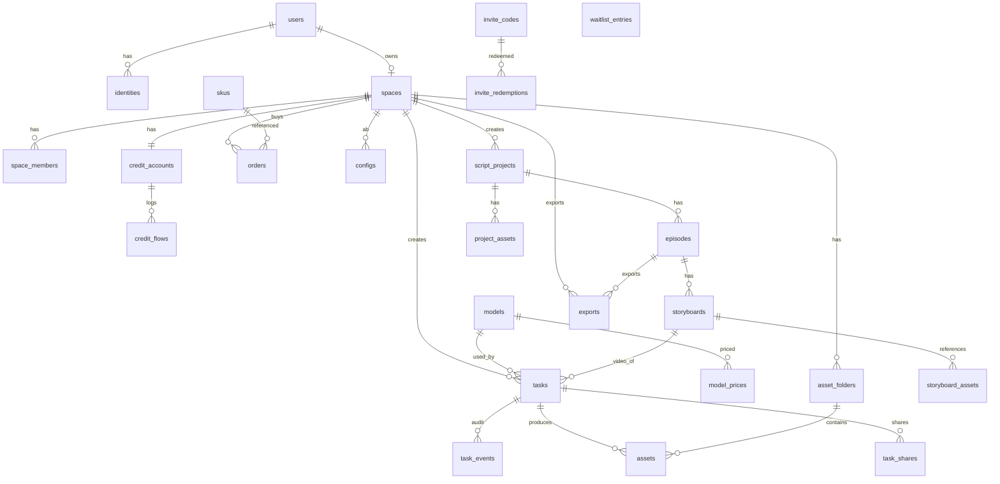

# 数据库设计

> v1.2 · PostgreSQL 16 · 主键统一雪花 ID (bigint, 应用层生成)；均含 created_at/updated_at（下略）
> 命名：表/字段 snake_case 复数；枚举用 smallint+应用层常量（避免 PG enum 迁移痛）
> v1.1 · 2026-10-24 · 按启动前审查报告修订（P0-02/03/04/05/07/09、P1-11/22、P2-01/02/14/19）
> v1.2 · 2026-10-24 · 按《逆向一致性审查》修订：模型目录字段对齐 46 模型（mode_order/两 scene 键/价格三通道）、资产定稿状态、任务分享表、时长改为模型目录校验、credit_flows 去 expire、data_center 取值对齐 domainMap、补迁移执行顺序与外键 ALTER（RE-01~RE-20）
>
> **迁移执行顺序（本文件 DDL 按依赖而非章节顺序执行）**：§1 users/identities/spaces → §4 credit_accounts/credit_flows → §8 admin_users → §1.5 invite_* → §2 models/model_prices → §5 assets → §6 script_projects/episodes/storyboards/project_assets → §3 tasks/task_events/idempotency_records/exports/task_shares → §7 canvas_* → §8 configs。跨节前向外键（tasks.episode_id/shot_id、exports.episode_id、invite_redemptions.flow_id、invite_codes.created_by）在目标表建好后用文件内标注的 `ALTER TABLE` 补加，禁止直接按本文件从上到下执行。

## ER 总览



## 1. 账号与空间

```sql
CREATE TABLE users (
  id            BIGINT PRIMARY KEY,
  nickname      TEXT NOT NULL DEFAULT '',
  avatar_uri    TEXT,
  region        TEXT NOT NULL DEFAULT 'CN',
  data_center   TEXT NOT NULL DEFAULT 'sz',        -- 对齐竞品 domainMap 四区：sz|eus|eop|sgp；国内主区 sz
  status        SMALLINT NOT NULL DEFAULT 1,       -- 1正常 2封禁
  age_declared_at TIMESTAMPTZ,                     -- 注册协议勾选"已满18"留痕(合规C3, P0-07)
  last_login_at TIMESTAMPTZ
);
CREATE TABLE identities (
  id           BIGINT PRIMARY KEY,
  user_id      BIGINT NOT NULL REFERENCES users(id),
  provider     TEXT   NOT NULL,                    -- phone|wechat|apple
  phone_hash   TEXT,                               -- HMAC-SHA256(phone)，等值查询+唯一判定用(ADR-007)
  phone_cipher TEXT,                               -- AES-GCM(phone)，展示/发码解密用；provider=phone 时与 phone_hash 同时必填
  external_id  TEXT,                               -- 开放平台 unionid(wechat/apple)；provider=phone 时为 NULL
  UNIQUE (provider, phone_hash),
  UNIQUE (provider, external_id)
);
-- 手机号等值查询与唯一索引一律走 phone_hash；phone_cipher 仅在展示、重发短信等需要明文处解密。
CREATE INDEX idx_identities_user ON identities(user_id);
CREATE TABLE spaces (
  id            BIGINT PRIMARY KEY,
  owner_user_id BIGINT NOT NULL REFERENCES users(id),
  type          SMALLINT NOT NULL DEFAULT 1,       -- 1个人 2团队(Ph3)
  name          TEXT NOT NULL DEFAULT '我的空间'
);
CREATE TABLE space_members (                       -- Ph3 启用，MVP 仅 owner 一行
  space_id  BIGINT NOT NULL REFERENCES spaces(id),
  user_id   BIGINT NOT NULL REFERENCES users(id),
  role      SMALLINT NOT NULL DEFAULT 3,           -- 1owner 2admin 3member
  credits_quota INT NOT NULL DEFAULT 0,            -- 团队配额(Ph3)
  PRIMARY KEY (space_id, user_id)
);
```

### 1.5 邀请与等待名单（Alpha 准入，P0-05）

```sql
CREATE TABLE invite_codes (
  id         BIGINT PRIMARY KEY,
  code       TEXT NOT NULL UNIQUE,                 -- 发放给运营/种子用户的码
  credits    INT NOT NULL DEFAULT 0,               -- 核销时赠送积分(0=纯准入无额度)
  max_uses   INT NOT NULL DEFAULT 1,               -- 最大核销次数
  used_count INT NOT NULL DEFAULT 0,               -- 已核销次数(原子自增, ≤ max_uses)
  expires_at TIMESTAMPTZ,
  status     SMALLINT NOT NULL DEFAULT 1,          -- 1有效 2停用 3耗尽
  created_by BIGINT REFERENCES admin_users(id)
);
CREATE INDEX idx_invite_codes_status ON invite_codes(status, expires_at);
CREATE TABLE invite_redemptions (                  -- 一码多次核销留痕；(code_id, space_id) 唯一防同人重复用同码
  id BIGINT PRIMARY KEY,
  code_id BIGINT NOT NULL REFERENCES invite_codes(id),
  space_id BIGINT NOT NULL REFERENCES spaces(id),  -- 核销落账的空间(赠送积分进该空间 credit_flows kind=gift)
  flow_id  BIGINT REFERENCES credit_flows(id),     -- 赠分流水指针(credits>0 时必有)
  UNIQUE (code_id, space_id)
);
-- 前向外键（§4 credit_flows / §8 admin_users 建表后补加）
-- ALTER TABLE invite_codes ADD CONSTRAINT fk_invite_creator FOREIGN KEY (created_by) REFERENCES admin_users(id);
-- ALTER TABLE invite_redemptions ADD CONSTRAINT fk_invite_flow FOREIGN KEY (flow_id) REFERENCES credit_flows(id);
CREATE TABLE waitlist_entries (                    -- 未持码用户留资(J3a)；仅存哈希, 无需登录
  id BIGINT PRIMARY KEY,
  phone_hash TEXT NOT NULL UNIQUE,                 -- 同 identities.phone_hash 口径(HMAC-SHA256)
  source     TEXT NOT NULL DEFAULT 'landing',      -- 来源渠道标记(landing/share/...)
  invited_at TIMESTAMPTZ                           -- 后续发码时标记(运营用)
);
```

## 2. 模型注册表与计价

```sql
CREATE TABLE models (
  id           BIGINT PRIMARY KEY,
  vendor       TEXT NOT NULL,                      -- volcengine|aliyun|kling|vidu|minimax|deepseek|self
  name         TEXT NOT NULL UNIQUE,               -- 协议层标识 seedance-2.0-pro
  display_name TEXT NOT NULL,                      -- "Seedance 2.0 Pro"
  capability   TEXT NOT NULL,                      -- video|image|text|speech|music(主能力)
  types        TEXT[] NOT NULL DEFAULT '{}',       -- 多能力标记(RE：type/types；如 video+audio)
  adapter_code TEXT NOT NULL,                      -- worker 路由 'volcengine:video-v3'
  visible      BOOLEAN NOT NULL DEFAULT TRUE,
  need_vip     BOOLEAN NOT NULL DEFAULT FALSE,
  sort         INT NOT NULL DEFAULT 100,
  mode_order   JSONB NOT NULL DEFAULT '{}',        -- 同模式内排序 {"image2video":1,...}
  modes        JSONB NOT NULL DEFAULT '{}',        -- 见下 §modes 结构
  scene_modes  JSONB NOT NULL DEFAULT '{}'         -- 两 scene 键，见下（+studio_asset_image 为 mode）
);
-- modes 结构(以 image2video 为例；对齐 RE 46 模型目录 params.generation.<mode>)
-- {"image2video":{
--   "endpoint":"/web/v1/ai/image-to-video",        -- 供应商端点，adapter 内部路由
--   "ratios":["16:9","9:16"],
--   "durations":[4,5,6,8,10],                      -- 每模型不同，禁止全局固定
--   "default_duration":5,
--   "resolution_options":[{"value":"720p","label":"720P"},
--                         {"value":"1080p","label":"1080P"}],
--   "resolutions":["720p","1080p"],                -- 兼容/筛选用
--   "counts":[1,2,3,4],"default_count":1,
--   "media_limits":{"image":9,"video":3,"audio":3,"total":12},
--   "mouth_drive":"optional","off_peak":false
-- }}
-- scene_modes 两键（RE 实证）：
-- {"script_to_scene_refer":{"enabled":true},            -- 剧本拆分镜选模
--  "storyboard_reference_video":{durations[],ratios[],  -- 分镜视频投递参数(覆盖 mode)
--    resolution_options[],media_limits{},default_duration,mouth_drive,off_peak}}
-- 注：studio_asset_image 是 image 的一个 generation mode（见上 modes），不是 scene 键；
-- 资产生图用它选模，画幅/分辨率读该 mode 的 ratios/resolution_options。
CREATE TABLE model_prices (
  id            BIGINT PRIMARY KEY,
  model_id      BIGINT NOT NULL REFERENCES models(id),
  mode          TEXT NOT NULL,
  resolution    TEXT NOT NULL DEFAULT '',           -- ''=不限(如 text2image)
  duration_s    INT,                                -- NULL=按次, 非空=按秒档
  credits       INT NOT NULL,                       -- 实付积分(含毛利)；MVP 唯一生效价
  strike_credits INT,                               -- 划线原价(对齐 RE original_price)
  member_credits INT,                               -- 会员价(RE member_price)；Beta VIP 启用，MVP 留空
  time_limited_credits INT,                         -- 限时价(RE time_limited_price)；MVP 留空
  active        BOOLEAN NOT NULL DEFAULT TRUE,
  UNIQUE (model_id, mode, resolution, duration_s)
);
-- RE 定价三通道：member_price / time_limited_price / original_price（display 回退链
-- member → time_limited → original）；MVP 只启用 credits(=当期实付) 与 strike_credits(=划线)，
-- Beta 启用 member_credits/time_limited_credits，避免现在返回假 0 折扣。
```

> 竞品对照：结构**对齐**其 46 模型目录的 `display_name/need_vip/mode_order/params.generation.<mode>/两 scene 键/price_variants`（实测 30 video + 13 image + 3 file），按 MVP 裁剪，**不是逐字段复制**〔RM-证据：cli-out/model-all.json〕。初始数据：从该目录导入 8~10 行（Seedance 2.5/2.0 VIP、TGI 2/TGI 2.5、天幕 2.0、DeepSeek 等），导入时按上述结构映射并保留 `mode_order` 与 scene 键；`studio_asset_image` 记在 `modes` 而非 `scene_modes`。

## 3. 任务（脊柱）

```sql
CREATE TABLE tasks (
  id               BIGINT PRIMARY KEY,
  space_id         BIGINT NOT NULL REFERENCES spaces(id),
  user_id          BIGINT NOT NULL REFERENCES users(id),
  episode_id       BIGINT REFERENCES episodes(id), -- 任务归属(P0-03)：流水线任务必填, 工具箱任务 NULL
  shot_id          BIGINT REFERENCES storyboards(id), -- 镜级任务(分镜视频)必填, 其余 NULL
  attempt_no       INT NOT NULL DEFAULT 1,         -- 同镜重试次数(第1次=1)；重试任务+1
  origin_task_id   BIGINT REFERENCES tasks(id),    -- 重试链指针(首代任务=NULL)；历史经此+shot_id 反查
  capability       TEXT NOT NULL,
  mode             TEXT NOT NULL,
  scene            TEXT,                            -- script_to_scene_refer|storyboard_reference_video；
                                                   -- 资产生图用 mode=studio_asset_image，不填 scene
  model_id         BIGINT NOT NULL REFERENCES models(id),
  input            JSONB NOT NULL,                 -- {prompt, reference_uris[], first_frame_uri,...}
  options          JSONB NOT NULL,                 -- {ratio,resolution,duration,count,seed,...}
  status           SMALLINT NOT NULL DEFAULT 1,    -- 1PENDING 2RUNNING 3SUCCEEDED 4FAILED
                                                   -- 5CANCELED 6REVIEWING 7REVIEW_REJECTED
  progress         SMALLINT NOT NULL DEFAULT 0,
  error            JSONB,                          -- {kind,message,vendor_code}
  vendor_task_id   TEXT,
  results          JSONB,                          -- [{uri,preview_uri,duration_s,width,height,meta}]
  credits_frozen   INT NOT NULL DEFAULT 0,
  credits_settled  INT NOT NULL DEFAULT 0,
  idempotency_key  TEXT,                           -- 仅记录来源请求键(审计用)，幂等判定见 idempotency_records
  dedupe_key       TEXT,                           -- 任务级去重键(P0-04)：服务端按 f(request_key, shot_id) 派生；
                                                   -- 重试任务按 f(origin_task_id, attempt_no) 派生，前端不参与
  finished_at      TIMESTAMPTZ,
  expire_at        TIMESTAMPTZ                     -- 结果保留90天
);
CREATE UNIQUE INDEX uq_tasks_dedupe ON tasks(dedupe_key, space_id)
  WHERE dedupe_key IS NOT NULL;                    -- 任务级幂等兜底(防 Redis 失效双写)
CREATE INDEX idx_tasks_expire ON tasks(expire_at); -- §9/§10 清理扫描用(P2-19)
CREATE INDEX idx_tasks_shot ON tasks(shot_id, attempt_no DESC); -- 断点续跑/重试历史反查
CREATE INDEX idx_tasks_space_status ON tasks(space_id, status, created_at DESC);
CREATE INDEX idx_tasks_polling ON tasks(id, status) WHERE status IN (1,2,6);
-- 前向外键：episodes/storyboards 在 §6 创建，迁移中最后用 ALTER 补加（禁止按文件顺序直接建 tasks）
-- ALTER TABLE tasks ADD CONSTRAINT fk_tasks_episode FOREIGN KEY (episode_id) REFERENCES episodes(id);
-- ALTER TABLE tasks ADD CONSTRAINT fk_tasks_shot FOREIGN KEY (shot_id) REFERENCES storyboards(id);
-- ALTER TABLE exports ADD CONSTRAINT fk_exports_episode FOREIGN KEY (episode_id) REFERENCES episodes(id);
CREATE TABLE task_events (
  id BIGINT PRIMARY KEY, task_id BIGINT NOT NULL REFERENCES tasks(id),
  type TEXT NOT NULL, payload JSONB
);
CREATE TABLE idempotency_records (                 -- 请求级幂等(P0-04)：一键一请求, 批量接口重放返回原响应体
  id            BIGINT PRIMARY KEY,
  key           TEXT NOT NULL,
  space_id      BIGINT NOT NULL REFERENCES spaces(id),
  request_hash  TEXT NOT NULL,                     -- 请求体哈希(重放同键不同体 → 400101)
  response_body JSONB,                             -- 首次响应体(完成后写入, 并发中同键请求等待/返回冲突码)
  expire_at     TIMESTAMPTZ NOT NULL,              -- 创建后 5min 过期, 定时清理
  UNIQUE (key, space_id)
);
CREATE INDEX idx_idem_expire ON idempotency_records(expire_at);
CREATE TABLE exports (                             -- 导出异步化(P1-12)：全集打包 zip
  id BIGINT PRIMARY KEY, space_id BIGINT NOT NULL REFERENCES spaces(id),
  episode_id BIGINT NOT NULL REFERENCES episodes(id),
  status SMALLINT NOT NULL DEFAULT 1,              -- 1PENDING 2PACKAGING 3SUCCEEDED 4FAILED
  file_uri TEXT, expires_at TIMESTAMPTZ,           -- 成功后 7 天清理(§10)
  error JSONB
);
CREATE INDEX idx_exports_space ON exports(space_id, created_at DESC);
CREATE TABLE task_shares (                          -- 结果分享(PRD F3)：公开只读预览，默认 7 天
  id BIGINT PRIMARY KEY,
  task_id BIGINT NOT NULL REFERENCES tasks(id),
  space_id BIGINT NOT NULL REFERENCES spaces(id),
  token TEXT NOT NULL UNIQUE,                      -- 不可猜随机串(≥128bit)
  expires_at TIMESTAMPTZ NOT NULL,
  revoked_at TIMESTAMPTZ
);
CREATE INDEX idx_task_shares_expire ON task_shares(expires_at);
```

**状态枚举（流水线各表 status，smallint+应用层常量，集中此处定义）**：

| 表 | 字段 | 值 |
|---|---|---|
| script_projects.status | 项目状态 | 1草稿(已建未确认) 2确认(大纲已定) 3归档 |
| episodes.status | 剧集状态 | 1草稿(大纲生成即落库) 2确认(剧本定稿) |
| project_assets.status | 资产状态 | 1草稿(已抽取/待生图) 2已定稿(有 portrait_asset_id，可被分镜引用) |
| storyboards.status | 分镜状态 | 1草稿(LLM 生成待编辑) 2确认(可投递) 3已投递 4出图完成 5出片完成 |
| exports.status | 导出状态 | 1PENDING 2PACKAGING 3SUCCEEDED 4FAILED |

## 4. 积分与订单

```sql
CREATE TABLE credit_accounts (
  space_id BIGINT PRIMARY KEY REFERENCES spaces(id),
  balance  INT NOT NULL DEFAULT 0 CHECK (balance >= 0),
  frozen   INT NOT NULL DEFAULT 0 CHECK (frozen >= 0)
);
CREATE TABLE credit_flows (
  id            BIGINT PRIMARY KEY,
  space_id      BIGINT NOT NULL REFERENCES spaces(id),
  delta         INT NOT NULL,                      -- 可用余额变动(P0-09 口径, 见下)
  frozen_delta  INT NOT NULL DEFAULT 0,            -- 冻结额变动(见下)
  kind          TEXT NOT NULL,                     -- recharge|gift|freeze|settle|unfreeze|adjust
                                                   -- 不写 expire：Alpha/Beta 积分不设有效期；
                                                   -- 若将来引入有效期，新增 kind 并同步 §4 对账不变式
  ref_task_id   BIGINT, ref_order_id BIGINT, ref_code_id BIGINT,  -- code_id=邀请码赠分
  balance_after INT NOT NULL,
  memo          TEXT
);
CREATE INDEX idx_flows_space ON credit_flows(space_id, created_at DESC);
```

**流水口径（唯一口径，消除二义，P0-09）**：`delta` 一律记 **可用余额变动**；`frozen_delta` 一律记 **冻结额变动**：

| kind | delta | frozen_delta |
|---|---|---|
| recharge / gift / expire / adjust | 充值/赠送记正、过期/调整按实 | 0 |
| freeze（提交冻结） | -cost | +cost |
| settle（成功结算） | 0 | -cost |
| unfreeze（失败/取消/审核拒解冻） | +cost | -cost |

**对账不变式（全库唯一表述，security §3 / testing §2-1 同文）**：`balance == Σ delta` 且 `frozen == Σ frozen_delta`。

freeze→成功/失败 三行示例流水（初始 balance=100, frozen=0, 任务 cost=8）：

| kind | delta | frozen_delta | balance_after | 说明 |
|---|---|---|---|---|
| freeze | -8 | +8 | 92 | 提交冻结：可用 92、冻结 8 |
| settle | 0 | -8 | 92 | 成功结算：冻结清零（可用不再变动） |
| unfreeze（替代行） | +8 | -8 | 100 | 若任务失败：解冻回可用 |

```sql
CREATE TABLE skus (
  id BIGINT PRIMARY KEY, kind TEXT NOT NULL,       -- credits|vip
  sku TEXT NOT NULL UNIQUE,                        -- SKU 编码(接口返回, 对齐 api-spec §10)
  label TEXT NOT NULL,                             -- 展示名("入门包"等)
  price_cents INT NOT NULL, credits INT NOT NULL,
  period TEXT, active BOOLEAN NOT NULL DEFAULT TRUE
);
CREATE TABLE orders (
  id BIGINT PRIMARY KEY, space_id BIGINT NOT NULL, sku_id BIGINT NOT NULL,
  amount_cents INT NOT NULL, channel TEXT,         -- wechat_native|wechat_h5
  status SMALLINT NOT NULL DEFAULT 1,              -- 1待支付 2已支付 3已关闭 4已退款
  paid_at TIMESTAMPTZ, refunded_at TIMESTAMPTZ,
  channel_order_no TEXT
);
```

## 5. 资产

```sql
CREATE TABLE asset_folders (
  id BIGINT PRIMARY KEY, space_id BIGINT NOT NULL, parent_id BIGINT,
  name TEXT NOT NULL
);
CREATE TABLE assets (
  id BIGINT PRIMARY KEY, space_id BIGINT NOT NULL,
  kind TEXT NOT NULL,                              -- image|video|audio
  uri TEXT NOT NULL, preview_uri TEXT,
  source_task_id BIGINT REFERENCES tasks(id),
  folder_id BIGINT REFERENCES asset_folders(id),
  name TEXT NOT NULL DEFAULT '', tags TEXT[] NOT NULL DEFAULT '{}',
  meta JSONB NOT NULL DEFAULT '{}',
  deleted_at TIMESTAMPTZ                           -- 软删, 7天物理清
);
CREATE INDEX idx_assets_space ON assets(space_id, kind, created_at DESC);
CREATE INDEX idx_assets_tags ON assets USING GIN(tags);
```

## 6. 剧本流水线（MVP 启用 · 旗舰功能，PRD F2）

```sql
CREATE TABLE script_projects (
  id BIGINT PRIMARY KEY, space_id BIGINT NOT NULL,
  title TEXT NOT NULL, genre TEXT, drama_type SMALLINT DEFAULT 1, -- 1真人 2动漫
  ratio TEXT NOT NULL DEFAULT '9:16',
  source_type SMALLINT NOT NULL DEFAULT 1,         -- 1novel 2idea 3script(导入剧本拆集) 4fission(预留 Ph3)
  source_text TEXT, status SMALLINT NOT NULL DEFAULT 1  -- 状态枚举见 §3 状态枚举表
);
CREATE TABLE episodes (
  id BIGINT PRIMARY KEY, project_id BIGINT NOT NULL REFERENCES script_projects(id),
  ep_no INT NOT NULL, title TEXT, script_text TEXT,
  status SMALLINT NOT NULL DEFAULT 1               -- 状态枚举见 §3 状态枚举表
);
CREATE TABLE project_assets (
  id BIGINT PRIMARY KEY, project_id BIGINT NOT NULL REFERENCES script_projects(id),
  kind TEXT NOT NULL,                              -- character|scene|prop
  name TEXT NOT NULL, description TEXT, prompt TEXT,
  ref_image_uri TEXT,
  source_task_id BIGINT REFERENCES tasks(id),      -- 资产生图任务(studio_asset_image)
  portrait_asset_id BIGINT REFERENCES assets(id),  -- 定妆图/定稿资产指针(P1-08 统一字段名)
  status SMALLINT NOT NULL DEFAULT 1,              -- 1草稿 2已定稿(可被分镜引用)；见 §3 状态枚举表
  finalized_at TIMESTAMPTZ
);
CREATE TABLE storyboards (
  id BIGINT PRIMARY KEY, episode_id BIGINT NOT NULL REFERENCES episodes(id),
  shot_no INT NOT NULL, shot_desc TEXT, video_prompt TEXT,
  duration_s INT,                                  -- 默认 5；投递时按所选模型 storyboard_reference_video.durations
                                                   -- 就近取低档并回写，不做全局固定档位(模型间枚举不同)
  ratio TEXT, resolution TEXT,                     -- 覆盖项目默认；必须在所选模型 scene 枚举内
  status SMALLINT NOT NULL DEFAULT 1,              -- 状态枚举见 §3 状态枚举表
  image_task_id BIGINT, video_task_id BIGINT       -- 当前生效任务指针(P0-03)；重试历史经 tasks.shot_id+origin_task_id 反查
);
CREATE TABLE storyboard_assets (
  storyboard_id BIGINT REFERENCES storyboards(id),
  project_asset_id BIGINT REFERENCES project_assets(id),
  PRIMARY KEY (storyboard_id, project_asset_id)
);
```

## 7. 画布（Ph3，占位）

```sql
CREATE TABLE canvases (
  id BIGINT PRIMARY KEY, space_id BIGINT NOT NULL,
  title TEXT NOT NULL DEFAULT '未命名画布', version INT NOT NULL DEFAULT 1
);
CREATE TABLE canvas_nodes (
  id BIGINT PRIMARY KEY, canvas_id BIGINT NOT NULL REFERENCES canvases(id),
  node_type TEXT NOT NULL,        -- RE 11 种：text|image|video|audio|table|script|asset|
                                  -- clip|director|threeDWorld|group（Ph3 占位，勿只建 9 种）
  name TEXT NOT NULL DEFAULT '',
  x INT NOT NULL, y INT NOT NULL, width INT, height INT,
  params JSONB NOT NULL DEFAULT '{}',   -- video.settings: duration/enableSound/mouthDrive/shotType/offPeak/fps
  task_id BIGINT, version INT NOT NULL DEFAULT 1
);
CREATE TABLE canvas_edges (
  id BIGINT PRIMARY KEY, canvas_id BIGINT NOT NULL,
  src_node_id BIGINT NOT NULL, dst_node_id BIGINT NOT NULL
);
-- node_locks 走 Redis(TTL 30s 心跳续期)，不落库；canvas_snapshots 存 JSONB 快照按版本
CREATE TABLE canvas_snapshots (
  id BIGINT PRIMARY KEY, canvas_id BIGINT NOT NULL,
  version INT NOT NULL, payload JSONB NOT NULL
);
```

## 8. 运营

```sql
CREATE TABLE configs (                             -- key/module/lang 结构对齐竞品配置中心
  key TEXT NOT NULL, module TEXT NOT NULL DEFAULT 'web',
  lang TEXT NOT NULL DEFAULT 'zh-CN', value JSONB NOT NULL,
  PRIMARY KEY (key, module, lang)
);
CREATE TABLE admin_users (
  id BIGINT PRIMARY KEY, username TEXT NOT NULL UNIQUE,
  password_hash TEXT NOT NULL, role TEXT NOT NULL DEFAULT 'ops'
);
```

## 9. 索引与性能要点

1. 轮询热路径只碰 `idx_tasks_polling`（部分索引，行数=在途任务）；
2. `credit_flows` 只追加不更新；对账任务每日核对 `balance_after` 连续性；
3. tasks 按月分区：DAU>5k 后启用（MVP 单表 + expire_at 索引清理即可）；
4. JSONB 字段读取侧 `jsonb_path_query`，禁止在 WHERE 中对大 JSONB 做非索引过滤；
5. `task_shares.token` 唯一索引承担公开预览的主查询；过期清理走 `idx_task_shares_expire`，不在热路径扫全表。

## 10. 数据生命周期

| 数据 | 保留 | 依据 |
|---|---|---|
| 生成结果文件 | 90 天（到期 OSS 生命周期删除） | 成本；用户可下载转存 |
| 导出 zip（exports.file_uri） | 7 天后删除（exports-cleanup 定时任务，见 deployment §7） | 成本（P1-12） |
| 任务记录 | 永久（脱敏：到期清空 input.prompt/结果 uri） | 对账+纠纷 |
| credit_flows | 永久 | 财务 |
| 埋点原始日志 | 180 天 | 分析 |
| 回收站资产 | 7 天物理删 | 体验 |
| 分享 token | 7 天过期，撤销即时失效（定时清理过期行） | 安全/体验 |

## 11. 迁移规范

- 工具：`drizzle-orm` + `drizzle-kit`（TS 同构，SQL 可审）；迁移文件入 git，禁止手改生产；
- 破坏性变更走双写/灰度；每次迁移在 staging 演练并在 PR 附回滚 SQL。
