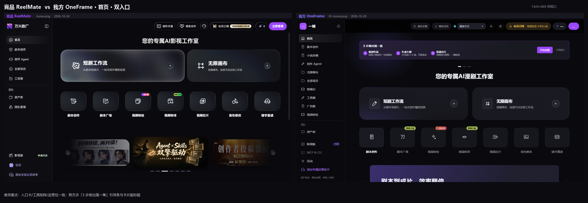
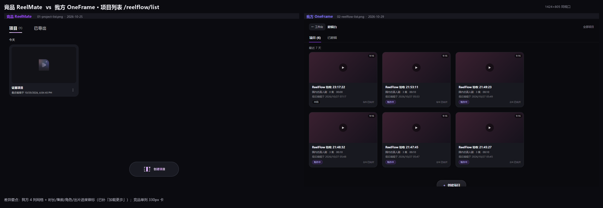
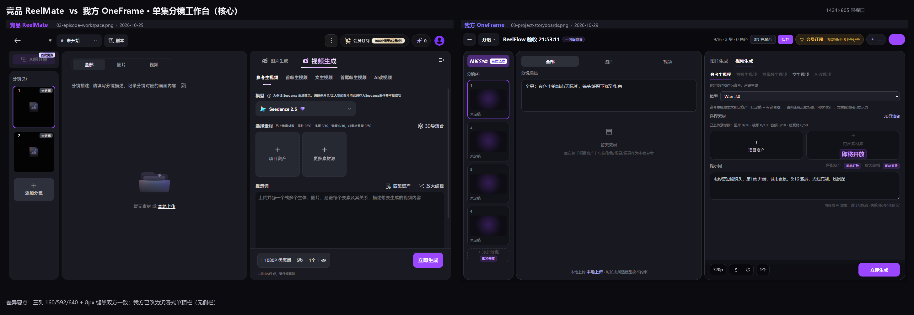
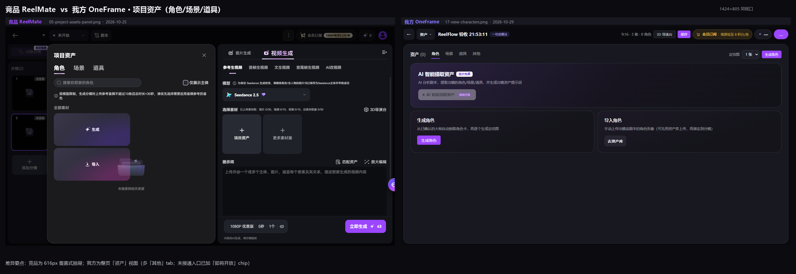
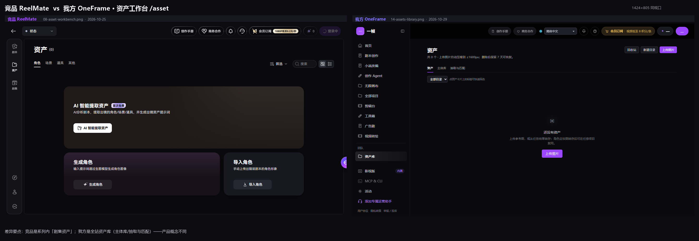
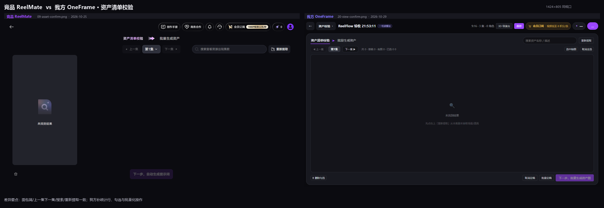
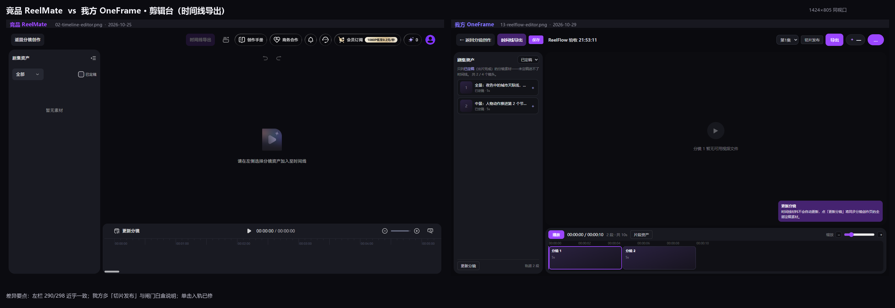
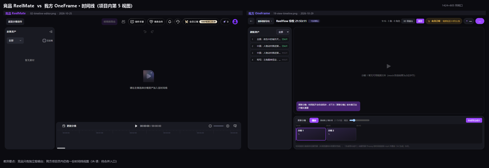
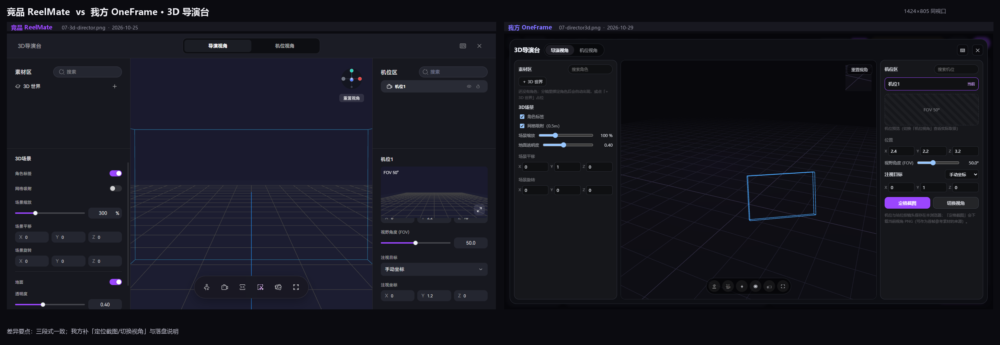
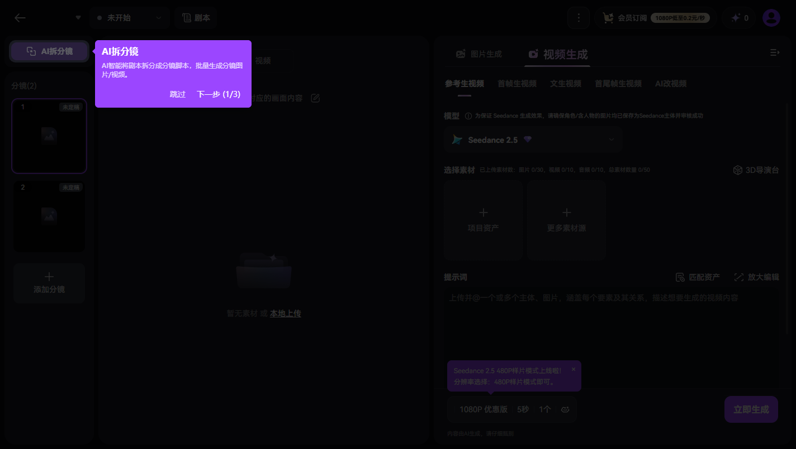

# 一帧（OneFrame）× 竞品 ReelMate · 短剧工作流 UI 对比

> **v1.1 · 2026-10-29（UI 对齐实施后）** · 作者：Agent Team（Lead 汇总）
> **版本关系**：v1.0 是诊断基线（对齐前，代码 `bd4d9cc8`）；v1.1 记录同一天完成的**对齐实施 + 复测**（见 §10），布局已逐像素对齐，行为/自动化对齐完成 6/12 项。
> **证据口径**：竞品 = ReelMate 万兴剧厂一手截图 + 实测（1424×805，2026-10-25 18:00–18:10，账号积分 0，**生成/导出类动作未执行**）；我方 = 同视口现抓（1424×805，2026-10-29 05:3x 对齐前 / 06:3x 对齐后），真实登录态 + mock 适配器；外部 5 款见 [landscape.md](_ui-audit/landscape.md)（可核查但证据等级 A–D，已降级标注）。
> **配套材料**：[竞品 UI 事实清单](_ui-audit/ref-facts.md) · [我方 UI 事实清单](_ui-audit/ours-facts.md) · [外部产品横向参考](_ui-audit/landscape.md) · [并排对照图 9 张](evidence/ui-compare/) · [我方对齐后原图 15 张](evidence/ui-compare/ours-2026-10-29/) · [可视化对照页](competitor-ui-comparison.html)
> **判定口径**：只比"同视口、同页面、同状态下看得见的东西"。竞品没取证到的状态一律标 ❌ 并写进 §9，不拿我方实现去替竞品说话。

---

## 0. 一页结论（TL;DR）

**0）v1.1 状态：布局已 1:1 对齐；行为对齐完成 6/12，剩余 6 项见 §10。**
对齐后复测（1424×805 像素扫描）：左分镜条 `8..167 = 160`、中素材区 `176..767 = 592`、右生成台 `776..1415 = 640`、单顶栏 64、内容高 733 —— 与竞品实测坐标（8/168/176/768/776/1416、64/733）逐像素一致。

**1）骨架已经对齐，差的不是"像不像"，是"自动化程度 / 状态表达 / 剩余口径 bug"。**
三列工作台、面板语言（底 `rgba(194,204,241,.08)`、圆角 16/20、40 高按钮、品牌激活 40%）、"首次免费"徽标、"未定稿"闸门、"更新分镜"显式同步、"@ 主体"占位、胶囊底栏 —— 我方都已实现；v1.1 起工作台也改成竞品式沉浸式单顶栏。

**2）空间三组数字已归零。**

| 指标 | 竞品 | 对齐前 | 对齐后 |
|---|---|---|---|
| 单集工作台可用宽度 | 1408（无侧栏） | 1152（侧栏 240） | **1424** ✅ |
| 右生成台宽度 | 640 | 460 | **640** ✅ |
| 中素材区宽度 | 592 | 492 | **592** ✅ |
| 可用高度（顶栏之后） | 733（单顶栏 64） | 661（双顶栏 128） | **733** ✅ |
| 逐镜绑定+生成（30 镜典型剧） | 1 次「匹配资产」自动匹配（🟡 步数未实测） | 约 90 次点击 | **仍约 90 次（未做，P0）** |

**3）竞品最强的一处不是视觉，是「匹配资产」这个自动化钩子 —— 这项仍未做。**
竞品 `匹配资产` 点一次 → 按提示词自动匹配项目资产，且服务端把"匹配 + 拆分镜"做成组合任务。我方仍是 disabled 占位（v1.1 只把它标成「即将开放」），用户只能逐镜「项目资产 → 勾选 → 应用」（2 次点击/镜）。这是整条链路上最贵的一处差距。

**4）5 个"看起来有、其实点不动"的控件已透明化。**
v1.1 起 `匹配资产`、`放大编辑`、`更多素材源`、`+ 添加分镜`、`AI 智能提取资产` 全部保留禁用态，但加了可见的「即将开放」chip + 用户可读的说明（不再只靠 hover title），并修掉了资产页说明里"后端链路建设中"这类内部话术。

**5）我方也有明确更强的地方，别为了"像竞品"改回去**：批量投递 + 分镜矩阵 + 预算预填、资产校验的统计/全选/批量定稿、6 个显式视图（剧本 / 资产 / 分镜 / 导出 / 时间线 / 校验）、剪辑台闸门的白盒说明（"只列已定稿……共 2/4 个镜头"）、导出→轮询→下载 mp4 的闭环。竞品这几处要么没有证据，要么根本没有界面。

**6）剩余 6 项**（§10）：① 批量投递丢 `mode`；② `已出片` 两套口径；③ 匹配资产；④ 两套时间线入口合并；⑤ 项目资产抽屉化；⑥ 提示词库 / 放大编辑。其中 ①② 是会让人白干的口径 bug，建议下一轮先修。

---

## 1. 证据与口径

| 类别 | 来源 | 时间 / 视口 | 可信度 | 限制 |
|---|---|---|---|---|
| 竞品一手截图 | [evidence/reelflow/](evidence/reelflow/) 11 张 + `measure.json` | 2026-10-25 · 1424×805 | 高（Playwright 逐页导航 + 计算样式量测） | 账号积分 0 → 生成/定稿/导出态未取证；`reference-reelflow-spec.md` 为同轮产物 |
| 竞品早期页面 | `rea-reelmate/home.png`、`t2v.png`、`pricing.png` 等 | 2026-10-24 · 1424×805 | 中（静态截图） | 首页/工具/价格可用；工作流内页无 |
| 竞品首访引导 | [_acceptance/ref/page-episode-create.png](evidence/ui-compare/ref-coachmark-2026-10-25.png)（本报告转存） | 2026-10-25 · 1424×805 | 高（真实 coach-mark 浮层） | 只覆盖第 1/3 步，后两步 ❌ |
| 我方现抓 | [evidence/ui-compare/ours-2026-10-29/](evidence/ui-compare/ours-2026-10-29/) 12 张 + `capture-report.json` | 2026-10-29 05:3x · 1424×805 | 高（真实登录态 UI） | mock 适配器；出片为占位字节 |
| 我方代码审计 | [_ui-audit/ours-facts.md](_ui-audit/ours-facts.md)（617 行，代码基线 `bd4d9cc8`） | 2026-10-29 | 高（`文件:行号` 可复核） | 运行时行为需联调验证的项已标 ❌ |
| 外部 5 款 | [_ui-audit/landscape.md](_ui-audit/landscape.md)（811 行） | 2026-10-29 | A–D 分级 | 全部静态抓取、无登录态、无截图；剪映 Hub 仅媒体口径 |

**为什么能直接比**：竞品与本次我方截图都是 **1424×805、deviceScaleFactor=1、深色**；页面级列宽/顶栏高度用像素扫描交叉验证（§4.1）。比"看起来"更硬的部分都写成了数字。

**本文不做什么**：不评价模型质量/生成效果（竞品积分 0，无法取证）；不做像素级视觉走查（竞品 11 张截图只有 3 种页面状态）；不把 ADR-013「竞品怎么做我们就怎么做」当免责 —— 该偏离的地方（如项目卡信息量、批量投递）明确写"我方更优，建议保留"。

---

## 2. 端到端：同一部短剧的两条路径

> 竞品步数一律 🟡（竞品 Web 侧没有步骤条，其自身文档也只给了 CLI 分母）；我方步数来自代码 + 真实 DOM 脚本（[ours-facts §2](_ui-audit/ours-facts.md)）。

| # | 阶段 | 竞品（UI / 动作 / 闸门） | 我方（UI / 动作 / 闸门） | 判定 |
|---|---|---|---|---|
| 0 | 入口 | 首页双入口卡：主卡 640×160 r32、副卡 480；点「短剧工作流」1 击 | 同构；多「3 步做出第一集」引导条 + 卡内副标题；1 击 | 对齐 |
| 1 | 项目列表 | `项目(N)` / `已导出` 双 tab；单列 330×250 卡；底部 FAB `创建项目` | 同双 tab；4 列卡（9:16 徽标 + 类型/集数/时长/草稿/`0/0 已出片`）；FAB | 对齐，我方信息更全 |
| 2 | 新建 | 跳 `/reelflow/edit/create`（空剪辑器形态）→ `返回分镜创作` | 弹窗（名称/文件/粘贴/剧目类型/比例）→ 直接落 `/projects/:id` | 偏离（我方更短，无"空编辑器"态） |
| 3 | 工作台 | 三列 160 / 592 / 640，**无侧栏**、单顶栏 64 | **三列 160 / 592 / 640，无侧栏、单顶栏 64**（v1.1 对齐） | ✅ 已对齐 |
| 4 | 剧本 / 分集 | `剧本` 胶囊；正文编辑器 ❌ 未取证 | 「剧本·分集大纲」视图：逐集卡 + 已确认徽标 + 自动保存 + 确认大纲 | 竞品 ❌，我方独有 |
| 5 | 资产提取 | `AI拆分镜 首次免费`、`AI 智能提取资产 首次免费` 均可点 | 同文案；按钮仍 disabled，但已加「即将开放」chip + 用户可读说明 | 竞品优（可用性，已透明化） |
| 6 | 清单校验 | 面包屑 `资产清单校验 → 批量生成资产`；空态底部 CTA 禁用 | 同面包屑 + 统计行 + 全选/批量定稿/删除 + `下一步，批量生成资产图` | 对齐，我方更完备 |
| 7 | 资产匹配 | `匹配资产` 1 击 → toast `根据提示词内容自动匹配项目资产`；服务端组合任务**自动接拆分镜** | **disabled 占位**；只能逐镜抽屉勾选 → 应用 | **竞品优（最大差距）** |
| 8 | 拆分镜 | `AI拆分镜` 1 击/集（首次免费）；重跑语义 ❌ | `AI拆分镜` 1 击/集；重跑**无二次确认**、整体覆盖 | 对齐（我方缺护栏） |
| 9 | 逐镜生成 | 5 模式 tab / 模型 / 配额 `0/30·0/10·0/10·0/50` / `@` 主体 / `立即生成 ✦63` | 同结构；`匹配资产`·`放大编辑` disabled；`立即生成 ✦{报价}`（报价失败则不显示） | 对齐，自动化更弱 |
| 10 | 批量投递 | ❌ 未取证（CLI 侧有批量） | 「导出与投递」：模型 / 预算上限 / 按报价预填 / `批量投递 N 镜` / 分镜矩阵 / 导出本集 zip | **我方独有** |
| 11 | 剪辑台 | 左 298 剧集资产（`全部▾` + `已定稿` 复选）+ 播放器 884×497 + 时间线 1102×164；`更新分镜` 显式同步 | 三区同构；左栏写明"只列已定稿……共 2/4 个镜头"；`更新分镜` + 自动保存 700ms + `切片发布` / `片段资产` | 对齐，我方多发布 |
| 12 | 导出 | 点 `时间线导出` **无面板出现** ❌ | `导出` → 2s 轮询 → `下载 mp4`（5 分钟超时提示、AI 水印说明） | 我方有闭环 |
| 13 | 已导出 | ❌ 未取证 | tab 已改名 **`已剪辑`**（v1.1；语义=时间线有时长的项目），不是导出历史 | 双方都欠（我方名实已对齐） |

**步数结论**：我方最短可出片路径 **约 21–22 次点击 + 1 处文本输入**；典型 3 集×10 镜 ≈ **150 次点击**，其中 30 镜的"绑资产 + 立即生成"占 **90 次（60%）**。竞品在同一链路上多了一个「匹配资产」自动化钩子，但其真实步数 ❌ 未实测 —— 本报告不编竞品步数。

> 说明：竞品「匹配 + 拆分镜」是组合任务这一点来自**竞品 CLI Skill 文档**（`docs/01-product/_parts/d-pipeline.md:33`、`:259`），不是 UI 实测；UI 侧只取证到 `根据提示词内容自动匹配项目资产` 的 toast（`06-match-asset.png`）。两者一起才构成"竞品有自动化钩子"的判断。

---

## 3. 逐页对比

> 每页一张并排图（左竞品 / 右我方），原图与量测各自可查。差异只写"能看出来且可复核"的。

### 3.1 首页 · 双入口



| 维度 | 竞品 | 我方 |
|---|---|---|
| 标题 | `您的专属AI影视工作室` | `您的专属AI漫剧工作室` |
| 主入口卡 | 640×160、r32、`linear-gradient` + 内发光 + 1px 渐变描边 | 同构；卡内多一行副标题 |
| 新手引导 | 无全局引导条（靠工作台内 coach-mark） | 顶部「3 步做出第一集 / 新建作品·生成大纲·投递出片」+ `开始创建` + `不再提示` |
| 工具矩阵 | 7 卡（剧本创作 / 剧本广场 / 视频转绘 / 视频转译 / 视频拉片 / 音色修改 / 错字重读）+ `上新` `即将上线` 徽标 | 同 7 卡同序；徽标为 `即将上线` / `一局会员` |
| 运营轮播 | 3 图 + 6 dash | 有（`剧本到成片，效率翻倍`） |

**结论**：对齐。引导条是**加分项**（把"第一步该干嘛"放在首屏），但它在 1424×805 下占 76px 且只能"本机不再提示"；建议改成可折叠/首访一次后收起，并在项目内用 coach-mark 接力（见 §6.1）。

### 3.2 项目列表 `/reelflow/list`



| 维度 | 竞品 | 我方 |
|---|---|---|
| tab | `项目 (N)` / `已导出` | 同；另加左上 `返回工作台 / 剪辑台` + 右上 `全部项目` |
| 卡片 | 330×250，缩略图 310×140，标题 14/700，`最后编辑于 …`，`⋮`，hover `编辑` | ≈300×250，4 列；`9:16` 角标、`国内仿真人剧 · 3集 · 00:00`、`草稿` chip、`0/0 已出片` |
| 空态 / CTA | 一句话 + 底部胶囊 FAB（236×68） | 同款 FAB `+ 创建项目` |

**结论**：我方卡片多出的四类信息（画幅/类型/集数/时长/**出片进度**）直接服务"这部片做到哪了"，比竞品的"最后编辑于"更有用 —— **建议保留**。要补的是竞品的 hover `编辑` 与 `⋮` 菜单（我方当前未见，🟡 hover 态未取证）。另：列表硬截断 48 条无分页，是当前最硬的可用性缺陷之一（§7 P1）。

### 3.3 单集分镜工作台（核心页）



**布局实测（像素扫描，1424×805）**

```
竞品： 8 [分镜条 160] 8 [素材区 592] 8 [生成台 640] 8          顶栏 64（单层）→ 可用高 733
我方： 8 [分镜条 160] 8 [素材区 592] 8 [生成台 640] 8          顶栏 64（单层）→ 可用高 733   ← v1.1 对齐后
  （对齐前：240 侧栏 + 64 全局顶栏，可用区 1152×661）
```

| 区域 | 竞品 | 我方（v1.1） | 差异性质 |
|---|---|---|---|
| 顶栏 | `←` + `未开始 ▾`(144×40) + `剧本`(76×40) ｜ `⋮` / 会员订阅 / 积分 / 头像 | `←` + `分镜 ▾` + 项目名 + `一句话玩法` ｜ 画幅·集数·角色 meta / `3D导演台` / `保存` / 账户组（会员订阅·积分·头像） | 阶段表达不同（胶囊 vs picker 菜单）；账户组已补 |
| 左分镜条 | `AI拆分镜` 136×32 + `首次免费` 压在按钮上缘；卡 128×128、pitch 144；`+ 添加分镜` 128×72 虚线 | 160 宽（同竞品）；`AI拆分镜` + `首次免费`；`+ 添加分镜` 仍禁用，但带「即将开放」chip | 宽度已对齐；1 项禁用（已透明） |
| 中素材区 | `分镜描述:` 只读标签 + 铅笔；空态插画 + `暂无素材` + `或 本地上传` | 592 宽（同竞品）；`分镜描述` 可直接编辑 textarea + 空态指引；`本地上传` 文案重复渲染（缺陷 #19，未修） | 宽度已对齐；1 处文案噪音 |
| 右生成台 | 640 宽：5 模式 → 模型（`Seedance 2.5` ♥ + 一致性提示）→ `选择素材` 配额 + `3D导演台` → 两卡 → 提示词 600×300 → 底栏 `1080P 优惠版｜5秒｜1个` + `立即生成 ✦63` | 640 宽（同竞品）；`匹配资产`/`放大编辑`/`更多素材源` 仍禁用但带「即将开放」chip；底栏 `720p｜5秒｜1个` + `立即生成`（报价失败不显示 `✦`） | 宽度已对齐；3 个入口仍缺（已透明） |

**结论**：v1.1 起这一页的"空间"与竞品逐像素一致，剩下的都是**内容/能力**差异：
- `匹配资产`/`放大编辑`/`更多素材源` 三个低权重入口仍未接通（现在标了「即将开放」，用户不会误以为坏了）—— 竞品这三个位置是**产品力**；
- 竞品 5 模式 tab 顺序与"参考生视频"默认一致（我方一致 ✅）；
- 竞品底栏上方有**一次性运营公告条**（`Seedance 2.5 480P样片模式上线啦！…` + `×`），我方没有公告位；
- 我方 `本地上传` 重复渲染、报价失败时 `✦` 不显示（后者是"不编造数字"的刻意设计，建议显示 `✦ —`）。

### 3.4 项目资产（角色 / 场景 / 道具）



| 维度 | 竞品 | 我方 |
|---|---|---|
| 形态 | **覆盖式抽屉**：x152~768（宽 616）、r20、`rgb(27,27,29)` + 1px 描边，背后压暗 | **整页视图**（picker 切到「资产」） |
| tabs | `角色 / 场景 / 道具`（3 个） | `角色 / 场景 / 道具 / 其他`（4 个） |
| 工具行 | 搜索（`搜索你想要的角色`）+ `仅展示主体` 复选 | `定妆图 {n} 张` 下拉 + `生成角色` |
| 约束提示 | 常驻信息条：`参考音频不超过10条且总时长<30秒…` | 无（仅在提示词区/模式处零散提示） |
| 空态 | `全部素材` + `✦ 生成`（紫渐变）/ `⤓ 导入`（紫→粉）两卡 | `AI 智能提取资产` 大卡（白按钮 + 「即将开放」chip，说明改为"AI 分析剧本，提取出镜的角色/场景/道具，并生成出镜资产提示词"）+ `生成角色` / `导入角色` 两卡 |

**结论**：形态差异（抽屉 vs 整页）不是审美问题 —— 抽屉**保留了三列工作台的上下文**，整页切换会把"刚看的那一镜"从视野里拿掉（回分镜要再点 2 次 picker）。建议把项目资产做成右侧抽屉（宽 620 左右），整页视图保留给"资产库"入口。另：我方搜索框未绑定（缺陷 #17）、缺 `仅展示主体`。

### 3.5 资产库 `/assets`（我方）vs `/asset`（竞品）



| 维度 | 竞品 `/asset` | 我方 `/assets` |
|---|---|---|
| 语义 | **剧集资产**（项目/系列上下文内）：左侧 72 宽竖排 `剧本 / 资产 / 剧集` 三视图 | **全站资产库**：`资产 / 主体库 / 抽取与匹配` 三 tab + 回收站/新建目录/上传 |
| 结构 | 标题 `资产 (0)` + `角色/场景/道具/其他` + `筛选 ▾` + 搜索 + 网格/列表切换 | 标题 `资产` + 说明"上传压缩到 ≤1600px；删除后保留 7 天" + 全部目录下拉 + 空态 |
| 空态 CTA | 三卡并列（提取 1000×260 / 生成 650×180 / 导入 334×180） | 单 CTA `上传图片` |

**结论**：两边**产品概念不同**，不是缺页：竞品把"剧集资产"放在项目上下文里，我方拆成"全站库 + 项目内资产视图"。建议保留我方模型（更适合多项目复用角色），但补竞品的**筛选 / 网格-列表切换 / 三卡空态**；`主体库`/`抽取与匹配` 两个 tab 当前无 10-29 截图（见 §9）。

### 3.6 资产清单校验



| 维度 | 竞品 | 我方 |
|---|---|---|
| 面包屑 | `资产清单校验 → 批量生成资产` | 同（第二步文案 `批量生成资产`） |
| 工具行 | `上一集 / 第1集▾ / 下一集` + 搜索（`搜索查看资源出现集数`）+ `重新提取` | 同 + 统计行 `共0·草稿0·有图0·已选0` + `选中缺图` / `取消全选` |
| 空态 | 单卡 312×532 + `未找到结果` + 副行；底部 `下一步，自动生成提示词` **禁用** | 大面积空态 + `未找到结果` + 指引"先点右上「重新提取」"；底部 `删除勾选 / 取消定稿 / 批量定稿 / 下一步，批量生成资产图` |
| 批量 | 未见（空态） | 勾选 + 批量定稿/删除/生成（逐条循环） |

**结论**：对齐且**我方更完备**（竞品这一页只有空态证据）。文案差异值得注意：竞品是两步（`下一步，自动生成提示词` → 再生成资产），我方合成一步（`下一步，批量生成资产图`）；建议在按钮旁加一句"将自动生成提示词"，否则用户不知道提示词从哪来。

### 3.7 剪辑台（时间线导出）



| 维度 | 竞品 | 我方 | 差异 |
|---|---|---|---|
| 顶栏 | `返回分镜创作` + `时间线导出`（选中态）+ `保存`（🟡 显隐有争议）｜ 创作手册/商务/会员/积分/头像 | `返回分镜创作` + `时间线导出` + `保存` + 项目名 ｜ `第1集▾` / `切片发布` / `导出` / 账户组 | 我方多切片发布与账户组 |
| 左栏 | 298 宽：`剧集资产` + `全部▾` + `已定稿` 复选；空态 `暂无素材` | 290 宽：`剧集资产` + `已定稿▾` + **闸门说明**"只列已定稿（出片完成）……共 2/4 个镜头"；未定稿行半透明不可拖 + toast | 宽度几乎一致 ✅ |
| 中区 | 播放器 884×497（16:9）+ 空态 `请在左侧选择分镜资产加入至时间线` + undo/redo | 播放器 + 空态 `分镜 1 暂无可用视频文件` + 右下紫色气泡"更新分镜"说明 | 对齐 |
| 时间线 | 1102×164：`更新分镜` 108×32 + 播放 + `00:00:00 / 00:00:00` + 缩放 + 刻度尺（1 分钟/格） | ≈1104×142：`更新分镜` + `播放` + `00:00:00 / 00:00:10` + `2 段 · 共 10s` + `片段资产` + 缩放 + 刻度；片段带 `已定稿` 与时长 | 对齐，我方更矮（少 22px） |
| 导出 | 点 `时间线导出` **无面板** ❌ | `导出` → 轮询 → `下载 mp4`；另有 `切片发布`（区间裁剪 + token/分享） | **我方有闭环 ✅** |

**结论**：对齐；我方在"闸门可解释性"与"导出闭环"上明显更强，应保持。v1.1 已修交互一致性：左栏**单击即入轨**（保留拖拽与 Enter），与文案一致。

### 3.8 项目内「时间线导出」视图（我方独有）



竞品只有独立剪辑台（`/reelflow/edit/:id`）；我方在 `/projects/:id` 里又做了一份"时间线导出"视图（还能 `合成导出成片`），与剪辑台**并存但能力不对等**（项目页内不能拖拽/裁剪/切片发布）。更麻烦的是两处闸门口径不同：项目页按"有 video_task_id"算已出片，剪辑台按 `status===5 && video_task_id`（缺陷 #2/#25）。

**结论**：同一能力两个入口是 IA 债。建议：项目页的「时间线」视图改成**入口态**（缩略预览 + `去剪辑台继续` 按钮），或直接删掉该视图，统一由剪辑台承载。

### 3.9 3D 导演台



| 维度 | 竞品 | 我方 |
|---|---|---|
| 结构 | 全屏浮层：左 359（素材区 + 3D 世界 + 场景参数）/ 中 704（视口 + 机位框 + gizmo + `重置视角` + 6 图标工具条）/ 右 359（机位区 + FOV 预览 + 位置/视野/注视目标/坐标） | 同三段式；参数项一致（角色标签 / 网格吸附 / 场景缩放 / 平移 / 旋转 / 地面透明度） |
| 差异 | 场景缩放默认 `300%`；`注视目标=手动坐标`；右栏有 `机位1` 列表 | 缩放默认 `100%`、网格吸附 `0.5m`；多 `定位截图`（存当前视角 PNG 作首帧参考）+ `切换视角` + 落盘说明 |
| 浮层壳 | 中置 `导演视角 / 机位视角` 分段控件；`⌨` / `✕` | 同；顶栏右侧另有 `⌨` / `✕` |

**结论**：结构对齐，我方补的「定位截图 → 首帧」是真实工作流闭环（竞品证据未见），建议保留并写进产品说明。差异只在默认值与措辞，不必强行统一。

---

## 4. 横向：空间、语言、状态

### 4.1 空间预算（像素扫描）

| 区域 | 竞品 | 我方（v1.1） | 说明 |
|---|---|---|---|
| 全站侧栏 | 工作流内页 **无**（仅 `/series-manage` 等入口页有 240） | 工作台 / 剪辑台 **无**（`layouts/blank`，`app.vue` 按 `/projects/:id` 判定） | ✅ 已对齐 |
| 顶栏层数 | 1（64） | **1（64）**：全局顶栏在沉浸式页隐藏，账户组（会员订阅 / 积分 / 头像）下沉到页头 `<AccountPills>` | ✅ 已对齐 |
| 面板缝隙 | 8 | **8** | ✅ 已对齐 |
| 面板外边距 | 8 | **8** | ✅ 已对齐 |
| 生成台占比 | 640 / 1408 = **45.5%** | 640 / 1408 = **45.5%** | ✅ 已对齐 |

### 4.2 设计令牌

| 令牌 | 竞品（实测） | 我方（`tokens.css`） | 判定 |
|---|---|---|---|
| 页面底色 | `#0B0B10` | `--dark-base: #0a0a0e` | 近似 ✅ |
| 面板底 | `rgba(194,204,241,.08)`（合成 ≈ `#191A22`） | `--panel-tint: rgba(194,204,241,.08)`（工作流页实测合成 `#181920`） | **一致 ✅**（v1.0 曾误读为实体 `--dark-layout`，已勘误） |
| 主色 | `#9B46FF` | `--brand-500: #9b46ff` | 一致 ✅ |
| 品牌激活底 | `rgba(155,70,255,.4)` | 同思路 | 一致 ✅ |
| 圆角 | 8 / 10 / 12 / 16 / 20 / 24 | `--radius-*` 7 级 | 一致 ✅ |
| 按钮 | 次级 40 高 / r10 / 14-700；主按钮 48 / r12 | 同 | 一致 ✅ |
| 字阶 | 工作流内页无 24px 大标题（主标题 16/400） | 同（内页 `h2` 20/700 为主） | 基本一致 |

**结论**：令牌层几乎 1:1；唯一可见差别是"面板材质的冷暖"与密度（缝隙/内距）。若要做一次"更像素级"的对齐，只需把面板底改为 `rgba(194,204,241,.08)` 语义 token，而不是改色板。

### 4.3 状态与阶段表达

| 场景 | 竞品 | 我方 | 评价 |
|---|---|---|---|
| 阶段 | 顶栏胶囊 `未开始 ▾` + `剧本` | picker 菜单 `分镜 ▾`（选项带 label+desc） | 我方更可解释（每项带一句话说明），但**多 1 层点击**；竞品胶囊少占空间 |
| 分镜状态 | `未定稿` 标签（其余态 ❌） | `未定稿` / 已定稿等（Tag 组件） | 我方状态更全，但**跨页不一致**（见 §7 P0-2） |
| 反馈 | 顶部居中 toast（红 X + 文案），就地改文案 `加载中…` | 顶部横幅 banner（error 红 / info 蓝 / busy）+ toast | 我方 banner 更可读（不会被误关），但**多条同时出现会堆叠**（截图已见 `project not found` + 蓝条） |
| 引导 | 3 步 coach-mark（`data-guide-target` 可运营配置，可跳过） | 首页引导条 + 各页空态文案 | 竞品的"在工作台里教"更贴近动作；建议补 coach-mark |
| 运营公告 | 一次性公告条（`Seedance 2.5 480P样片模式上线啦！……` + `×`，贴在底栏上方） | 无常驻公告位（靠蓝条/红条） | 我方缺一个"运营可发、用户可关"的公告位 |
| 禁用 | 禁用即禁用（空态 CTA 禁用，无额外解释） | 5 处未实现功能保留禁用，但已加可见「即将开放」chip + 用户可读说明（v1.1）；其余为状态禁用 | 已透明化 ✅（触屏/键盘可读） |



> 竞品 coach-mark：紫色气泡锚在 `AI拆分镜` 上，标题 `AI拆分镜` + 一句解释"AI智能将脚本拆分成分镜脚本，批量生成分镜图片/视频。" + `跳过` / `下一步 (1/3)`；底层页面整体压暗。同一张图还露出一次性公告条与 `更多素材源` 卡 —— 这两处我方分别缺（无公告位）与禁用（`更多素材源` disabled）。

### 4.4 成本可见性

竞品：`立即生成 ✦ 63` 常显（`point-calculate` 返回前不显示，同一页面两次截图不同 —— 与"先估后付"一致）；底栏常驻配额 `图片 0/30，视频 0/10，音频 0/10，总 0/50`；顶栏常驻价格广告位 `会员订阅 1080P低至0.2元/秒`。
我方：设计同构（`shotQuote` → `立即生成 ✦n`；配额行；顶栏 `视频低至8积分/条`），但本次取证两张工作台截图的报价均为空 —— 报价接口失败即不显示（代码注释"失败则不显示，不编造数字"，这是对的）。**建议**：失败时显示 `✦ —` 或"报价中"，避免用户以为"不要钱"。

### 4.5 导航模型（v1.1 已按竞品方案落地）

竞品的选择是"工作流内页完全沉浸"：没有全局导航，`← 返回分镜创作` 承担全部返回，`⋮` 收纳低频动作。**v1.1 起我方采用同一方案**：`/projects/:id` 与 `/reelflow/edit/:id` 走 `layouts/blank`（无侧栏、单顶栏），账户组由页头 `<AccountPills>` 承载；`←` 回列表、列表页仍在 app 壳内保留全站导航。

代价与取舍（与竞品同款）：在工作台里不能直接切到工具/团队/资产，必须先 `←` 回列表——这是"沉浸"换来的空间。若后续觉得可达性更重要，可加一个可选的 64px 图标条（hover 展开）作为折中；当前先严格对齐竞品，不在主路径上加第三种形态。

---

## 5. 我方更强、建议保留的差异

| # | 我方能力 | 竞品对照 | 为什么保留 |
|---|---|---|---|
| 1 | **批量投递 + 分镜矩阵 + 预算预填/续投** | ❌ 无 UI 证据（CLI 侧有） | 30 镜的剧不可能逐镜点 90 次；矩阵把"哪镜成功/在途/失败/未投递"一屏说清 |
| 2 | **资产校验统计行 + 全选 + 批量定稿/删除/生成** | 仅空态证据 | 竞品这一步是"看清单"，我方是"改清单" |
| 3 | **6 个显式视图**（剧本/资产/分镜/导出/时间线/校验） | 顶栏胶囊 + 内嵌阶段，剧本编辑器 ❌ | 对新手是"地图"，对熟手是"跳转" |
| 4 | **剪辑台闸门白盒说明**（`只列已定稿……共 2/4 个镜头`） | 只有 `已定稿` 复选 | 把"为什么这里只有 2 个"提前说清，少一次客服 |
| 5 | **导出 → 轮询 → 下载 mp4** 的闭环（含 5 分钟超时提示） | 点导出无面板 ❌ | 这是"能不能交付"的最后一公里 |
| 6 | **切片发布**（区间裁剪 + token/分享） | 无证据 | 短剧投流场景真实需要 |
| 7 | **3D 导演台「定位截图 → 首帧」** | 未见 | 把 3D 摆位与首帧生成接起来，是竞品没走完的一步 |
| 8 | **项目卡片的"出片进度"**（`0/3 已出片`） | 只有 `最后编辑于` | 直接回答"做到哪了" |

---

## 6. 竞品值得抄 / 不值得抄

### 6.1 值得抄（按 ROI 排序）

| # | 竞品做法 | 我方现状 | 抄的理由 |
|---|---|---|---|
| 1 | **`匹配资产` 一键匹配 + 自动拆分镜**（组合任务） | disabled 占位 | 把典型剧目 90 次点击压到个位数；一致性也更好（按剧集正文匹配，而非逐镜记忆） |
| 2 | **沉浸式工作台**（无侧栏、单顶栏、8px 缝隙） | 240 侧栏 + 2×64 顶栏 | 一次性回收 256×72px，等于白送 18% 画布 |
| 3 | **提示词库 / 放大编辑**（官方词库、团队自定义、运镜库、特效模版库、色板库） | `放大编辑` disabled、`knowledge` 页存在但未接入 | 短剧导演的"运镜/特效"是高频词，比让用户自己写提示词强 |
| 4 | **首次进入的 3 步 coach-mark**（可跳过、锚点可运营配置） | 首页引导条 + 空态文案 | 在动作发生处教学，转化率高于横幅（竞品实拍见 §4.3 图） |
| 5 | **白按钮 = 最强 CTA**（`AI 智能提取资产` 白底深字） | 有（整页资产卡里已用白按钮） | 已对齐，保持 |
| 6 | **价格贴在动作上**（`立即生成 ✦63`）+ 配额常驻 | 设计同构，报价失败时空白 | 补"报价中/—"兜底即可 |
| 7 | **胶囊化阶段**（`未开始 ▾` / `剧本`） | picker 菜单（1 层） | 空间更省；但我方 description 有教学价值 → 建议保留菜单、把胶囊放在项目名左侧做"面包屑感" |

### 6.2 不值得抄

| # | 竞品做法 | 为什么不抄 |
|---|---|---|
| 1 | **`1080P 优惠版` = 720p 码率**（label 与真实规格分离；同一 label 跨模型指向不同分辨率） | 结构性欠账。若要做营销标签，必须"label + 真实规格"双写（如 `1080P 优惠版 · 720p`） |
| 2 | **空态 CTA 禁用但无原因**（`下一步，自动生成提示词` 灰着，不解释为什么） | 我方已有"先点右上「重新提取」"这类可行动指引，更好 |
| 3 | **工作流内页完全没有全局导航** | 深链/返回路径全压给 `←`；一旦从剪辑台跳到分镜页，回来要找路。我方的侧栏折叠方案两全 |

---

## 7. 改进清单（P0 / P1 / P2）

> P0 = 会让用户白干/多花 30 步以上；P1 = 一次性空间或口径债；P2 = 打磨。括号内编号对应 [ours-facts §3](_ui-audit/ours-facts.md) 的缺陷号。

### P0（建议本周）

| # | 问题 | 改法 | 涉及文件 | 验收 |
|---|---|---|---|---|
| 1 | **批量投递不带 `mode`**（#1）：用户选「文生视频」→ 批量按默认参考模式跑 → 30 镜 400105 | `submitBatch` 请求体加 `mode`，与 `submitShot` 同源；批量前若有镜"未定稿/无参考"先给预检清单 | `pages/projects/[id].vue:386-396, 552-554` | 选文生视频批量投递 3 镜，全部成功；加一条 e2e 断言 |
| 2 | **两套"已出片"口径**（#2）：项目页 = 有 `video_task_id`；剪辑台 = `status===5` | 统一为 `status===5 && video_task_id`；项目页左栏 `已出片` 改为"已出片 / 在途"两态 | `projects/[id].vue:1168-1170, 2204, 1308` | 投递未完成的镜头在项目页显示"在途"，剪辑台不出现 |
| 3 | **`匹配资产` 不可用**（#16）→ 逐镜 2 步绑定 | 先做"按提示词匹配项目资产"（前端可先用现有 `shot-materials` + 关键词/主体匹配做 v0.5，后端接 `episode match-resources` 后替换）；匹配结果进抽屉预勾选 | `projects/[id].vue:2046`、`projects/*` | 一镜从"权限拒绝"变成"已预选 2 个资产"，点击 ↓ ≥1 步 |
| 4 ✅ | **剪辑台"点击加入"不生效**（#10） | v1.1 已修：`moved=false` 也走 `addShot`（追加到末尾），保留拖拽与 Enter | `reelflow/edit/[id].vue:471-481` | 实测单击左栏素材：时间线片段 2 → 3 |
| 5 ✅ | **剪辑台创建项目回不来**（#3） | v1.1 已修：列表跳 `/projects?create=1&redirect=reelflow`，创建成功回 `/reelflow/edit/:id` | `reelflow/list.vue:188-191`、`projects/index.vue:105-124` | 剪辑台 → 新建 → 落在剪辑台 |

### P1（本周—下周）

| # | 问题 | 改法 | 验收 |
|---|---|---|---|
| 6 ✅ | **空间债**：侧栏 240 + 双顶栏 | v1.1 已修：`/projects/:id` 改走 blank 壳（无侧栏 + 单顶栏），账户组下沉页头 | 实测 160/592/640 + 8px 缝隙、内容高 733 = 竞品坐标 |
| 7 ⬜ | **两套时间线**（#25） | 未做：项目页时间线视图仍在（与剪辑台并有），建议改成"预览 + 去剪辑台" | 全站只剩一个时间线编辑面 |
| 8 ✅ | **列表硬截断**（#4）：48/50 无分页 | v1.1 已修：两处列表加「加载更多」（48/50 页大小、按 id 去重、切 tab 重置） | 项目数 > 页大小时可继续加载 |
| 9 ✅（改名） | **`已导出` tab 名不符实**（#5） | v1.1 改名「已剪辑」；真导出记录（`timeline_exports`）仍未接 | tab 文案与筛选语义一致 |
| 10 ✅ | **5 个 disabled 占位**（#16） | v1.1 已加「即将开放」chip + 用户可读说明（去掉"后端链路建设中"内部话术） | 5 处均可读、不再靠 hover |
| 11 ⬜ | **项目资产抽屉化 + 搜索绑定**（#17） | 未做（项目资产仍是整页视图；抽屉搜索未绑定） | 抽屉内搜索"林"能筛出角色 |
| 12 ⬜ | **native `prompt()`**（#12） | 未做（`assets.vue` 新建目录仍用浏览器 prompt） | 新建目录/重命名风格一致 |
| 13 ✅ | **重生成覆盖无确认**（#13/#14） | v1.1 已加大纲/AI拆分镜二次确认（Modal，含"将覆盖已编辑内容"） | 误点不再丢编辑 |

### P2（打磨）

| # | 问题 | 改法 |
|---|---|---|
| 14 | 提示词库 / 放大编辑（#16） | 接 `knowledge` 页知识库做"官方/团队"词库；放大编辑做全屏 textarea |
| 15 | 首访 coach-mark | 用 `data-guide-target` 锚 `AI拆分镜`/`项目资产`/`更新分镜` 三点 |
| 16 | 状态徽标统一 | 统一 `未定稿/已定稿/生成中/失败/已出片` 五态 Tag（跨项目页/剪辑台/任务页） |
| 17 ✅ | 面板材质 | 勘误：工作流页早已使用 `--panel-tint: rgba(194,204,241,.08)`，实测合成色与竞品一致，无需改 |
| 18 | 可访问性（#26） | `aria-modal`、焦点陷阱、`aria-label`、禁用态不靠 title |
| 19 | 文案 bug | `本地上传` 重复（#19）、`已选 3 3`（#20）、`已出片` 双口径 |
| 20 | 窄屏/移动端 | ≤1180 单列断点（剪辑台已有），补 900/768 |
| 21 | 运营公告位 | 底栏上方"一次性公告条（可关 + 后台配置）"，替代常驻 banner 承担上新通知 |
| 22 | 项目卡 hover `编辑` + `⋮` 菜单 | 对齐竞品，补重命名/删除/复制的快捷入口 |

---

## 8. 外部参照（ReelMate 之外的 5 款）

> 完整证据与降级说明见 [landscape.md](_ui-audit/landscape.md)。以下只摘"对 UI 决策有用"的，弱证据已标注。

| 产品 | 工作流形态 | 对 UI 的启示 | 证据等级 |
|---|---|---|---|
| 即梦 AI | ❌ 无剧集化链路（官方文档层只有"能力入口 + 一次生成"） | 我方"剧集/分镜/时间线"是差异化，不是落后 | B（SEO 页），**不可引其"3 步"为实测步数** |
| 可灵 AI | ❌ 无链路；一致性用**四类命名参考**（人物长相 / 角色特征 / 通用垫图 / 多图参考）+ 数字角色 2.0（资产级） | "命名分档"比"参数条"更易懂：我方 5 模式 tab 已接近，但资产侧可引入"主体/参考图/垫图"三档命名 | A（官方文档）/ 布局 ❌ |
| Vidu | 有应用左导航（首页/资产/创作/Agent/工具）；`1–7 参考 + RefHub + @ 引用` | `@` 是行业共性；差异在"@ 背后是项目资产（可复用可审计）还是本次上传"→ 我方"主体库"方向正确 | A（官方演示页） |
| 海螺 AI | 首页即生成器；参考槽 `参考 (0/1)` | **容量上限印在控件上**（不要靠报错）；我方配额行已做，建议把单镜"素材上限"也印在卡上 | A（首屏） |
| 剪映 Hub | 媒体口径：无限画布 + 多轨道 + AI Ultra 会员 | 计费合并/画布承载脚本 | **D（仅媒体报道，无界面证据）——本报告不引用其链路细节** |

**横向结论**：外部世界基本没有"剧本 → 角色 → 分镜 → 逐镜 → 时间线 → 成片"的完整剧集化 UI。我方与 ReelMate 这条线是**差异化能力**，但这也意味着**没有成熟参照可抄** —— 剩下的只能向"更细的自动化（匹配资产）"和"更省空间的工作台"要体验。

---

## 9. 证据缺口与下一步取证

### 9.1 竞品侧（未取证，报告里一律不猜）

1. 剧本正文编辑器（`/script-manage`、`/script-view/:id`）与 AI 改稿会话；
2. 分镜卡的定稿态 / 有素材态 / 生成中 / 失败态；
3. 资产匹配结果 UI（只有 toast）；
4. 项目资产抽屉**有数据态**（列表/勾选/`仅展示主体`）；
5. 5 种生成模式各自的参数区差异；
6. 导出面板 / 导出进度 / 成片下载页；`已导出` tab 内容；
7. `⋮` 菜单、`未开始 ▾` 下拉选项、时间线 `全部 ▾` 选项；
8. 提示词库 / 提示词优化助手（DOM 有、截图没打开）；
9. 移动端（`innerWidth<720` 直接跳 mobile-landing，UI 未取证）；
10. 首次免费的具体额度与条件。

> 取证成本最低的补充方式：一次"有积分账号"的录屏（只跑 1 镜最低档 + 一次提取/匹配），即可补齐 2/3/4/6 —— 这正是本项目最缺的一段竞品证据。

### 9.2 我方侧（v1.1 已补 15 张，仍缺）

| 缺口 | 现状 | 建议 |
|---|---|---|
| 剪辑台当前版 | ✅ 已补（[13-reelflow-editor](evidence/ui-compare/ours-2026-10-29/13-reelflow-editor.png)） | 补"导出中/完成/下载"与"拖拽中/裁剪中" |
| 分镜工作台有数据 | ✅ 已补（[03](evidence/ui-compare/ours-2026-10-29/03-project-storyboards.png)，4 镜；左栏/中栏/生成台均为对齐后布局） | 补 400105 红条、生成中/失败 Tag |
| 资产校验有数据 | ✅ 已补（[20](evidence/ui-compare/ours-2026-10-29/20-view-confirm.png)，空态） | 补有数据 + 勾选态 |
| 导出/投递矩阵 | ✅ 已补（[18](evidence/ui-compare/ours-2026-10-29/18-view-batch.png)，矩阵有 4 镜） | 补矩阵四色全亮态 |
| 重生成确认 / 单击入轨 | ✅ 新增（[22-regen-confirm](evidence/ui-compare/ours-2026-10-29/22-regen-confirm.png)、[23-editor-click-add](evidence/ui-compare/ours-2026-10-29/23-editor-click-add.png)） | — |
| 资产抽屉 / 候选弹窗 | ❌ 抓取脚本点不到（`+ 项目资产` 卡片） | 换选择器或直连组件 story |
| 窄屏 / 5 语言 | ❌ | 用 1280/1024/900 三档复抓 |
| `/assets` 主体库 / 抽取与匹配 | ❌ | 复抓这两个 tab |

### 9.3 复跑方式

```powershell
# 1) 我方可视化取证（1424×805，真实登录态；分镜不足时会 mock 生成 4 镜）
cd E:\wanxing\_acceptance
node ui-compare-capture.cjs          # 主流程 15 张 → _acceptance/out-ui-compare/
node ui-align-verify.cjs             # 逐视图 + 重生成确认 + 剪辑台单击入轨 → 16~23 + align-verify.json
node _check-editor-click.cjs         # 只验「单击左栏素材 → 时间线 +1 段」→ editor-click-check.json
# 2) 并排对照图（竞品/我方同视口 → docs/03-frontend/evidence/ui-compare/）
& "C:\Users\Administrator\.dsh\dsh-runtimes\dsh-primary-runtime\dependencies\python\python.exe" _ui_compare_montage.py
# 3) 竞品侧：需登录态 + 积分账号，复用 rea-reelmate/chrome-profile + ref-*.cjs（见 _acceptance/ref-*.cjs）
```

---

## 10. v1.1 变更记录与复测（2026-10-29）

### 10.1 改了什么

| 文件 | 改动 |
|---|---|
| `app.vue` | 新增 `immersiveProjectDetail` 判定：`/projects/:id` 走 `blank` 裸壳（`/projects` 列表仍在 app 壳内） |
| `pages/projects/[id].vue` | `layout: app → blank`；页头加 `<AccountPills />`；`.episode` 改 `100dvh` + `padding 0 8px 8px` + `gap 8`；`.work` 改 `160px minmax(320px,1fr) 640px` + `gap 8`；补 ≤1400 断点；5 处 disabled 加「即将开放」chip + 可读说明；大纲/AI拆分镜加重生成二次确认 Modal；补齐 `--soon-chip`/`confirm-text` 样式 |
| `components/AccountPills.vue` | **新增**：工作流页账户组（会员订阅 / 积分 / 头像 / 菜单），与全局顶栏同源 `useAuth` + i18n |
| `pages/reelflow/edit/[id].vue` | 左栏**单击即入轨**（`moved=false` 走 `addShot`，保留拖拽/Enter）；顶栏加 `<AccountPills compact />` |
| `pages/reelflow/list.vue` | 创建项目带 `redirect=reelflow`；「加载更多」分页（48/页、按 id 去重、切 tab 重置、`loadSeq` 丢弃过期响应）；tab 改名「已剪辑」 |
| `pages/projects/index.vue` | 创建成功按 `redirect=reelflow` 回剪辑台；「加载更多」分页（50/页） |
| `i18n/locales/*.json`（5 语言） | 新增 11 个 key：`common.comingSoon`、`common.loadMore`、`reelflow.tabEdited`、5 个 `soon*Hint`、`aiExtractDescClean`、2 条 `regen*Confirm` |

### 10.2 复测结果（可复跑）

| 验收项 | 结果 | 证据 |
|---|---|---|
| 三列坐标 | 左 160 / 中 592 / 右 640，缝隙 8、外边距 8、顶栏 64、内容高 733 —— 与竞品实测逐像素一致 | 像素扫描 `_acceptance/_measure_new_ws.py`；[03-episode-workspace.png](evidence/ui-compare/03-episode-workspace.png) |
| 单顶栏 + 无侧栏 | 页面内 `.sidebar`/`.topbar` 均为 0，`.ep-head` 存在 | `_probe-layout.cjs` 输出 |
| 单击入轨 | 时间线片段 **2 → 3**（单击左栏素材后） | `_check-editor-click.cjs` → `editor-click-check.json` |
| 重生成确认 | 文案"AI 拆分镜会整体替换本集现有分镜（含已编辑的描述与提示词），确定继续？"，取消/确认可用 | [22-regen-confirm.png](evidence/ui-compare/ours-2026-10-29/22-regen-confirm.png) |
| 列表「已剪辑」 | tab 文本 `项目 (6) / 已剪辑` | `ui-align-verify.cjs` 输出 |
| 即将开放 chip | 5 处均可见（含触屏，不依赖 hover） | [17-view-characters.png](evidence/ui-compare/ours-2026-10-29/17-view-characters.png) |
| typecheck / lint | `vue-tsc --noEmit` 通过；eslint 0 error | 本地执行 |
| **生产构建复测** | `nuxt build` 后重启 3003：`.sidebar=0`、`.topbar=0`、`.ep-head` 存在；栅格实测 `160px 592px 640px`，rail x=8/w=160、stage x=176/w=592、gen x=776/w=640、三列高 733 | [prod-03-storyboards.png](evidence/ui-compare/ours-2026-10-29/prod-03-storyboards.png)、`prod-align-verify.json` |

### 10.3 未做 / 已知风险

1. **`匹配资产` 仍未接通**（P0）：需要后端组合任务（`episode match-resources`），本轮只做了"透明化"。
2. **批量投递丢 `mode`、`已出片` 两套口径**：属行为层 P0，未在本轮改动（改错会直接影响扣费/投递，需要单独 PR + e2e）。
3. **两套时间线入口 / 项目资产抽屉 / 原生 `prompt()` / 提示词库**：未做。
4. **工作台内不再有全站导航**（与竞品同款取舍）：从工作台切工具/团队需先 `←` 回列表。若产品不接受，可加"64px 图标条"折中。
5. **报价未取到时 `立即生成` 不显示 `✦`**（既有设计）：建议改成 `✦ —`，避免误读为免费。
6. **验证数据说明**：为验证"单击入轨/已出片"两条路径，在本地 dev 库把项目 `108322059313152000` 的 2 个分镜置为 `status=5`，并给该 space 充值 5000 积分（仅本地 55432 实例，未提交任何 SQL 到仓库）。
7. **构建期坑（已踩并修复）**：`routeRules` 的 `/v1/**` 反代目标 `NUXT_API_PROXY` 是**构建期**读取的，直接用默认值 build 会把 `/v1` 代理到 3000（另一个项目 E:\ecpm），表现为登录接口 404。正确姿势：`$env:NUXT_API_PROXY='http://127.0.0.1:3002'; pnpm --filter @app/web build`，再重启 3003。本轮已按此重建并在 3003 复测通过。

### 10.4 下一轮建议顺序

① 修 `批量投递 mode` + `已出片` 口径（P0 行为）→ ② 接 `匹配资产`（自动化钩子）→ ③ 合并两套时间线 → ④ 项目资产抽屉化 → ⑤ 提示词库 / 放大编辑 / coach-mark。

---

## 附录 A · 证据索引

| 文件 | 内容 | 时间 |
|---|---|---|
| [evidence/ui-compare/01-home.png](evidence/ui-compare/01-home.png) … [09-3d-director.png](evidence/ui-compare/09-3d-director.png) | 9 页并排对照（左竞品 / 右我方，1424×805） | 2026-10-29 |
| [evidence/ui-compare/ours-2026-10-29/](evidence/ui-compare/ours-2026-10-29/) | 我方原图 15 张（对齐前 05:3x + 对齐后 06:3x）+ `capture-report.json` / `align-verify.json` / `editor-click-check.json` | 2026-10-29 |
| [evidence/reelflow/](evidence/reelflow/) | 竞品短剧工作流 11 张 + `measure.json` | 2026-10-25 |
| [_ui-audit/ref-facts.md](_ui-audit/ref-facts.md) | 竞品 UI 事实（页面/尺寸/文案/交互/24 条设计决策/22 条证据缺口） | 2026-10-29 |
| [_ui-audit/ours-facts.md](_ui-audit/ours-facts.md) | 我方 UI 事实（路由/视图/端到端步数/27 条缺陷/截图缺口） | 2026-10-29 |
| [_ui-audit/landscape.md](_ui-audit/landscape.md) | 外部 5 款横向参考（证据等级 A–D） | 2026-10-29 |
| [competitor-ui-comparison.html](competitor-ui-comparison.html) | 可视化对照页（同一批图 + 差异要点） | 2026-10-29 |

## 附录 B · 术语

- **已定稿**：资产 `status=2` 且有参考图 / 分镜 `status=5`（出片完成）—— 竞品与我方同名但分属资产与分镜两层，勿混。
- **匹配资产**：按剧集正文/提示词自动匹配项目资产，竞品侧为组合任务（匹配完成自动拆分镜）。
- **更新分镜**：显式同步动作 —— 时间线不会自动跟随分镜变化。
- **沉浸式工作台**：工作流内页隐藏全局侧栏、单顶栏，最大化内容区（竞品形态）。

---

**一句话总结（v1.1）**：空间已经和竞品逐像素对齐（160/592/640、单顶栏、8px 缝隙），"看起来是同一个产品"这件事做完了；剩下的是**行为与自动化**——把 `匹配资产` 的 90 次点击、`批量投递` 的 `mode`、`已出片` 的两套口径修掉，才算真正对齐"怎么做"。
